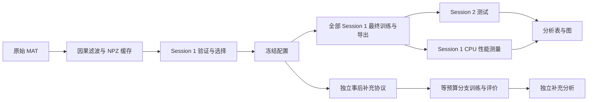

# EEG 通道选择与运动想象 BCI 模型压缩

COMP 690-193（2026 秋季）课程项目，Python 包名为 `mibci`。项目研究：在固定电极数量下，显式考虑 EEG 特征冗余的通道选择，能否优于仅相关性和空间权重选择，以及这种差异在 INT8 量化后是否保留；同时评估电极缩减、结构化剪枝与量化的准确率和部署成本。

项目实现了数据准备、按 run 分组验证、通道选择、EEGNet 训练、剪枝、ONNX 导出、静态量化、跨天测试、CPU 性能测量、结果分析和录制数据回放。原主实验、事后补充实验和文档维护分别保留证据。

本文件面向阅读、运行和复现项目的人；开发与自动化代理应继续阅读 [agent.md](agent.md)，标准代理入口为 [AGENTS.md](AGENTS.md)。详细研究叙述见 [研究报告](docs/REPORT.md)，历史操作记录见 [WORK_LOG.md](docs/WORK_LOG.md)。

代码仓库：<https://github.com/lipeiye/comp690-final-project>（公开）。仓库不含 `data.nosync/`（原始与处理 EEG、模型权重）、虚拟环境和 `release/` 交付 ZIP。模型权重在 GitHub Release [`models-v1`](https://github.com/lipeiye/comp690-final-project/releases/tag/models-v1)：主实验原模型和补充模型各一个 ZIP，下载与核对见[第 6.1 节](#61-从-github-release-下载模型)；EEG 数据按第 7 节下载并核对 SHA-256。下文“当前项目状态”描述的是作者本地副本。

零基础阅读：[从零读懂这个脑电项目](docs/BEGINNER_GUIDE_ZH.md)，用例子解释数据来源、电极选择、剪枝、INT8 量化和实验结果。

阅读导航：

- 了解研究：[当前状态](#1-当前项目状态)、[主要结果](#2-主要结果与解释)、[代码地图](#3-目录与代码地图)。
- 运行项目：[安装环境](#4-安装与运行环境)、[实验协议](#5-数据模型与实验协议)、[现有模型推理](#6-优先使用已有证据和补充模型)。
- 独立复现：[主实验](#7-从零独立复现主实验)、[补充实验](#8-事后-matched-budget-补充工作流)、[脚本索引](#9-全部脚本入口索引)。
- 维护交付：[产物格式](#10-产物格式与命名约定)、[报告与演示](#11-报告演示与交付)、[常见问题](#12-维护限制与常见问题)。

已有专题材料可结合 [复现与恢复指南](docs/REPRODUCIBILITY.md)、[冻结配置](results/frozen_config.json) 和 [完整分析汇总](results/analysis/summary.md) 阅读。涉及脚本路径行为时，以当前源码和本文的具体命令为准。

## 1. 当前项目状态

以下是 2026-11-09 在原 Apple M4 Mac mini 副本上的核验状态。2026-11-04 的核验在另一台 M5 电脑的副本上进行，那份副本没有 `data.nosync/`（`.nosync` 目录不经 iCloud 同步），所以当时记为原模型缺失。文件存在、实验记录一致和原权重恢复是不同概念。

| 部分 | 当前状态 | 可以据此做什么 |
| --- | --- | --- |
| 主实验结果 | validation/runs、validation/quant、final/runs、final/quant、test 各 459 份记录；深审计一致 | 阅读历史结果，从保留预测重算指标 |
| 主实验原模型 | M4 本机 `data.nosync/models/validation`、`final` 保存 2026-11-03 生成的 2,808 个文件（972 个 `.pt`、1,836 个 ONNX，含 54 个预算选择文件）。2026-11-09 用它们重算 session 2：FP32/INT8 共 918 组、264,384 次预测与 `results/test` 逐条一致；验证集 459 个模型的混淆矩阵、loss 和 ONNX 文件大小与 `results/validation/quant` 一致；`audit_project.py --deep --require-artifacts` 通过 | 用原模型推理、回放、重测性能；克隆者从 Release 下载（第 6.1 节） |
| 原始与处理数据 | 18 个 `.mat`、18 个 session `.npz`（M4 本机保存原文件；M5 副本于 11-04 重新下载并核对） | 核对数据、运行现有模型、开展独立复现 |
| 补充实验模型 | 54 个独立重建基础模型 + 162 个分支，216 个 `.pt`、432 个 ONNX；存于 M5 副本和 11-04 交付包，M4 本机 `data.nosync` 没有这个目录 | 从 Release 或交付包取得后推理、回放和测量；须标注独立重建来源 |
| 报告与演示 | Markdown/PDF 报告、19 页本地 HTML 幻灯片、回放视频 | 阅读与展示已生成成果 |
| 历史交付包 | `release/COMP690_completed_2026-11-04.zip` | 本轮 README/代理指南更新前的快照，不自动反映当前文档 |

原主实验记录和原模型来自作者的 Apple M4 Mac mini；补充独立重建来自后续 M5 环境。补充实验在没有原权重的 M5 副本上设计和运行，所以独立重建了基础模型。原模型后来在 M4 上确认存在，这不改变补充实验的设计和结论；补充模型也不能称为恢复出的原权重。

## 2. 主要结果与解释

下表为 Session 2 的无专家伪迹标记试次：先在每位被试内平均 3 个种子，再平均 9 位被试。单位为准确率百分比，完整 17 条件×2 精度结果见 [primary 表](results/analysis/conditions_primary.csv)。

| 条件 | FP32 | INT8 |
| --- | ---: | ---: |
| 全部 22 电极 `full-22` | 65.04% | 65.30% |
| 冗余感知，16 电极 `proposed-16` | 66.78% | 66.64% |
| 仅相关性，16 电极 `relevance-16` | 66.21% | 66.17% |
| 空间权重，16 电极 `weightnorm-16` | 66.82% | 66.44% |
| 冗余感知，8 电极 `proposed-8` | 60.59% | 60.46% |
| 仅相关性，8 电极 `relevance-8` | 59.92% | 59.61% |
| 空间权重，8 电极 `weightnorm-8` | 62.10% | 62.27% |
| 仅相关性 16 电极、剪枝 50% `relevance-16-prune50` | 64.99% | **65.01%** |

历史验证流程选定 `relevance-16-prune50` INT8。其测试均值相对 full-22 FP32 为 **−0.03 个百分点**，被试配对 bootstrap 95% 区间为 **[−2.16, +2.40]**；**4/9** 被试下降超过 2 个百分点。平均值接近不能证明等效，也不是对新被试的泛化验证。

冗余感知选择没有显示出相对仅相关性或空间权重选择的可靠优势；以最终训练 seed 0 的通道集合为口径，16/8 电极时，它与仅相关性选择分别在 6/9、7/9 被试上产生相同子集。这里的相关结构不是共享神经源的证据。

历史 M4 CPU 测量中，INT8 并未自动提速：分组空间卷积的量化内核有明显开销。最终方案参数/initializer 字节约减少 4.0 倍，整个 ONNX 文件只减少约 7.1%。理论激活张量约 5.5 倍的比例不等于实测进程内存或 MCU SRAM。

事后 matched-budget 补充实验给未剪枝和剪枝分支相同的额外 100 epoch。对 relevance-16 INT8，50% 剪枝相对同样微调的未剪枝分支下降 **1.56 个百分点**，95% 区间 **[−2.86, −0.42]**。它说明原比较混入了额外训练影响，不能据此重新选择历史 finalist。

补充 M5 独立 ONNX Runtime 进程峰值约 57–59 MiB，包含解释器、运行时和分配器等开销。详细数据见 [补充分析](results/supplementary/matched_budget/analysis.json) 和 [配对比较](results/supplementary/matched_budget/paired_comparisons.csv)。

## 3. 目录与代码地图

```text
project/
├── README.md / agent.md / AGENTS.md     项目说明与代理工作指南
├── pyproject.toml / uv.lock             包定义与锁定依赖
├── .python-version                     Python 3.12
├── src/mibci/                          核心 Python 包
├── scripts/                            23 个 Python 入口和 run_all.sh
├── tests/                              10 项 unittest
├── data.nosync/
│   ├── raw/                            MOABB 下载的原始数据
│   ├── processed/                      18 个 NPZ 和 manifest.json
│   ├── models/validation/、final/       主实验原模型（M4 本机；Release 原模型 ZIP）
│   ├── models/supplementary/            补充模型（M5 副本；Release 补充模型 ZIP）
│   └── maintenance/                     渲染与维护中间文件
├── results/
│   ├── frozen_config.json              历史配置、选择结果、验证表哈希
│   ├── data_summary.csv / pilot/        数据统计和开发 pilot
│   ├── validation/ / final/ / test/     历史训练、导出、测试记录
│   ├── benchmark/ / analysis/ / demo/   历史性能、统计、图与视频
│   ├── supplementary/matched_budget/   事后补充计划、运行、预测和分析
│   └── maintenance/                    审计与报告派生结果
├── docs/                               报告、复现说明、工作记录、证据
│   └── evidence/baseline/               维护前源码快照，不是当前实现
├── presentation/
│   ├── deck_source/                    deck.json 和逐页 HTML 源码
│   ├── assets/                         本地图与视频
│   └── index.html                      生成的可浏览演示
└── release/                            已打包交付快照
```

`COMP690_Project_Proposal.md/.docx` 与 `peer tutoring transcript.pdf` 记录提案及修订背景；`plan.md` 是过程材料，当前实现和冻结记录才是运行参数的直接依据。

| 核心模块 | 职责与主要接口 |
| --- | --- |
| `__init__.py` | 包说明，无独立执行逻辑 |
| `data.py` | 数据常量、`download`、因果 `preprocess_session`、缓存、Session 2 读取保护 |
| `splits.py` | `VAL_RUNS` 与 `fold_masks`，按完整 run 分训练/验证 |
| `selection.py` | Welch 频带对数功率、Fisher 相关性、Spearman 冗余、贪心/权重/随机选择 |
| `model.py` | `build_eegnet`、`save_bundle`、`load_bundle`、去参数化部署副本 |
| `train.py` | `TrainConfig`、通道标准化、固定预算 `fit`、`predict`、`scores` |
| `experiment.py` | 结果/模型目录、设备分配、Session 1 分区、单次训练、进程池 |
| `prune.py` | 最终 pointwise 卷积的结构化裁剪与微调常量 |
| `deploy.py` | ONNX 导出、静态 INT8 PTQ、ORT CPU 推理、延迟和算子 profiling |
| `costs.py` | 逐层参数量、MAC、输入与激活张量内存估计 |
| `artifacts.py` | 文件存在性、SHA-256、安全恢复检查、严格有限数值的原子 JSON 写入 |
| `env.py` | 环境、依赖和硬件信息记录 |



## 4. 安装与运行环境

需要 Python 3.12 和 [uv](https://docs.astral.sh/uv/)。`pyproject.toml` 声明 Python ≥3.12，`.python-version` 固定开发版本 3.12；复现以 `uv.lock` 为准。

```bash
UV_PROJECT_ENVIRONMENT=.venv.nosync uv sync --locked
.venv.nosync/bin/python -m unittest discover -s tests -v
```

主要依赖包括 PyTorch、Braindecode、NumPy、SciPy、scikit-learn、MNE、MOABB、ONNX、ONNX Runtime、pandas、Matplotlib 和 imageio-ffmpeg。不要为了排版更新训练依赖；PDF 导出另需 ReportLab/Pillow 的文档环境。

当前 `.venv` 是指向 `.venv.nosync` 的符号链接；`.nosync` 命名用于当前 iCloud 工作目录的数据/环境隔离。直接运行 `.venv.nosync/bin/python` 可避免 `uv run` 再次解析环境。

| 环境变量 | 默认值 / 作用 |
| --- | --- |
| `UV_PROJECT_ENVIRONMENT` | `uv` 的虚拟环境路径；示例使用 `.venv.nosync` |
| `MIBCI_DATA_DIR` | 项目根 `data.nosync`；raw、processed、models 都由此派生 |
| `MIBCI_RESULTS_DIR` | 项目根 `results`；主实验及 matched 脚本的记录输出 |
| `MIBCI_DEVICE` | `legacy`；可设 `cpu`、`mps`、`cuda`，显式请求不可用设备会报错 |

默认 `legacy` 在 MPS 可用时让被试 1–6 使用 MPS，7–9 使用 CPU；无 MPS 时均用 CPU。CUDA 路径存在，但本项目没有在 NVIDIA 环境验证。改变硬件、后端、依赖或种子后的运行应标记独立复现，不承诺逐位一致。

环境变量在模块导入时解析，应在启动 Python 前设置。报告、演示、打包及部分维护脚本固定读取项目根，不随 `MIBCI_RESULTS_DIR` 重定向；完整限制见第 12 节。

## 5. 数据、模型与实验协议

数据为 BCI Competition IV 2a / BNCI 2014-001：9 位被试，每人两天、每天 6 runs×48 trials，共 **5,184** 试次。当前缓存每个 session 为 288 试次；主分析干净试次合计 Session 1 **2,328**，Session 2 **2,368**。

| 项目 | 实现约定 |
| --- | --- |
| 信号 | 250 Hz、22 EEG 通道、微伏；排除 EOG，保留记录参考 |
| 滤波 | SciPy Butterworth `order=4`，4–38 Hz；`sosfilt` 因果处理，每个 run 零状态启动 |
| 窗口 | cue 后 0.5–2.5 秒，共 500 点；cue 在 trial-start 后 2 秒 |
| 标签 | `0=left_hand`、`1=right_hand`、`2=feet`、`3=tongue` |
| 主分析 | 训练/验证/测试均排除专家伪迹标记试次 |
| 次分析 | 同一最终模型测试 Session 2 全部试次，不重新训练 |
| 验证 | Session 1 三折，分别留出 runs 1–2、3–4、5–6；代码索引为 0–5 |
| 归一化 | 每通道沿试次和时间计算均值/标准差，仅拟合训练分区 |
| EEGNet | F1=8、D=2、默认 F2=16、时间卷积核 64、dropout 0.5、max-norm 约束 |
| 训练 | Adam lr=1e-3、batch=64、固定 epoch，无 early stopping |
| 预算 | full 模型先训练 500 epoch；25-epoch 平滑曲线选预算，当前历史选择 475 |
| 种子 | 最终训练 0、1、2；先在每位被试内平均种子，独立样本数仍为 9 |
| 剪枝 | 最后 pointwise 卷积输出滤波器按 L1 裁去 25%/50%，实际缩小张量；再训练 100 epoch、lr=1e-4 |
| PTQ | QDQ、signed INT8 激活、per-channel INT8 权重、MinMax 校准，仅训练窗口 |
| 不确定性 | 被试配对差异的 percentile bootstrap，10,000 次、95%、seed=690 |

22 通道顺序固定如下；外部输入必须遵守此顺序，不能只保证通道数量相同：

```text
Fz FC3 FC1 FCz FC2 FC4 C5 C3 C1 Cz C2 C4 C6 CP3 CP1 CPz CP2 CP4 P1 Pz P2 POz
```

`proposed` 使用 8–13 Hz 与 13–30 Hz 的 Welch 对数功率，相关性为两个频带的平均多类 Fisher 分数并缩放到 0–1；冗余为两个频带平均绝对 Spearman 相关。贪心目标是相关性减去 `0.5 × 与已选通道的平均冗余`。

对照为 relevance-only、full 模型空间权重的 L2 范数、3 组 seed=690 固定随机子集。每种方法选择 16/8 个电极，子集按原 montage 索引排序后重新训练。共 13 个未剪枝条件，加两基线各两种剪枝比例，共 **17 个条件**。

预算选择先平均全部 27 条 full 验证曲线，再做居中的 25-epoch 滑动平均，选取距平滑最大准确率不超过 0.5 个百分点的最早 25 倍数 checkpoint。475 是历史运行的规则输出；新实验应根据自己的验证曲线应用规则，不能把 475 写死后称为重新选择。

最终选择只使用验证结果：达到 full-22 FP32 准确率减 2 个百分点的候选中，依次优先更少电极、更少参数字节、更高准确率；随机子集只作对照。没有合格候选时退回最高验证准确率。

`data.load_session(subject, 2)` 默认拒绝读取，最终评价须显式 `final_evaluation=True`；测试脚本还要求冻结文件。预处理会预先缓存两天数据，这不授权用 Session 2 排名、拟合归一化、校准量化或重新选择模型。

源文件 SHA-256 记录于 [data_summary.csv](results/data_summary.csv)。MOABB 的该下载路径关闭 TLS 证书验证，保留哈希用于核对内容一致性，不是独立来源认证。

## 6. 优先使用已有证据和补充模型

### 6.1 从 GitHub Release 下载模型

克隆的仓库没有模型权重。Release [`models-v1`](https://github.com/lipeiye/comp690-final-project/releases/tag/models-v1) 有两个 ZIP，解压到 `data.nosync/` 后路径与作者本地一致：

| 附件 | 内容 | 解压后位置 |
| --- | --- | --- |
| `comp690-models-original-m4.zip`（34.6 MB） | 主实验原模型，2026-11-03 在 M4 上生成：validation 513 个 `.pt` + 918 个 ONNX，final 459 个 `.pt` + 918 个 ONNX | `data.nosync/models/validation/`、`final/` |
| `comp690-models-supplementary-m5.zip`（6.7 MB） | matched-budget 补充模型，M5 上独立重建：54 个基础模型 + 162 个分支，216 个 `.pt` + 432 个 ONNX | `data.nosync/models/supplementary/matched_budget/` |

```bash
mkdir -p data.nosync /tmp/mibci-models
curl -fL -o /tmp/mibci-models/comp690-models-original-m4.zip https://github.com/lipeiye/comp690-final-project/releases/download/models-v1/comp690-models-original-m4.zip
curl -fL -o /tmp/mibci-models/comp690-models-supplementary-m5.zip https://github.com/lipeiye/comp690-final-project/releases/download/models-v1/comp690-models-supplementary-m5.zip
unzip -n /tmp/mibci-models/comp690-models-original-m4.zip -d data.nosync
unzip -n /tmp/mibci-models/comp690-models-supplementary-m5.zip -d data.nosync
(cd data.nosync && shasum -a 256 -c --quiet SHA256SUMS-original-m4.txt SHA256SUMS-supplementary-m5.txt)
```

`unzip -n` 不覆盖已有文件；`shasum --quiet` 只在文件不符时输出。两个 ZIP 本身的 SHA-256 写在 Release 说明里。模型文件保持生成时的原字节：ONNX 里有 PyTorch 导出时记下的作者本机路径，不影响推理。`.pt` 是 pickle 格式，只加载核对过哈希的文件。

### 6.2 使用已有证据和模型

以下示例针对当前项目副本；先恢复默认数据/结果路径，避免继承其他实验的环境变量。

```bash
export MIBCI_DATA_DIR="$PWD/data.nosync"
export MIBCI_RESULTS_DIR="$PWD/results"
python3 scripts/audit_project.py --deep --output /tmp/mibci-audit.json
```

审计无需 PyTorch。默认可在历史结果一致但原模型缺失时成功；加 `--require-artifacts` 会要求原 validation/final 模型与预处理文件齐全。M4 本机副本 2026-11-09 通过了这一要求；解压原模型 ZIP 并准备好数据后也应通过，只有补充模型时不能通过。

使用现有补充模型进行 INT8 推理；FP32 将 `--precision` 改为 `fp32` 并选另一个输出文件名。原模型用法相同，例如 `--bundle data.nosync/models/final/sub-03_seed-0_relevance-16-prune50.pt`：

```bash
.venv.nosync/bin/python scripts/infer_bundle.py \
  --bundle data.nosync/models/supplementary/matched_budget/branches/sub-03_seed-0_relevance-16-matched50.pt \
  --input-npz data.nosync/processed/sub-03_ses-2.npz \
  --precision int8 --output results/maintenance/example_predictions_int8.json
```

输入 NPZ 必须包含有限、非空的 `X`，形状为 `(trials, 22, 500)`，已完成项目规定的因果滤波和截窗。推理只做 bundle 中的通道选择与训练归一化；它不能把原始 EEG 直接变成合格窗口。输出含预测、标签名、logits、通道和三个输入产物哈希；重复运行须选新的输出文件名。

测量补充模型的独立进程 RSS：

```bash
.venv.nosync/bin/python scripts/benchmark_memory.py \
  --bundle data.nosync/models/supplementary/matched_budget/branches/sub-01_seed-0_relevance-16-matched50.pt \
  --runs 1000 --output results/maintenance/example_memory.json
```

该脚本要求 `.pt` 和两精度 ONNX 齐全，从 Session 1 准备输入；每种精度在不导入 PyTorch 的独立子进程中执行 100 次预热及指定次数推理。RSS 是整个进程占用，生命周期峰值不是单次推理增量。

用同一补充模型生成新的录制数据回放：

```bash
mkdir -p results/maintenance/demo
.venv.nosync/bin/python scripts/replay_demo.py --subject 3 --session 2 --run 0 --trials 10 \
  --bundle data.nosync/models/supplementary/matched_budget/branches/sub-03_seed-0_relevance-16-matched50.pt \
  --int8 --save results/maintenance/demo/supplementary_participant3.mp4
```

回放按 250 Hz、每帧 10 点流式滤波，并检查窗口与离线缓存的一致性。决策在 cue 后 2.5 秒窗口结束后产生；视频中的人无法回应反馈，因此不验证在线闭环控制或异步意图检测。不带 `--save` 时打开交互窗口。

## 7. 从零独立复现主实验

完整训练耗时取决于硬件。下面使用单 worker，便于观察阶段、控制资源和定位失败；仍保留默认被试设备分配。所有命令在同一个终端、项目根执行。

新结果和数据目录必须独立于历史目录；不要删除冻结文件、旧 JSON 或缺模型记录来绕过保护。示例采用项目内目录，也避开当前 `prepare_data.py` 对项目外输出路径的限制。

```bash
export UV_PROJECT_ENVIRONMENT=.venv.nosync
export MIBCI_DATA_DIR="$PWD/reproduction.nosync/data"
export MIBCI_RESULTS_DIR="$PWD/reproduction.nosync/results"

# 数据准备：下载文件对照历史 SHA-256
.venv.nosync/bin/python scripts/prepare_data.py --expected-summary results/data_summary.csv

# Session 1：full 曲线、训练预算与各通道条件
.venv.nosync/bin/python scripts/run_validation.py --stage full --workers 1 --threads 1
.venv.nosync/bin/python scripts/choose_budget.py
.venv.nosync/bin/python scripts/run_validation.py --stage subsets --workers 1 --threads 1
.venv.nosync/bin/python scripts/quantize_models.py --phase validation --workers 1
.venv.nosync/bin/python scripts/summarize_validation.py --pruning-base

# 验证剪枝并冻结最终配置
.venv.nosync/bin/python scripts/run_pruning.py --phase validation --workers 1
.venv.nosync/bin/python scripts/quantize_models.py --phase validation --workers 1
.venv.nosync/bin/python scripts/summarize_validation.py --freeze

# 全部 Session 1 训练，再一次性进入 Session 2 评价
.venv.nosync/bin/python scripts/train_final.py --stage full --workers 1
.venv.nosync/bin/python scripts/train_final.py --stage subsets --workers 1
.venv.nosync/bin/python scripts/run_pruning.py --phase final --workers 1
.venv.nosync/bin/python scripts/quantize_models.py --phase final --workers 1
.venv.nosync/bin/python scripts/evaluate_test.py --workers 1

# 训练完成、机器空闲且接电时测量；再生成统计图表
.venv.nosync/bin/python scripts/benchmark.py
.venv.nosync/bin/python scripts/analyze.py
mkdir -p "$MIBCI_RESULTS_DIR/demo"
.venv.nosync/bin/python scripts/replay_demo.py --save "$MIBCI_RESULTS_DIR/demo/replay.mp4"

# 审计新实验：root 指向包含 results/ 的复现目录
python3 scripts/audit_project.py --root "$PWD/reproduction.nosync" \
  --data-dir "$MIBCI_DATA_DIR" --deep --require-artifacts \
  --output "$PWD/reproduction.nosync/audit.json"
```

选预算前确认 full 的 **27 条曲线**全部完成；`--freeze` 前核对全体 9 人、3 folds 的验证矩阵，含剪枝后 runs/quant **各 459 个记录**。当前预算与汇总脚本不会主动验证整个网格完整；不能把不完整子集的成功执行当作完整实验冻结。

恢复以完整 run 为单位：已有 JSON、所需模型齐全且指定元数据匹配时跳过；有 JSON 但模型缺失、空文件或元数据不符会报错。未完成 run 可以重做，这不是优化器/epoch 级恢复。冻结之后只重启未完成的最终训练、导出、评价阶段，不重新运行预算选择或冻结。

`run_all.sh` 记录了原并发顺序，但末尾回放路径硬编码为根 `results/demo/replay.mp4`，所以此处使用明确的逐步命令。脚本中前 6 位被试与后 3 位被试同时运行两组进程池，并非适合所有机器的默认资源配置。

## 8. 事后 matched-budget 补充工作流

详细设计见 [SUPPLEMENTARY_PROTOCOL.md](docs/SUPPLEMENTARY_PROTOCOL.md)。现有补充已经完成；读取结果或使用其模型不需要再次训练。以下示例建立一个新的独立补充目录，保留原 frozen 配置及通道选择依据。

```bash
export MIBCI_DATA_DIR="$PWD/supplement-reproduction.nosync/data"
export MIBCI_RESULTS_DIR="$PWD/supplement-reproduction.nosync/results"
.venv.nosync/bin/python scripts/prepare_data.py --expected-summary results/data_summary.csv
mkdir -p "$MIBCI_RESULTS_DIR/final"
cp results/frozen_config.json "$MIBCI_RESULTS_DIR/frozen_config.json"
cp -R results/final/rankings results/final/runs "$MIBCI_RESULTS_DIR/final/"
cp -R results/test "$MIBCI_RESULTS_DIR/test"

.venv.nosync/bin/python scripts/run_matched_control.py --stage plan --rebuild-bases
.venv.nosync/bin/python scripts/run_matched_control.py --stage train --workers 1
.venv.nosync/bin/python scripts/run_matched_control.py --stage evaluate --workers 1
.venv.nosync/bin/python scripts/run_matched_control.py --stage analyze
```

这里复制的历史记录只用作固定设计和预测一致率比较，新权重/预测写入 `supplementary/matched_budget/`。新目录中的历史主实验 JSON 不表示新主实验已训练；不要随后对它运行主实验训练脚本。

若拥有原始 full/relevance `.pt`，可把匹配的原模型恢复至所选数据目录 `models/final/`，规划时省略 `--rebuild-bases`。已完成的补充实验运行在没有原权重的 M5 副本上，因此选择了独立重建，上例沿用同一做法；原模型现在可从 Release 原模型 ZIP 取得。

| 比较 | 含义 |
| --- | --- |
| `base` | 475 epoch 基础模型 |
| `matched0` / `0` | 不剪枝，额外训练 100 epoch |
| `matched25`、`matched50` / `25`、`50` | 剪枝 25%/50%，同样额外训练 100 epoch |
| `0 − base` | 额外训练效应 |
| `25/50 − 0` | 相同微调预算下的剪枝效应 |
| `25/50 − base` | 同时包含额外训练和剪枝效应 |

每条分支重建 Adam、lr=1e-4、batch=64、使用对应 seed；PTQ 仍只用 Session 1。计划固定 54 bases、162 branches、216 个待评估模型。`analyze` 要求完整网格，当前生成的配对 CSV 汇总 primary accuracy；secondary 指标保留在逐模型 test JSON 中。

`protocol.json` 固定历史配置、通道排名和训练/评价核心源码 SHA-256；后续阶段发现变化会拒绝继续。不能修改核心源码后沿用原协议。协议中的 bundle 路径是执行时绝对路径；交付模型可用推理 CLI 重定位，但不能将拷贝后的目录视作原运行的直接续跑。

## 9. 全部脚本入口索引

参数表中的数字为默认值；`--subjects` 默认 1–9。训练/导出脚本使用锁定环境，纯标准库维护工具可用 `python3`。本目录实际有 **23 个 Python 脚本 + 1 个 Shell 脚本**。

| 入口 | 参数与用途 |
| --- | --- |
| `prepare_data.py` | `--subjects ...`、`--expected-summary CSV`；重建缓存和数据汇总 |
| `pilot_baseline.py` | `--subject 1 --epochs 500 --seed 0 --threads 4 --out PATH`；开发 pilot，默认根 `results/pilot` |
| `run_validation.py` | 必需 `--stage full\|subsets`；`--subjects ... --workers 6 --threads 1` |
| `choose_budget.py` | 无参数；由 full 验证曲线写 epoch 预算 |
| `summarize_validation.py` | `--pruning-base` 或 `--freeze`；无标记时仍会写验证汇总 |
| `train_final.py` | 必需 `--stage full\|subsets`；`--subjects ... --workers 3` |
| `run_pruning.py` | 必需 `--phase validation\|final`；`--subjects ... --workers 3` |
| `quantize_models.py` | 必需 `--phase validation\|final`；`--workers 8`，没有 subjects 过滤参数 |
| `evaluate_test.py` | `--workers 8`；评价全部 final/runs 所对应的模型 |
| `benchmark.py` | 无参数；subject 1、seed 0 代表架构，100 次预热、1,000 次计时 |
| `analyze.py` | 无参数；读冻结配置、测试/排名/benchmark，写分析表和图 |
| `replay_demo.py` | `--subject 3 --session 2 --run 0 --trials 10`；`--bundle PATH --int8/--no-int8 --save PATH` |
| `run_all.sh` | 无 CLI 参数；主流程并发协调，受环境变量及硬编码回放路径限制 |
| `run_matched_control.py` | 必需 `--stage plan\|train\|evaluate\|analyze`；`--rebuild-bases --subjects ... --workers 3` |
| `complete_supplement.py` | 必需 `--training-pids ... --artifact-python PATH`；历史一次性等待、评价、校验、报告协调器 |
| `infer_bundle.py` | 必需 `--bundle PATH --input-npz PATH --output PATH`；`--precision fp32\|int8` 默认 int8 |
| `benchmark_memory.py` | `--bundle PATH --output PATH --runs 1000`；独立进程测两精度 RSS |
| `audit_project.py` | `--root PATH --data-dir PATH --deep --require-artifacts --output PATH`；证据/产物审计 |
| `build_report.py` | 无参数；根 results → Markdown 报告、docs/assets 和 maintenance 派生表 |
| `export_report_pdf.py` | 无参数；根 `docs/REPORT.md` → `docs/REPORT.pdf`，需独立文档依赖 |
| `build_presentation.py` | 无参数；deck.json 顺序和逐页源码 → 本地 HTML 与 assets |
| `manifest_results.py` | 无参数；重写历史结果 SHA 清单，排除补充与 maintenance |
| `record_maintenance.py` | 无参数；相对 baseline/before 清单检查改动并重写 patch/inventory |
| `package_release.py` | 必需 `--output ZIP`；可选 `--model-dir DIR`，追加模型到包内 models/ |

`complete_supplement.py` 固定了当前项目路径、训练日志名、模型数量和示例模型，会写报告及追加工作日志；它是历史协调工具，不是通用补充实验启动器。

## 10. 产物格式与命名约定

| 产物 | 内容与约定 |
| --- | --- |
| `sub-XX_ses-Y.npz` | `X` float32 `(trials,22,500)`；`y` 0–3；`run` 0–5；`artifact` bool；`first_window_s`；`source_sha256` |
| `processed/manifest.json` | 数据集、通道/标签顺序、采样率、滤波/窗口、单位、预处理依赖版本 |
| `*_fold-N_*.pt` | Session 1 验证模型；fold 为 0–2 |
| `*_seed-N_*.pt` | 最终/补充模型；seed 为 0–2 |
| `.pt` bundle | `state_dict`、`F2`、通道索引、训练 mean/std、subject/split/condition/seed/epochs 等元数据 |
| 同名 `.onnx` / `_int8.onnx` | FP32 / INT8 图；输入 `eeg` 为 float32 `(batch,channels,500)`，输出 `logits` |
| `models/validation/*_checkpoints.pt` | 字典以 epoch 为键，保存 full 模型中间权重；不是普通 bundle |
| `rankings/*.json` | 相关性分数、各方法排名、montage 顺序的通道子集 |
| `runs/*.json` | 训练配置、条件、通道名、训练量、时间和可用的验证指标 |
| `quant/*.json` | 导出误差、文件/参数字节、验证 FP32/INT8 指标与预测一致率 |
| `test/*.json` | primary/secondary 指标、两精度逐试次预测、y、artifact 及一致率信息 |
| `frozen_config.json` | epoch、种子、条件、剪枝基线、finalist、统计规则和验证 summary 哈希 |
| `analysis/*.csv` | 条件级、被试级、配对比较、效率和通道稳定性等派生表 |
| 补充 `protocol.json` | post-test 标记、base 来源、设计、job 清单及来源/代码哈希 |

典型主模型名称为 `sub-03_seed-0_relevance-16-prune50.pt`；对应补充名称为 `sub-03_seed-0_relevance-16-matched50.pt`，两者不能互换来源标签。`.pt` 中保留归一化和通道选择，仅拿 ONNX 文件不能完整恢复输入处理。

INT8 ONNX 仍接收 float32 输入；QDQ、浮点边界和运行时缓冲存在。`parameter_bytes`、完整文件 `file_bytes`、理论激活字节、实测进程 RSS 是不同指标。

导出使用 ONNX opset 18，只有 batch 轴动态，通道数和 500 个时间点固定；输出 logits 形状为 `(batch,4)`。归一化和通道选择在 ONNX 图外完成。历史 benchmark 的 INT8 `input_bytes` 是假设每元素 1 byte 的估计；现代码将实际 float32 `input_bytes` 与 `modeled_input_bytes` 分开记录，不能将旧字段解释为实际接口缓冲。

## 11. 报告、演示与交付

可直接打开现有 [报告 PDF](docs/REPORT.pdf)、[HTML 演示](presentation/index.html)、[历史回放视频](results/demo/replay_participant3.mp4)。需要重建生成成果时：

```bash
.venv.nosync/bin/python scripts/build_report.py
python3 scripts/build_presentation.py
python3 -m http.server 8765
```

浏览器访问 `http://localhost:8765/presentation/index.html`；方向键翻页、N 看讲稿、F 全屏。内容顺序取自 `presentation/deck_source/deck.json`，当前 19 页；生成器 docstring 的“17”已过时。也可直接打开 HTML，本地图和视频已打包。

修改研究报告时，应同步修改 `scripts/build_report.py` 中的模板/派生逻辑并重建，避免下一次生成覆盖手改内容。PDF 使用安装了 ReportLab/Pillow 的独立 Python 执行 `scripts/export_report_pdf.py`，生成后再做逐页视觉检查；不要为导出升级 `uv.lock`。

建立新的源码/结果交付包，或显式附带当前补充模型：

```bash
python3 scripts/package_release.py --output release/project_review_new.zip
python3 scripts/package_release.py --output release/project_with_supplement_models_new.zip \
  --model-dir data.nosync/models/supplementary/matched_budget
```

输出已存在会拒绝覆盖。默认包包含源码、测试、文档、演示和结果，不带虚拟环境、原始/处理 EEG 或模型；指定 model-dir 才包含 `.pt/.onnx/.json`。`RELEASE_MANIFEST.json` 记录逐文件大小、SHA-256 和模型来源提示。

当前打包器根文件白名单包含 README.md，**尚不包含新 agent.md/AGENTS.md**；如需交付代理指南，应另行纳入交付流程。本轮文档整理保留既有 ZIP，没有重新打包；旧 ZIP 的清单只描述当时的内容。

## 12. 维护限制与常见问题

- **只有结果没有模型**：审计一致不代表可直接推理。从 Release 恢复原 bundle/导出（第 6.1 节），或使用标注清楚的补充模型；不要删除历史 JSON 触发原位重训。
- **已冻结，无法重选预算**：这是预期保护。新实验使用独立结果/数据目录；已有冻结实验仅继续缺少的后续阶段。
- **重新运行覆盖范围**：`prepare_data.py`、`analyze.py`、报告/演示生成器会覆盖自己的派生输出；`manifest_results.py` 会建立新清单，不能用重跑清单替代保留前后哈希比较。
- **路径重定向并非全局**：主实验和 matched 使用环境变量；report/presentation/release/maintenance 固定项目根，pilot 默认 out 也固定根。audit 读 `--root/results`，默认输出仍为原根 `results/maintenance/audit.json`，应显式传 output。
- **探测脚本参数**：不是每个脚本都实现 argparse；对无参数的预算、分析、报告等脚本添加 `--help` 可能直接执行写入逻辑，先读源码或本表再运行。
- **项目外结果目录**：`prepare_data.py` 最后打印使用 `relative_to(PROJECT_ROOT)`，外部目录可能在已写入后报错；当前示例使用项目内复现目录。不要误判为全部准备工作未执行。
- **回放目录**：`--save` 不创建父目录；先 mkdir。默认 bundle 是冻结的原 finalist（seed 0），需要原模型；只有补充模型时须像第 6 节显式传补充 bundle。
- **补充协议哈希冲突**：恢复计划所对应版本，或创建新补充目录和协议；不要为了继续运行删除哈希检查或重写旧协议。
- **原始主剪枝比较有额外训练混杂**：未剪枝 base 没有同样的额外 100 epoch；相同预算效应应读取 matched 分支比较。
- **统计与部署边界**：9 位被试、跨天同人评价、探索性 bootstrap 区间；不能声称跨人泛化、等效、临床效果、在线闭环、功耗或 MCU 实测。
- **冻结与来源证据**：冻结时间文字和文件哈希可检查内部一致性，不能独立证明原始执行时间、原始训练过程或前瞻注册。
- **切换回历史材料**：独立运行结束后可执行 `unset MIBCI_DATA_DIR MIBCI_RESULTS_DIR MIBCI_DEVICE`，或显式重设路径，避免下一条实验命令沿用上一次目录。
- **版本管理状态**：本次检查的工作目录没有 `.git`；不要假设现有提交、分支或 Git 恢复点已经存在。

## 13. 本轮文档核验

2026-11-04 已核对核心模块、全部 24 个脚本入口、参数和读写路径；运行现有 **10 项 unittest，全部通过**。深审计对 **459 个历史测试记录**重算预测指标并确认表格及冻结哈希一致，输出保存在 `/tmp/mibci-documentation-audit.json`。

此次只整理 README 与代理指南，没有重训、重新选择最终方案、改写历史结果、生成新报告或更新旧交付 ZIP。后续执行状态应以各运行日志、审计输出和实际产物为准。
