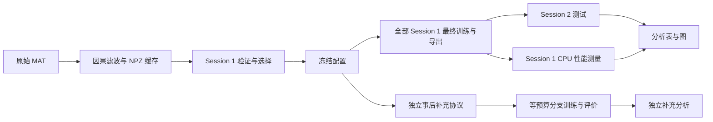

# EEG 通道选择与运动想象 BCI 模型压缩

COMP 690-193（2026 秋季）课程项目，Python 包名为 `mibci`。项目研究：在固定电极数量下，显式考虑 EEG 特征冗余的通道选择，能否优于仅相关性和空间权重选择，以及这种差异在 INT8 量化后是否保留；同时评估电极缩减、结构化剪枝与量化的准确率和部署成本。

项目实现了数据准备、按 run 分组验证、通道选择、EEGNet 训练、剪枝、ONNX 导出、静态量化、跨天测试、CPU 性能测量、结果分析和录制数据回放。原主实验、事后补充实验和文档维护分别保留证据。

本文件面向阅读、运行和复现项目的人；开发与自动化代理应继续阅读 [agent.md](agent.md)，标准代理入口为 [AGENTS.md](AGENTS.md)。详细研究叙述见 [研究报告](docs/REPORT.md)，历史操作记录见 [WORK_LOG.md](docs/WORK_LOG.md)。

代码仓库：<https://github.com/lipeiye/comp690-final-project>（公开）。仓库不含 `data.nosync/`（原始与处理 EEG、模型权重）、虚拟环境和 `release/` 交付 ZIP。模型权重在 GitHub Release [`models-v1`](https://github.com/lipeiye/comp690-final-project/releases/tag/models-v1)：主实验原模型和补充模型各一个 ZIP，下载与核对见[第 6.1 节](#61-从-github-release-下载模型)；EEG 数据按第 7 节下载并核对 SHA-256。下文“当前项目状态”描述的是作者本地副本。

零基础阅读：[从零读懂这个脑电项目](docs/BEGINNER_GUIDE_ZH.md)，用例子解释数据来源、电极选择、剪枝、INT8 量化和实验结果。

阅读导航：

- 了解研究：[当前状态](#1-当前项目状态)、[主要结果](#2-主要结果与解释)、[代码地图](#3-目录与代码地图)。
- 运行项目：[安装环境](#4-安装与运行环境)、[实验协议](#5-数据模型与实验协议)、[现有模型推理](#6-优先使用已有证据和补充模型)。
- 独立复现：[主实验](#7-从零独立复现主实验)、[补充实验](#8-事后-matched-budget-补充工作流)、[脚本索引](#9-全部脚本入口索引)。
- 维护交付：[产物格式](#10-产物格式与命名约定)、[报告与演示](#11-报告演示与交付)、[常见问题](#12-维护限制与常见问题)。

已有专题材料可结合 [复现与恢复指南](docs/REPRODUCIBILITY.md)、[冻结配置](results/frozen_config.json) 和 [完整分析汇总](results/analysis/summary.md) 阅读。涉及脚本路径行为时，以当前源码和本文的具体命令为准。

## 1. 当前项目状态

以下是 2026-11-09 在原 Apple M4 Mac mini 副本上的核验状态。2026-11-04 的核验在另一台 M5 电脑的副本上进行，那份副本没有 `data.nosync/`（`.nosync` 目录不经 iCloud 同步），所以当时记为原模型缺失。文件存在、实验记录一致和原权重恢复是不同概念。

| 部分 | 当前状态 | 可以据此做什么 |
| --- | --- | --- |
| 主实验结果 | validation/runs、validation/quant、final/runs、final/quant、test 各 459 份记录；深审计一致 | 阅读历史结果，从保留预测重算指标 |
| 主实验原模型 | M4 本机 `data.nosync/models/validation`、`final` 保存 2026-11-03 生成的 2,808 个文件（972 个 `.pt`、1,836 个 ONNX，含 54 个预算选择文件）。2026-11-09 用它们重算 session 2：FP32/INT8 共 918 组、264,384 次预测与 `results/test` 逐条一致；验证集 459 个模型的混淆矩阵、loss 和 ONNX 文件大小与 `results/validation/quant` 一致；`audit_project.py --deep --require-artifacts` 通过 | 用原模型推理、回放、重测性能；克隆者从 Release 下载（第 6.1 节） |
| 原始与处理数据 | 18 个 `.mat`、18 个 session `.npz`（M4 本机保存原文件；M5 副本于 11-04 重新下载并核对） | 核对数据、运行现有模型、开展独立复现 |
| 补充实验模型 | 54 个独立重建基础模型 + 162 个分支，216 个 `.pt`、432 个 ONNX；存于 M5 副本和 11-04 交付包，M4 本机 `data.nosync` 没有这个目录 | 从 Release 或交付包取得后推理、回放和测量；须标注独立重建来源 |
| 报告与演示 | Markdown/PDF 报告、19 页本地 HTML 幻灯片、14 页期中 PPTX（另有 15 页 HTML 期中草稿）、回放视频 | 阅读与展示已生成成果 |
| 期中后补充实验 | 2026-11-12 起，在原 M4 上追加三项测试后实验：加种子与电极数扫描（`results/supplementary/electrode_count/`，第二批在 `electrode_count_wave2/`）、INT8 部署改写与计时（`int8_study/`）、冗余度量检查（`redundancy_check/`）。两批训练共 703 次，已全部完成；结论见第 2 节末尾和 [期中评审后的计划](docs/POST_MIDTERM_PLAN.md) | 解释期中评审的三个问题；只作探索性证据，不改冻结方案 |
| 期中后研究（Longleaf） | 2026-11-20 起在 UNC Longleaf 上做的二十多项研究（`results/supplementary/<研究名>/`）：第二个数据集 Lee 2019（54 人）上事先登记的复现、选电极方法、脑区、位宽、跨 CPU 的 INT8、对齐、过拟合的直接检验，以及 11-22 期末冲刺的 WP1–WP8、WP1b、WP3b（进度表在 [FINAL_EXECUTION_PLAN.md](docs/FINAL_EXECUTION_PLAN.md) 第 9 节）。各研究的模型拉回本机 `data.nosync/models/supplementary/`（不进 Git） | 读每项研究的 `summary.md`；用 `python3 scripts/rebuild_all_tables.py` 从记录重建全部表图 |
| 课程报告与期末汇报 | [COURSE_REPORT.pdf](docs/COURSE_REPORT.pdf)（英文，正文 12 页，结论在第 12 页，12 号字、1 英寸页边距，参考文献、附录和伦理不计页数）；[final.pptx](presentation/final.pptx)（26 页）、逐页讲稿、Word 版讲稿和 [问答预案](presentation/final_qa.md) | 12-08 交报告、做期末汇报；第 11 节有重建命令 |
| 交付包 | `release/COMP690_final_2026-11-22.zip`（11-22 晚，112,814 个文件、181 MB：代码、全部结果记录、两份报告、期末汇报和讲稿，不含模型和原始脑电；校验记录 `release/package_verification_2026-11-22.json`）；旧的 `release/COMP690_completed_2026-11-04.zip` 是 11-04 的快照 | 交作业或备份时用新包；`release/` 不进 Git |

原主实验记录和原模型来自作者的 Apple M4 Mac mini；补充独立重建来自后续 M5 环境。补充实验在没有原权重的 M5 副本上设计和运行，所以独立重建了基础模型。原模型后来在 M4 上确认存在，这不改变补充实验的设计和结论；补充模型也不能称为恢复出的原权重。

## 2. 主要结果与解释

下表为 Session 2 的无专家伪迹标记试次：先在每位被试内平均 3 个种子，再平均 9 位被试。单位为准确率百分比，完整 17 条件×2 精度结果见 [primary 表](results/analysis/conditions_primary.csv)。

| 条件 | FP32 | INT8 |
| --- | ---: | ---: |
| 全部 22 电极 `full-22` | 65.04% | 65.30% |
| 冗余感知，16 电极 `proposed-16` | 66.78% | 66.64% |
| 仅相关性，16 电极 `relevance-16` | 66.21% | 66.17% |
| 空间权重，16 电极 `weightnorm-16` | 66.82% | 66.44% |
| 冗余感知，8 电极 `proposed-8` | 60.59% | 60.46% |
| 仅相关性，8 电极 `relevance-8` | 59.92% | 59.61% |
| 空间权重，8 电极 `weightnorm-8` | 62.10% | 62.27% |
| 仅相关性 16 电极、剪枝 50% `relevance-16-prune50` | 64.99% | **65.01%** |

历史验证流程选定 `relevance-16-prune50` INT8。其测试均值相对 full-22 FP32 为 **−0.03 个百分点**，被试配对 bootstrap 95% 区间为 **[−2.16, +2.40]**；**4/9** 被试下降超过 2 个百分点。平均值接近不能证明等效，也不是对新被试的泛化验证。

冗余感知选择没有显示出相对仅相关性或空间权重选择的可靠优势；以最终训练 seed 0 的通道集合为口径，16/8 电极时，它与仅相关性选择分别在 6/9、7/9 被试上产生相同子集。这里的相关结构不是共享神经源的证据。

历史 M4 CPU 测量中，INT8 并未自动提速：分组空间卷积的量化内核有明显开销。最终方案参数/initializer 字节约减少 4.0 倍，整个 ONNX 文件只减少约 7.1%。理论激活张量约 5.5 倍的比例不等于实测进程内存或 MCU SRAM。

事后 matched-budget 补充实验给未剪枝和剪枝分支相同的额外 100 epoch。对 relevance-16 INT8，50% 剪枝相对同样微调的未剪枝分支下降 **1.56 个百分点**，95% 区间 **[−2.86, −0.42]**。它说明原比较混入了额外训练影响，不能据此重新选择历史 finalist。

补充 M5 独立 ONNX Runtime 进程峰值约 57–59 MiB，包含解释器、运行时和分配器等开销。详细数据见 [补充分析](results/supplementary/matched_budget/analysis.json) 和 [配对比较](results/supplementary/matched_budget/paired_comparisons.csv)。

### 期中评审后的补充结果（2026-11-12，测试后追加，探索性）

以下结果都是在看过 Session 2 之后追加的，只用来解释上面的现象，不改变冻结的最终方案。详细依据见 [期中评审后的计划](docs/POST_MIDTERM_PLAN.md) 和 [报告第 6 节](docs/REPORT.md)。

**16 个电极为什么不比 22 个差。** 把每个模型从 3 个种子补到 10 个种子后（FP32，9 位被试平均）：

| 电极数（按相关性排名保留） | 22 | 20 | 18 | 16 | 14 | 12 | 10 | 8 |
| --- | ---: | ---: | ---: | ---: | ---: | ---: | ---: | ---: |
| 准确率 % | 64.25 | 64.37 | 64.98 | 65.57 | 63.81 | 63.01 | 62.16 | 60.06 |
| 与 22 个的差 | 0 | +0.12 | +0.73 | +1.31 | −0.44 | −1.24 | −2.10 | −4.20 |

- 16 减 22 是 **+1.31 个百分点**，被试 bootstrap 95% 区间 **[−0.11, +2.80]**。新训练的 7 个种子单独算是 +1.38，与原 3 个种子的 +1.17 一致，所以不是训练随机性；但区间下限碰到 0，不能推广到新被试。
- 提升只出现在 22 个电极时准确率低于 60% 的 4 位被试（平均 +3.1）；其余 5 位平均 −0.1。这个分组是事后划分的。
- 被去掉的 6 个电极多在前额方向，类别区分度只有保留电极的一半左右。随机去掉 6 个电极时，上述 5 位被试平均掉 2.9 个百分点；去掉最相关的 6 个时掉 5.3。
- 10 个种子下，冗余感知减仅相关性（16 电极）是 +0.28 [−0.42, +1.06]，主问题的结论不变。

**电极怎么选的。** 对每位被试，用其 Session 1 训练数据按公式计算，不是随机也不是按脑区指定；冻结方案用的是仅相关性的前 16 个。

**INT8 为什么慢。** 原因是 ONNX Runtime 对“8 组、每组 2 个滤波器”的空间卷积没有快路径，不是 M4 不支持 8 位运算。22 电极模型单次推理（M4，单线程）：FP32 0.276 ms，INT8 0.363 ms，INT16 0.310 ms；把前两层调换顺序（数学上等价，不需要重训）后 FP32 0.095 ms、INT8 0.067 ms，459 个原模型的 FP32 预测与原图 100% 一致。CoreML 后端也测了，没有比这更快的配置。调换之后，电极数对计算量的影响很小（22 → 8 个只少 15% 的乘加次数）。

### 期末冲刺的结果（2026-11-22，测试后追加）

都在看过 2a 的第二天之后做，2a 上是探索性的；Lee 2019（54 人）上的预测都在打分前写进各研究的 `protocol.json`。详细数字在 [POST_MIDTERM_PLAN.md](docs/POST_MIDTERM_PLAN.md) 1.7 节和课程报告。

- **多出来的输入，有代价的是其他输入预测不了的部分**（`input_kind_study`，K1–K3 都成立）。在 16 个电极后面加 46 个输入：保留电极的拷贝 +0.62 pp，同一条噪声重复 −1.83，一半噪声 −8.33，独立噪声 −13.33。被去掉的真实电极 2a 有 96%、Lee 2019 有 71% 能被留下的电极线性预测，所以它们代价小、带来的信息也小。`residual_surrogate_study` 把两项直接量了出来（把每次试验预测不了的那部分换成别的试验的；S1–S3 成立，S4 不成立）：Lee 2019 上预测不了的那部分代价 −4.12 pp、信息 +4.30 pp，正好抵消；2a 上代价 −1.50，信息第二天 +0.34（区间含 0）、当天留出组 +2.20。但在人与人之间，预测不了的比例并不能预测代价（S4，rho −0.08）。原来“信息 +6.2、代价 −6.5”的说法偏大，已更正。
- **数据够多时，更多电极才划算**（`pretrain_study`，T1–T3 都成立）。用 45 个别人的数据预训练再微调，全部 62 个电极比从头训练高 7.65 pp，比所有人共用的 16 个高 4.53 pp，46 个噪声的代价从 −12.1 降到 −2.2。2a 只有 8 个别人，预训练有害（−9.2）。
- **训练更久、加惩罚都不行**：训练 4 倍长（`long_training_study`，L1–L3 都不成立）、BatchNorm 抵消不了的惩罚（`scalefree_penalty_study`，N1–N3 都不成立）都没有让噪声的代价变小。加 46 个噪声的模型当天留出组从头到尾在随机水平，训练损失却下降得最快。
- **代价大部分来自记住每轮重复的噪声**（`fresh_noise_study`，F1、F3 成立，F2 不成立）。同样的噪声每轮重抽，网络自己把它关小（权重只有电极的 0.19 倍，录下来的噪声是 1.07 倍），46 个噪声的代价从 −13.3 降到 −1.1 pp，去掉约九成（2a 上约七成）；但没降到零（区间 [−2.1, −0.2]）。录下来的噪声每轮都一样，模型靠它记住训练试验：配原来的噪声训练试验 100% 答对，换一份没见过的噪声只剩 61.5%。
- **通道 dropout**（`chdrop_study`）：伤害不是 BatchNorm 统计量对不上（重估只救回 14%，B1 不成立），但它换来了对坏电极的耐受：2a 上坏一个电极，不加 dropout 平均掉 14.8 pp，p = 0.05 只掉 1.9（B3 成立）。
- **对齐为什么在 Lee 2019 上有害**（`alignment_mechanism_study`）：62 个方向里平均 49 个的方差不到最大方向的 1%，白化把它们放大成单位方差；保留但不放大，害处全部消失（102%）。同一天之内也有害，协方差也估计得准。
- **INT8**：单片机上补的 FIR 内核让整个网络的指令少 1.5–2.8 倍，136/136 逐位一致（`mcu_kernel_study`）。38 种合成卷积里，x86 上 INT8 几乎都比浮点慢，调换两层后的 INT8 只在 M4 上比调换后的浮点快（`int8_paths_study`）。没有 VNNI 的 x86 上 INT8 不准：x86 总把激活改成 uint8，第一个不同的层是时间卷积，不同的输出 100% 是预测的 16 位溢出，五层都用 7 位权重才一致（`int8_capture_study`）；两个内核的 uint8 版本在 x86 上逐位精确（`int8_kernel_x86_study`）。

## 3. 目录与代码地图

```text
project/
├── README.md / agent.md / AGENTS.md     项目说明与代理工作指南
├── pyproject.toml / uv.lock             包定义与锁定依赖
├── .python-version                     Python 3.12
├── src/mibci/                          核心 Python 包
├── scripts/                            实验、分析、报告的入口和 run_all.sh（逐个列在第 9 节）
├── tools/                              代码质量检查、金标准对照、Longleaf 提交（第 9 节末）
├── tests/                              unittest
├── mcu/                                单片机上的 EEGNet：CMSIS-NN 的 INT8 和 FP32 网络、测量框架、启动代码、链接脚本模板、QEMU 逐层计数插件（`scripts/mcu_study.py`）；`mcu/kernels/` 是 11-22 补上的 INT8 时间卷积内核和换上它的网络（`scripts/mcu_kernel_study.py`）
├── kernels/                            补上的 INT8 内核：ONNX Runtime 自定义算子 `ort_grouped_conv.c`（原层顺序的分组空间卷积，`scripts/ort_kernel_study.py`）和 `ort_spatial_first_conv.c`（调换后的空间卷积，`scripts/ort_kernel_swapped_study.py`），以及 x86 用的 uint8 版本 `ort_conv_u8.c`（两个算子都在里面，`scripts/int8_kernel_x86_study.py`）
├── data.nosync/
│   ├── raw/                            MOABB 下载的原始数据
│   ├── processed/                      18 个 NPZ 和 manifest.json
│   ├── models/validation/、final/       主实验原模型（M4 本机；Release 原模型 ZIP）
│   ├── models/supplementary/            补充模型（M5 副本；Release 补充模型 ZIP）
│   └── maintenance/                     渲染与维护中间文件
├── results/
│   ├── frozen_config.json              历史配置、选择结果、验证表哈希
│   ├── data_summary.csv / pilot/        数据统计和开发 pilot
│   ├── validation/ / final/ / test/     历史训练、导出、测试记录
│   ├── benchmark/ / analysis/ / demo/   历史性能、统计、图与视频
│   ├── supplementary/matched_budget/   事后补充计划、运行、预测和分析
│   ├── supplementary/electrode_count/  期中后：加种子、电极数扫描、反向对照；统计表和图也写在这里
│   ├── supplementary/electrode_count_wave2/ 期中后第二批：20/18/14/12/10 个电极补到 10 个种子
│   ├── supplementary/int8_study/       期中后：INT8 部署改写、各版本准确率与计时
│   ├── supplementary/redundancy_check/ 期中后：冗余度量检查（只用训练日）
│   ├── supplementary/overfit_study/    11-21：直接检验过拟合解释（噪声/打乱的电极、通道 dropout、当天留出组与第二天）
│   ├── supplementary/electrode_data_study/ 11-21：不同训练量下的电极数曲线
│   ├── supplementary/mcu_study/        11-21：CMSIS-NN 在模拟 Cortex-M0/M4/M55 上的指令条数、内存和准确率
│   ├── supplementary/ort_kernel_study/ 11-21：补上的 INT8 内核，459 个模型逐位核对和计时
│   ├── supplementary/<研究名>/          11-22 起的研究（`input_kind_study`、`long_training_study`、`scalefree_penalty_study`、`pretrain_study`、`chdrop_study`、`alignment_mechanism_study`、`mcu_kernel_study`、`int8_paths_study`、`int8_layers_study`），各有计划、记录和统计
│   └── maintenance/                    审计与报告派生结果
├── docs/                               报告、复现说明、工作记录、证据；`COURSE_REPORT.md/.pdf` 是课程要求格式的英文报告，图在 `docs/course_report/`
│   └── evidence/baseline/               维护前源码快照，不是当前实现
├── presentation/
│   ├── deck_source/                    deck.json、deck_midterm.json 和逐页 HTML 源码
│   ├── pptx/                           期中和期末 PPTX、讲稿 Word 版的生成脚本
│   ├── assets/                         本地图与视频
│   ├── index.html                      生成的可浏览演示
│   ├── midterm.pptx                    期中评审放映用的 PowerPoint
│   ├── midterm_script.md               期中逐页讲稿（中英对照），也是 PPTX 备注和 Word 版的来源
│   ├── midterm_script.docx             讲稿的 Word 版，便于打印
│   ├── final.pptx                      期末汇报放映用的 PowerPoint（26 页，没有备用页）
│   ├── final_script.md                 期末逐页讲稿（中英对照），也是 PPTX 标题、备注和 Word 版的来源
│   ├── final_script.docx               期末讲稿的 Word 版，便于打印
│   └── final_qa.md                     期末问答预案：两分钟的中文概述和 24 个可能被问到的问题（英文答法、中文意思、数字和出处）
└── release/                            已打包交付快照
```

`COMP690_Project_Proposal.md/.docx` 与 `peer tutoring transcript.pdf` 记录提案及修订背景；`plan.md` 是过程材料，当前实现和冻结记录才是运行参数的直接依据。

| 核心模块 | 职责与主要接口 |
| --- | --- |
| `__init__.py` | 包说明，无独立执行逻辑 |
| `data.py` | 数据常量、`download`、因果 `preprocess_session`、缓存、Session 2 读取保护 |
| `splits.py` | `VAL_RUNS` 与 `fold_masks`，按完整 run 分训练/验证 |
| `selection.py` | Welch 频带对数功率、Fisher 相关性、Spearman 冗余、贪心/权重/随机选择 |
| `model.py` | `build_eegnet`、`save_bundle`、`load_bundle`、去参数化部署副本 |
| `train.py` | `TrainConfig`、通道标准化、固定预算 `fit`、`predict`、`scores` |
| `experiment.py` | 结果/模型目录、设备分配、Session 1 分区、单次训练、进程池 |
| `prune.py` | 最终 pointwise 卷积的结构化裁剪与微调常量 |
| `deploy.py` | ONNX 导出、静态 INT8 PTQ、ORT CPU 推理、延迟和算子 profiling |
| `costs.py` | 逐层参数量、MAC、输入与激活张量内存估计 |
| `variants.py` | 期中后新增：已训练模型的等价图改写（`spatial_dense`、`spatial_first`）、可选位宽的 PTQ（`quantize`）、按 ONNX 图计算成本（`graph_costs`） |
| `overfit.py` | 11-21 新增：过拟合检验的输入替换（带限噪声、取自别的试验的信号）、带通道 dropout 的训练、按整组划分训练日、只用训练部分的相关性排序 |
| `mcu.py` | 11-21 新增：已训练 EEGNet 导出为 TFLite 布局的张量、按 TFLite 规范的 INT8 量化、与 CMSIS-NN 逐位一致的 NumPy 整数参考、生成 C 头文件 |
| `mcu_build.py` | 11-21 新增：编译 CMSIS-NN 和 `mcu/` 的程序、按板子的内存图链接、在 QEMU 上运行并读取逐层指令条数和段大小 |
| `ortkernel.py` | 11-21 新增：编译 `kernels/ort_grouped_conv.c`，把它换进 ONNX Runtime 自己优化后的图，带自定义算子的会话、交替计时和逐节点计时 |
| `ortkernel_u8.py` | 11-22 新增：x86 上 ONNX Runtime 把激活改成 uint8，int8 算子装不进去；编译 `kernels/ort_conv_u8.c`（同样两个算子的 uint8 版本，`-march=native`），借用 `ortkernel`、`ortkernel_swapped` 的换算子函数再改到 `mibci.u8` 域。测试 `tests/test_ortkernel_u8.py`（需设 `MIBCI_ORT_HEADERS`）核对 uint8 输出等于 int8 输出加 128 |
| `noise_mechanism.py` | 11-22 新增：噪声输入的额外抽样、去掉噪声输入的空间权重、在训练数据上重估 BatchNorm、空间滤波器输出中噪声的方差占比 |
| `input_penalty.py` | 11-22 新增：按输入的 group lasso 惩罚训练 EEGNet（不加惩罚时与 `train.fit` 逐位相同）、每个输入的空间权重范数 |
| `input_kind.py` | 11-22 新增：额外输入的种类（保留电极的拷贝、拷贝和噪声的混合、同一条噪声重复），被去掉的电极有多少方差是留下的电极线性预测不了的 |
| `scalefree_penalty.py` | 11-22 新增：和尺度无关的输入惩罚（每个空间滤波器先归一化成单位长度再按输入求范数之和；λ = 0 时与 `train.fit` 逐位相同） |
| `pretrain.py` | 11-22 新增：用别人的数据预训练（按预训练参与者平均排名选共用电极、每人各自标准化后合并、项目原来的 epoch 预算规则、Lee 2019 分组） |
| `chdrop.py` | 11-22 新增：通道 dropout 的机制（每个 BatchNorm 层存下的方差和实际方差之比、坏电极、固定的三电极组） |
| `alignment_variants.py` | 11-22 新增：跨天对齐的变体（收缩、Ledoit–Wolf、只白化大方向、小方向抬到 1%）和协方差的谱 |
| `mcu_kernels.py` | 11-22 新增：单片机 INT8 时间卷积内核的抽头头文件、NumPy 版内核算法和链接 |
| `int8_paths.py` | 11-22 新增：只有一层卷积的合成模型，量出 ONNX Runtime 的 INT8 在哪些形状上比 FP32 快 |
| `int8_layers.py` | 11-22 新增：引出 INT8 图的全部中间张量、按 x86 无 VNNI 时的 16 位配对判断饱和、把一层改成 7 位权重 |
| `fresh_noise.py` | 11-22 新增（WP3b）：`input_cost_study` 的 draw 0 输入；每轮重抽的带限噪声（种子由人、划分、模型种子、轮数决定）；没见过的噪声（draw 100）；按轮取训练输入的训练循环，每轮给同一份输入时与 `mibci.train.fit` 逐位相同 |
| `residual_surrogate.py` | 11-22 新增（WP1b）：用保留电极做最小二乘预测（带截距，只在训练试验上拟合，与 `input_kind.unexplained_fraction` 相同），把被去掉的电极分成能预测的部分和残差；按 SHA-256 种子生成不留原位的重排；三种额外输入 real、pred、surr |
| `int8_capture.py` | 11-22 新增：先在本机按正常推理的方式优化 INT8 图，再从优化后的图里取出全部整数张量（x86 上是 uint8），并核对与正常推理的 logits 逐位相同；`int8_layers.py` 的做法在 x86 上会改变计算路径 |
| `artifacts.py` | 文件存在性、SHA-256、安全恢复检查、严格有限数值的原子 JSON 写入 |
| `env.py` | 环境、依赖和硬件信息记录 |



## 4. 安装与运行环境

需要 Python 3.12 和 [uv](https://docs.astral.sh/uv/)。`pyproject.toml` 声明 Python ≥3.12，`.python-version` 固定开发版本 3.12；复现以 `uv.lock` 为准。

```bash
UV_PROJECT_ENVIRONMENT=.venv.nosync uv sync --locked
.venv.nosync/bin/python -m unittest discover -s tests -v
```

主要依赖包括 PyTorch、Braindecode、NumPy、SciPy、scikit-learn、MNE、MOABB、ONNX、ONNX Runtime、pandas、Matplotlib 和 imageio-ffmpeg。不要为了排版更新训练依赖；PDF 导出另需 ReportLab/Pillow 的文档环境。

当前 `.venv` 是指向 `.venv.nosync` 的符号链接；`.nosync` 命名用于当前 iCloud 工作目录的数据/环境隔离。直接运行 `.venv.nosync/bin/python` 可避免 `uv run` 再次解析环境。

| 环境变量 | 默认值 / 作用 |
| --- | --- |
| `UV_PROJECT_ENVIRONMENT` | `uv` 的虚拟环境路径；示例使用 `.venv.nosync` |
| `MIBCI_DATA_DIR` | 项目根 `data.nosync`；raw、processed、models 都由此派生 |
| `MIBCI_RESULTS_DIR` | 项目根 `results`；主实验及 matched 脚本的记录输出 |
| `MIBCI_DEVICE` | `legacy`；可设 `cpu`、`mps`、`cuda`，显式请求不可用设备会报错 |

默认 `legacy` 在 MPS 可用时让被试 1–6 使用 MPS，7–9 使用 CPU；无 MPS 时均用 CPU。CUDA 路径存在，但本项目没有在 NVIDIA 环境验证。改变硬件、后端、依赖或种子后的运行应标记独立复现，不承诺逐位一致。

环境变量在模块导入时解析，应在启动 Python 前设置。报告、演示、打包及部分维护脚本固定读取项目根，不随 `MIBCI_RESULTS_DIR` 重定向；完整限制见第 12 节。

## 5. 数据、模型与实验协议

数据为 BCI Competition IV 2a / BNCI 2014-001：9 位被试，每人两天、每天 6 runs×48 trials，共 **5,184** 试次。当前缓存每个 session 为 288 试次；主分析干净试次合计 Session 1 **2,328**，Session 2 **2,368**。

| 项目 | 实现约定 |
| --- | --- |
| 信号 | 250 Hz、22 EEG 通道、微伏；排除 EOG，保留记录参考 |
| 滤波 | SciPy Butterworth `order=4`，4–38 Hz；`sosfilt` 因果处理，每个 run 零状态启动 |
| 窗口 | cue 后 0.5–2.5 秒，共 500 点；cue 在 trial-start 后 2 秒 |
| 标签 | `0=left_hand`、`1=right_hand`、`2=feet`、`3=tongue` |
| 主分析 | 训练/验证/测试均排除专家伪迹标记试次 |
| 次分析 | 同一最终模型测试 Session 2 全部试次，不重新训练 |
| 验证 | Session 1 三折，分别留出 runs 1–2、3–4、5–6；代码索引为 0–5 |
| 归一化 | 每通道沿试次和时间计算均值/标准差，仅拟合训练分区 |
| EEGNet | F1=8、D=2、默认 F2=16、时间卷积核 64、dropout 0.5、max-norm 约束 |
| 训练 | Adam lr=1e-3、batch=64、固定 epoch，无 early stopping |
| 预算 | full 模型先训练 500 epoch；25-epoch 平滑曲线选预算，当前历史选择 475 |
| 种子 | 最终训练 0、1、2；先在每位被试内平均种子，独立样本数仍为 9 |
| 剪枝 | 最后 pointwise 卷积输出滤波器按 L1 裁去 25%/50%，实际缩小张量；再训练 100 epoch、lr=1e-4 |
| PTQ | QDQ、signed INT8 激活、per-channel INT8 权重、MinMax 校准，仅训练窗口 |
| 不确定性 | 被试配对差异的 percentile bootstrap，10,000 次、95%、seed=690 |

22 通道顺序固定如下；外部输入必须遵守此顺序，不能只保证通道数量相同：

```text
Fz FC3 FC1 FCz FC2 FC4 C5 C3 C1 Cz C2 C4 C6 CP3 CP1 CPz CP2 CP4 P1 Pz P2 POz
```

`proposed` 使用 8–13 Hz 与 13–30 Hz 的 Welch 对数功率，相关性为两个频带的平均多类 Fisher 分数并缩放到 0–1；冗余为两个频带平均绝对 Spearman 相关。贪心目标是相关性减去 `0.5 × 与已选通道的平均冗余`。

对照为 relevance-only、full 模型空间权重的 L2 范数、3 组 seed=690 固定随机子集。每种方法选择 16/8 个电极，子集按原 montage 索引排序后重新训练。共 13 个未剪枝条件，加两基线各两种剪枝比例，共 **17 个条件**。

预算选择先平均全部 27 条 full 验证曲线，再做居中的 25-epoch 滑动平均，选取距平滑最大准确率不超过 0.5 个百分点的最早 25 倍数 checkpoint。475 是历史运行的规则输出；新实验应根据自己的验证曲线应用规则，不能把 475 写死后称为重新选择。

最终选择只使用验证结果：达到 full-22 FP32 准确率减 2 个百分点的候选中，依次优先更少电极、更少参数字节、更高准确率；随机子集只作对照。没有合格候选时退回最高验证准确率。

`data.load_session(subject, 2)` 默认拒绝读取，最终评价须显式 `final_evaluation=True`；测试脚本还要求冻结文件。预处理会预先缓存两天数据，这不授权用 Session 2 排名、拟合归一化、校准量化或重新选择模型。

源文件 SHA-256 记录于 [data_summary.csv](results/data_summary.csv)。MOABB 的该下载路径关闭 TLS 证书验证，保留哈希用于核对内容一致性，不是独立来源认证。

## 6. 优先使用已有证据和补充模型

### 6.1 从 GitHub Release 下载模型

克隆的仓库没有模型权重。Release [`models-v1`](https://github.com/lipeiye/comp690-final-project/releases/tag/models-v1) 有两个 ZIP，解压到 `data.nosync/` 后路径与作者本地一致：

| 附件 | 内容 | 解压后位置 |
| --- | --- | --- |
| `comp690-models-original-m4.zip`（34.6 MB） | 主实验原模型，2026-11-03 在 M4 上生成：validation 513 个 `.pt` + 918 个 ONNX，final 459 个 `.pt` + 918 个 ONNX | `data.nosync/models/validation/`、`final/` |
| `comp690-models-supplementary-m5.zip`（6.7 MB） | matched-budget 补充模型，M5 上独立重建：54 个基础模型 + 162 个分支，216 个 `.pt` + 432 个 ONNX | `data.nosync/models/supplementary/matched_budget/` |

```bash
mkdir -p data.nosync /tmp/mibci-models
curl -fL -o /tmp/mibci-models/comp690-models-original-m4.zip https://github.com/lipeiye/comp690-final-project/releases/download/models-v1/comp690-models-original-m4.zip
curl -fL -o /tmp/mibci-models/comp690-models-supplementary-m5.zip https://github.com/lipeiye/comp690-final-project/releases/download/models-v1/comp690-models-supplementary-m5.zip
unzip -n /tmp/mibci-models/comp690-models-original-m4.zip -d data.nosync
unzip -n /tmp/mibci-models/comp690-models-supplementary-m5.zip -d data.nosync
(cd data.nosync && shasum -a 256 -c --quiet SHA256SUMS-original-m4.txt SHA256SUMS-supplementary-m5.txt)
```

`unzip -n` 不覆盖已有文件；`shasum --quiet` 只在文件不符时输出。两个 ZIP 本身的 SHA-256 写在 Release 说明里。模型文件保持生成时的原字节：ONNX 里有 PyTorch 导出时记下的作者本机路径，不影响推理。`.pt` 是 pickle 格式，只加载核对过哈希的文件。

### 6.2 使用已有证据和模型

以下示例针对当前项目副本；先恢复默认数据/结果路径，避免继承其他实验的环境变量。

```bash
export MIBCI_DATA_DIR="$PWD/data.nosync"
export MIBCI_RESULTS_DIR="$PWD/results"
python3 scripts/audit_project.py --deep --output /tmp/mibci-audit.json
```

审计无需 PyTorch。默认可在历史结果一致但原模型缺失时成功；加 `--require-artifacts` 会要求原 validation/final 模型与预处理文件齐全。M4 本机副本 2026-11-09 通过了这一要求；解压原模型 ZIP 并准备好数据后也应通过，只有补充模型时不能通过。

使用现有补充模型进行 INT8 推理；FP32 将 `--precision` 改为 `fp32` 并选另一个输出文件名。原模型用法相同，例如 `--bundle data.nosync/models/final/sub-03_seed-0_relevance-16-prune50.pt`：

```bash
.venv.nosync/bin/python scripts/infer_bundle.py \
  --bundle data.nosync/models/supplementary/matched_budget/branches/sub-03_seed-0_relevance-16-matched50.pt \
  --input-npz data.nosync/processed/sub-03_ses-2.npz \
  --precision int8 --output results/maintenance/example_predictions_int8.json
```

输入 NPZ 必须包含有限、非空的 `X`，形状为 `(trials, 22, 500)`，已完成项目规定的因果滤波和截窗。推理只做 bundle 中的通道选择与训练归一化；它不能把原始 EEG 直接变成合格窗口。输出含预测、标签名、logits、通道和三个输入产物哈希；重复运行须选新的输出文件名。

测量补充模型的独立进程 RSS：

```bash
.venv.nosync/bin/python scripts/benchmark_memory.py \
  --bundle data.nosync/models/supplementary/matched_budget/branches/sub-01_seed-0_relevance-16-matched50.pt \
  --runs 1000 --output results/maintenance/example_memory.json
```

该脚本要求 `.pt` 和两精度 ONNX 齐全，从 Session 1 准备输入；每种精度在不导入 PyTorch 的独立子进程中执行 100 次预热及指定次数推理。RSS 是整个进程占用，生命周期峰值不是单次推理增量。

用同一补充模型生成新的录制数据回放：

```bash
mkdir -p results/maintenance/demo
.venv.nosync/bin/python scripts/replay_demo.py --subject 3 --session 2 --run 0 --trials 10 \
  --bundle data.nosync/models/supplementary/matched_budget/branches/sub-03_seed-0_relevance-16-matched50.pt \
  --int8 --save results/maintenance/demo/supplementary_participant3.mp4
```

回放按 250 Hz、每帧 10 点流式滤波，并检查窗口与离线缓存的一致性。决策在 cue 后 2.5 秒窗口结束后产生；视频中的人无法回应反馈，因此不验证在线闭环控制或异步意图检测。不带 `--save` 时打开交互窗口。

## 7. 从零独立复现主实验

完整训练耗时取决于硬件。下面使用单 worker，便于观察阶段、控制资源和定位失败；仍保留默认被试设备分配。所有命令在同一个终端、项目根执行。

新结果和数据目录必须独立于历史目录；不要删除冻结文件、旧 JSON 或缺模型记录来绕过保护。示例采用项目内目录，也避开当前 `prepare_data.py` 对项目外输出路径的限制。

```bash
export UV_PROJECT_ENVIRONMENT=.venv.nosync
export MIBCI_DATA_DIR="$PWD/reproduction.nosync/data"
export MIBCI_RESULTS_DIR="$PWD/reproduction.nosync/results"

# 数据准备：下载文件对照历史 SHA-256
.venv.nosync/bin/python scripts/prepare_data.py --expected-summary results/data_summary.csv

# Session 1：full 曲线、训练预算与各通道条件
.venv.nosync/bin/python scripts/run_validation.py --stage full --workers 1 --threads 1
.venv.nosync/bin/python scripts/choose_budget.py
.venv.nosync/bin/python scripts/run_validation.py --stage subsets --workers 1 --threads 1
.venv.nosync/bin/python scripts/quantize_models.py --phase validation --workers 1
.venv.nosync/bin/python scripts/summarize_validation.py --pruning-base

# 验证剪枝并冻结最终配置
.venv.nosync/bin/python scripts/run_pruning.py --phase validation --workers 1
.venv.nosync/bin/python scripts/quantize_models.py --phase validation --workers 1
.venv.nosync/bin/python scripts/summarize_validation.py --freeze

# 全部 Session 1 训练，再一次性进入 Session 2 评价
.venv.nosync/bin/python scripts/train_final.py --stage full --workers 1
.venv.nosync/bin/python scripts/train_final.py --stage subsets --workers 1
.venv.nosync/bin/python scripts/run_pruning.py --phase final --workers 1
.venv.nosync/bin/python scripts/quantize_models.py --phase final --workers 1
.venv.nosync/bin/python scripts/evaluate_test.py --workers 1

# 训练完成、机器空闲且接电时测量；再生成统计图表
.venv.nosync/bin/python scripts/benchmark.py
.venv.nosync/bin/python scripts/analyze.py
mkdir -p "$MIBCI_RESULTS_DIR/demo"
.venv.nosync/bin/python scripts/replay_demo.py --save "$MIBCI_RESULTS_DIR/demo/replay.mp4"

# 审计新实验：root 指向包含 results/ 的复现目录
python3 scripts/audit_project.py --root "$PWD/reproduction.nosync" \
  --data-dir "$MIBCI_DATA_DIR" --deep --require-artifacts \
  --output "$PWD/reproduction.nosync/audit.json"
```

选预算前确认 full 的 **27 条曲线**全部完成；`--freeze` 前核对全体 9 人、3 folds 的验证矩阵，含剪枝后 runs/quant **各 459 个记录**。当前预算与汇总脚本不会主动验证整个网格完整；不能把不完整子集的成功执行当作完整实验冻结。

恢复以完整 run 为单位：已有 JSON、所需模型齐全且指定元数据匹配时跳过；有 JSON 但模型缺失、空文件或元数据不符会报错。未完成 run 可以重做，这不是优化器/epoch 级恢复。冻结之后只重启未完成的最终训练、导出、评价阶段，不重新运行预算选择或冻结。

`run_all.sh` 记录了原并发顺序，但末尾回放路径硬编码为根 `results/demo/replay.mp4`，所以此处使用明确的逐步命令。脚本中前 6 位被试与后 3 位被试同时运行两组进程池，并非适合所有机器的默认资源配置。

## 8. 事后 matched-budget 补充工作流

详细设计见 [SUPPLEMENTARY_PROTOCOL.md](docs/SUPPLEMENTARY_PROTOCOL.md)。现有补充已经完成；读取结果或使用其模型不需要再次训练。以下示例建立一个新的独立补充目录，保留原 frozen 配置及通道选择依据。

```bash
export MIBCI_DATA_DIR="$PWD/supplement-reproduction.nosync/data"
export MIBCI_RESULTS_DIR="$PWD/supplement-reproduction.nosync/results"
.venv.nosync/bin/python scripts/prepare_data.py --expected-summary results/data_summary.csv
mkdir -p "$MIBCI_RESULTS_DIR/final"
cp results/frozen_config.json "$MIBCI_RESULTS_DIR/frozen_config.json"
cp -R results/final/rankings results/final/runs "$MIBCI_RESULTS_DIR/final/"
cp -R results/test "$MIBCI_RESULTS_DIR/test"

.venv.nosync/bin/python scripts/run_matched_control.py --stage plan --rebuild-bases
.venv.nosync/bin/python scripts/run_matched_control.py --stage train --workers 1
.venv.nosync/bin/python scripts/run_matched_control.py --stage evaluate --workers 1
.venv.nosync/bin/python scripts/run_matched_control.py --stage analyze
```

这里复制的历史记录只用作固定设计和预测一致率比较，新权重/预测写入 `supplementary/matched_budget/`。新目录中的历史主实验 JSON 不表示新主实验已训练；不要随后对它运行主实验训练脚本。

若拥有原始 full/relevance `.pt`，可把匹配的原模型恢复至所选数据目录 `models/final/`，规划时省略 `--rebuild-bases`。已完成的补充实验运行在没有原权重的 M5 副本上，因此选择了独立重建，上例沿用同一做法；原模型现在可从 Release 原模型 ZIP 取得。

| 比较 | 含义 |
| --- | --- |
| `base` | 475 epoch 基础模型 |
| `matched0` / `0` | 不剪枝，额外训练 100 epoch |
| `matched25`、`matched50` / `25`、`50` | 剪枝 25%/50%，同样额外训练 100 epoch |
| `0 − base` | 额外训练效应 |
| `25/50 − 0` | 相同微调预算下的剪枝效应 |
| `25/50 − base` | 同时包含额外训练和剪枝效应 |

每条分支重建 Adam、lr=1e-4、batch=64、使用对应 seed；PTQ 仍只用 Session 1。计划固定 54 bases、162 branches、216 个待评估模型。`analyze` 要求完整网格，当前生成的配对 CSV 汇总 primary accuracy；secondary 指标保留在逐模型 test JSON 中。

`protocol.json` 固定历史配置、通道排名和训练/评价核心源码 SHA-256；后续阶段发现变化会拒绝继续。不能修改核心源码后沿用原协议。协议中的 bundle 路径是执行时绝对路径；交付模型可用推理 CLI 重定位，但不能将拷贝后的目录视作原运行的直接续跑。

## 9. 全部脚本入口索引

参数表中的数字为默认值；`--subjects` 默认 1–9。训练/导出脚本使用锁定环境，纯标准库维护工具可用 `python3`。每个脚本都有 `--help`，并且 `--help` 不会执行任何写入（`tools/guard.py` 检查）。这张表必须列出 `scripts/` 和 `tools/` 下的每个文件，否则 `tools/guard.py` 报错。

| 入口 | 参数与用途 |
| --- | --- |
| `prepare_data.py` | `--subjects ...`、`--expected-summary CSV`；重建缓存和数据汇总 |
| `pilot_baseline.py` | `--subject 1 --epochs 500 --seed 0 --threads 4 --out PATH`；开发 pilot，默认根 `results/pilot` |
| `run_validation.py` | 必需 `--stage full\|subsets`；`--subjects ... --workers 6 --threads 1` |
| `choose_budget.py` | 无参数；由 full 验证曲线写 epoch 预算 |
| `summarize_validation.py` | `--pruning-base` 或 `--freeze`；无标记时仍会写验证汇总 |
| `train_final.py` | 必需 `--stage full\|subsets`；`--subjects ... --workers 3` |
| `run_pruning.py` | 必需 `--phase validation\|final`；`--subjects ... --workers 3` |
| `quantize_models.py` | 必需 `--phase validation\|final`；`--workers 8`，没有 subjects 过滤参数 |
| `evaluate_test.py` | `--workers 8`；评价全部 final/runs 所对应的模型 |
| `benchmark.py` | 无参数；subject 1、seed 0 代表架构，100 次预热、1,000 次计时 |
| `analyze.py` | 无参数；读冻结配置、测试/排名/benchmark，写分析表和图 |
| `replay_demo.py` | `--subject 3 --session 2 --run 0 --trials 10`；`--bundle PATH --int8/--no-int8 --save PATH` |
| `run_all.sh` | 无 CLI 参数；主流程并发协调，受环境变量及硬编码回放路径限制 |
| `run_matched_control.py` | 必需 `--stage plan\|train\|evaluate\|analyze`；`--rebuild-bases --subjects ... --workers 3` |
| `complete_supplement.py` | 必需 `--training-pids ... --artifact-python PATH`；历史一次性等待、评价、校验、报告协调器 |
| `run_electrode_study.py` | 必需 `--stage plan\|train\|evaluate`；`--subjects ... --waves repro seeds sweep control --workers 3`；期中后的加种子、电极数扫描和反向对照，测试后追加 |
| `run_electrode_curve.py` | 必需 `--stage plan\|train\|evaluate`；`--subjects ... --workers 3`；第二批：给 20、18、14、12、10 个电极补种子 3–9，训练和打分直接调用第一批脚本里的函数，只把输出目录换成 `electrode_count_wave2/`；在第一批结果出来之后才计划 |
| `analyze_electrode_study.py` | 可选 `--first-wave-only`；合并历史种子 0–2 与两批新训练，写 `supplementary/electrode_count/` 的表、图和 summary.md；默认要求两批协议里的训练和评价全部完成 |
| `int8_study.py` | 必需 `--stage build\|benchmark\|analyze`；`--workers 6 --rounds 15 --runs 500`；由原 final 模型生成各部署版本、在第二天打分、计时；已有 benchmark.json 时拒绝覆盖 |
| `coreml_probe.py` | 可选 `--rounds 15 --runs 500`；在 P1、seed 0 的 22 电极模型上给 CoreML 后端计时（原图与调换层顺序的图，FP32 与 INT8），写 `supplementary/int8_study/coreml_probe.json`；已有结果时拒绝覆盖；需先跑过 `int8_study.py --stage benchmark` |
| `redundancy_check.py` | 无参数；只读训练日数据，写 `supplementary/redundancy_check/` |
| `region_study.py` | 必需 `--stage plan\|train\|evaluate`；`--part cv\|final\|all --shard i/n --workers N`；按 9 个功能脑区的全部 511 种组合训练（第一天三折交叉验证 + 第一天全部训练、第二天打分），期中后追加 |
| `analyze_region_study.py` | 无参数；脑区实验的统计：每个脑区组合的准确率、9 个脑区及 4 个粗分区的 Shapley 值（按准确率和每类召回率，交叉验证与第二天分开）、两两交互、按电极预算选组合（本人交叉验证、留一被试的人群方案、用测试日选的上限），与仅相关性规则对比；要求全部记录齐全 |
| `selection_study.py` | 必需 `--stage rank\|plan\|train\|evaluate`；`--shard i/n --workers N`；Riemannian、CSP、包装法、生理先验和跨被试人群方案在 4–16 个电极上的对比，期中后追加 |
| `selection_control_study.py` | 必需 `--stage plan\|train\|evaluate`；`--shard i/n --workers N`；硬件对照：把选电极研究借用的 135 个存档参照模型（relevance-8/10/12/16、full-22，种子 0–2）在 Longleaf CPU 上按同样配方重训，避免把训练硬件的差别当成方法的差别 |
| `analyze_selection_study.py` | 无参数；选电极方法对比的统计：每种方法在 4–16 个电极上的准确率、与仅相关性规则和全部 22 个电极的配对差，各方法在 8 个电极时选中每个电极的频率（头皮图），包装法训练日估计与测试日结果并列 |
| `quant_study.py` | 必需 `--stage plan\|run`；`--kind ptq\|qat --shard i/n --workers N`；与硬件无关的位宽研究：训练后量化的位宽网格、逐层敏感度、混合精度、量化感知微调，期中后追加 |
| `analyze_quant_study.py` | 可选 `--ptq-only`；位宽研究的统计：每种权重×激活位宽的准确率变化（先在人内平均种子，参与者 bootstrap 区间）、模拟 8 位与 ONNX Runtime INT8 的一致率、逐层敏感度（训练日和测试日分开，按训练日判定哪些张量需要 8 位）、混合精度、量化感知微调对等预算 FP32 微调的差、与硬件无关的成本（权重和激活字节、乘加次数、位运算、按 Horowitz 45 nm 估计的运算能耗） |
| `quant_rule_study.py` | 必需 `--stage plan\|run`；`--shard i/n --workers N`；把位宽研究里训练日（第一天）的逐层敏感度变成混合精度表（全体平均一张、每个模型各一张，阈值 2 和 0.5 个百分点），不重新训练，在第二天检验，期中后追加 |
| `analyze_quant_rule_study.py` | 无参数；混合精度规则的统计：相对浮点和 8/8 的准确率差（参与者 bootstrap 区间）、损失超过 2 个百分点的人数、权重字节和位运算 |
| `alignment_study.py` | 必需 `--stage plan\|train\|evaluate`；`--shard i/n --workers N`；无监督跨天对齐（Euclidean alignment），期中后追加 |
| `replication_study.py` | 必需 `--stage plan\|train\|evaluate`；`--shard i/n --workers N`；第二个两天数据集（Lee 2019，54 人）上的前瞻性复现：在第二天任何试验被打分之前，把 2a 的发现写成假设和检验方法（电极按相关性减少、相关性对随机、谁从少电极受益、8 位整数、2a 训练日的混合精度表、跨天对齐），只在 Longleaf 上运行 |
| `analyze_replication_study.py` | 无参数；按计划里事先写好的方法逐条检验复现假设，并给出电极数曲线、每人结果 |
| `replication_riemann_study.py` | 必需 `--stage plan\|train\|evaluate`；`--shard i/n --workers N`；在 Lee 2019 的 54 人上前瞻性检验 2a 上探索出来的结果：按黎曼距离一起选 8、16、20 个电极，是否比一个一个打分的冻结规则好；计划在第二天任何试验打分之前冻结 |
| `analyze_replication_riemann_study.py` | 无参数；按计划检验 R1–R3（黎曼选法减去同数量的相关性选法，配对复现研究的记录） |
| `prepare_lee2019.py` | `--subjects ... --delete-raw`；下载并缓存第二个两天数据集 Lee 2019 OpenBMI（54 人，62 电极，约 65 GB，只在 Longleaf 上运行），记录每个源文件的 SHA-256 |
| `system_energy.py` | 无参数；一次解码决策的能量预算（前端、无线、网络计算），常数取高低两端并注明来源，数量级估计而非测量，写 `supplementary/system_energy/` |
| `analyze_alignment_study.py` | 无参数；跨天对齐的统计：对齐前后的准确率配对差、每人结果（单列 P2）、对齐前后 16 和 8 个电极相对 22 个的差 |
| `analyze_overfit_study.py` | 无参数；过拟合检验的统计：Lee 2019 上 P1–P4 的事先登记检验，两个数据集的全部对比（区间、2a 的种子误差），训练集、当天留出组和第二天三种准确率随训练量的变化 |
| `analyze_electrode_data_study.py` | 无参数；每种训练量下“准确率随电极数”的曲线、最好的电极数及其自助法分布，Lee 2019 上 D1、D2 的检验；合并 `overfit_study` 的 22/16、62/45 个电极的记录 |
| `analyze_mcu_study.py` | 无参数；单片机研究的表和图：每个内核、精度和层顺序的指令条数，逐层指令和每次乘加的指令数，flash 和 RAM，逐位一致的统计，CMSIS-NN INT8 在第二天的准确率 |
| `analyze_ort_kernel_study.py` | 无参数；补上的 INT8 内核：459 个模型逐位核对的结果、各版本的时延、ONNX Runtime 逐层计时和图 |
| `analyze_compute.py` | 无参数；每项期中后研究在哪里运行（Longleaf 或本机）、计划了多少任务、训练了多少模型、用了多少 CPU 小时，写 `results/supplementary/compute_summary.json` 和 `.md` |
| `overfit_study.py` | 必需 `--stage plan\|train\|evaluate`；`--datasets bnci2a lee2019`；`--shard i/n --workers N`；直接检验“16 个电极为什么能比 22 个好”的过拟合解释：用噪声或别的试验的信号代替被去掉的电极、通道 dropout、只用训练日的一部分并在当天留出的组和第二天上同时打分；2a 上是探索性的，Lee 2019 上事先写好预测 |
| `electrode_data_study.py` | 必需 `--stage plan\|train\|evaluate`；`--datasets bnci2a lee2019`；`--shard i/n --workers N`；在训练日只用一部分数据（2a：6 组里的 2 组或 4 组；Lee 2019：2 组里的 1 组）时重画“准确率随电极数”的曲线，检验最好的电极数是否随训练量移动；和 `overfit_study.py` 的 22/16、62/45 个电极的模型合起来分析；2a 上探索性，Lee 2019 上事先写好预测 |
| `input_cost_study.py` | 必需 `--stage plan\|train\|evaluate`；`--datasets bnci2a lee2019`；`--shard i/n --workers N`；量出“多一个没有信息的输入”的代价：在 16 个电极上再加 k 个噪声输入（2a：1–16 个；Lee 2019：4–46 个），并在不同训练量下训练；2a 上探索性，Lee 2019 上事先写好预测 |
| `analyze_input_cost_study.py` | 无参数；“多加 k 个噪声输入”的剂量曲线：每个训练量下第二天和当天留出组的代价、每多一个输入的代价（斜率）、占高于随机部分的比例，Lee 2019 上 C1、C2 的检验，以及 2a 上同一条件两次噪声抽样的对比；k = 0 取自 `overfit_study`（2a）和 `electrode_data_study`（Lee 2019） |
| `noise_mechanism_study.py` | 必需 `--stage plan\|heldout\|train\|evaluate`；`--shard i/n --workers N`；噪声输入为什么有代价：`heldout` 只用第一天，对 `input_cost_study` 的全部 fold 模型和 k = 0 基线去掉噪声输入的空间权重、重估 BatchNorm 后再测留出组，并量出空间滤波器输出里噪声的占比（训练后和初始化时）；`train`/`evaluate` 在 2a 上另抽 4 次噪声并互换两项研究的噪声位置，检验代价随噪声抽样的变化 |
| `analyze_noise_mechanism_study.py` | 无参数；噪声机制研究的表和图：去掉噪声权重、重估 BatchNorm 后当天留出组恢复了多少代价，空间滤波器输出中噪声的占比（训练后与初始化时），噪声占比与准确率的同人内相关，6 次噪声抽样的代价和抽样之间的标准差，两项研究噪声互换位置的对比，训练损失曲线；记录不全的部分标为未完成 |
| `input_penalty_study.py` | 必需 `--stage plan\|train\|select\|evaluate`；`--part folds\|final`（train）；`--shard i/n --workers N`；给 EEGNet 的空间权重按输入加 group lasso 惩罚（`mibci.input_penalty`），检验它能否学会关掉没用的输入：先在训练日的 fold 上训练全部惩罚强度并用当天留出组选强度（`select` 只用第一天），再只训练选中强度的最终模型、在第二天打分；2a 探索性，Lee 2019 上事先写好 G1–G3 |
| `analyze_input_penalty_study.py` | 无参数；惩罚研究的表和图：每种条件在各惩罚强度下的当天留出组准确率和选中的强度，选中强度下最终模型第二天的准确率（和不加惩罚的同条件模型比），Lee 2019 上 G1–G3 的检验，噪声输入和电极输入的权重范数 |
| `input_kind_study.py` | 必需 `--stage plan\|train\|evaluate\|predictability`；`--datasets bnci2a lee2019`；`--subjects ...`（本机冒烟测试）；`--shard i/n --workers N`；多出来的输入什么样才有代价：在 16 个电极后面接保留电极的拷贝、拷贝和噪声的混合（a = 0.25、0.5、0.75）或同一条噪声重复 k 次（2a 加 6 个，Lee 2019 加 46 个），和只用 16 个电极、纯噪声（`input_cost_study`）比较；`predictability` 只用第一天，算被去掉的电极有多少方差是留下的电极线性预测不了的；2a 探索性，Lee 2019 上事先写好 K1–K3 |
| `analyze_input_kind_study.py` | 无参数；额外输入种类研究的表和图：每种输入在第二天和当天留出组的代价（和只用 16 个电极、纯噪声比），代价随混合比例 a 的变化，Lee 2019 上 K1–K3 的检验，被去掉的电极预测不了的方差比例及它对应的 a |
| `residual_surrogate_study.py` | 必需 `--stage plan\|train\|evaluate`；`--datasets`、`--subjects`、`--shard i/n`、`--workers`；把被去掉电极的“信息”和“代价”直接量出来（WP1b）：用保留的 16 个电极线性预测每个被去掉的电极（只在训练部分上拟合），额外输入是真实电极（`real`）、只有预测部分（`pred`）、预测部分加别的试验的残差（`surr-dK`，同一组试验内整块重排、不看类别）；代价 = surr − 只用 16 个，信息 = real − surr；2a 1,125 个模型、Lee 2019 1,296 个，Lee 2019 上 S1–S4 在打分前写进计划；第二天只在 evaluate 阶段读 |
| `analyze_residual_surrogate_study.py` | 无参数；分解表（代价、信息、两者之和、只有预测部分的代价、只差输入顺序的对照）、S1–S4 的判定、每个条件的准确率和图；Lee 2019 的当天留出组用已有的 full-62 代替 real |
| `fresh_noise_study.py` | 必需 `--stage plan\|train\|reference\|evaluate`；`--datasets`、`--subjects`、`--shard i/n`、`--workers`；噪声每轮重抽（WP3b）：和 `input_cost_study` 的 relevance-16-plus-k 完全相同，只是训练时每一轮给每次试验重新抽一份噪声（`mibci.fresh_noise`），打分输入和标准化与固定噪声的对照逐位相同；2a 加 6、16 个，Lee 2019 加 46 个，共 936 个模型；`reference` 阶段用同样的口径测固定噪声的旧模型（噪声占比、权重比、训练试验配上没见过的噪声时的准确率，只读第一天）；Lee 2019 上 F1–F3 在打分前写进计划；第二天只在 evaluate 阶段读 |
| `analyze_fresh_noise_study.py` | 无参数；F1–F3 的判定、固定与重抽两种噪声对只用 16 个的代价（第二天和当天留出组）、两种条件下学到的东西对照表（噪声占比、权重比、训练试验配上见过与没见过的噪声时的准确率）和图 |
| `long_training_study.py` | 必需 `--stage plan\|train\|evaluate`；`--datasets bnci2a lee2019`；`--subjects ...`（本机冒烟测试）；`--shard i/n --workers N`；是不是没训练够：冻结配方训练 4 倍长（1,900 个 epoch），在第 475、950、1,900 个 epoch 存权重；fold 模型每个 epoch 记下当天留出组的准确率和损失，最终模型三个保存点都在第二天打分；第 475 个 epoch 的权重和旧研究同条件、同种子的模型逐位比较；2a 探索性，Lee 2019 上事先写好 L1–L3 |
| `analyze_long_training_study.py` | 无参数；训练更久研究的表和图：三个保存点上各条件第二天的准确率、噪声输入的代价和“全部电极减相关性 16 个”随训练长度的变化，当天留出组准确率随 epoch 的曲线，Lee 2019 上 L1–L3 的检验，第 475 个 epoch 与旧模型是否逐位相同 |
| `scalefree_penalty_study.py` | 必需 `--stage pilot\|plan\|train\|select\|evaluate`；`--part folds\|final`（train）；`--subjects ...`；`--shard i/n --workers N`；和尺度无关的输入惩罚（`mibci.scalefree_penalty`：每个空间滤波器先归一化成单位长度，再按输入求范数之和），检验 BatchNorm 的尺度不变是不是 group lasso 关不掉没用输入的原因；`pilot` 只用第一天、2a 的 P1 和 P2，用来定 λ 的五档；之后照搬 `input_penalty_study` 的条件、fold、选 λ（只用第一天）和最终模型，选中 λ = 0 时另训“离最好不超过 1 pp 的最大一档”；2a 探索性，Lee 2019 上事先写好 N1–N3 |
| `analyze_scalefree_penalty_study.py` | 无参数；尺度无关惩罚研究的表和图：每档 λ 在 fold 模型上的当天留出组准确率和噪声对电极的归一化范数之比，选中的 λ，最终模型第二天的准确率，Lee 2019 上 N1–N3 的检验，全部电极的模型里范数最大的 16 个输入和相关性规则选的 16 个的重合 |
| `pretrain_study.py` | 必需 `--stage plan\|pretrain\|scratch\|budget\|finetune\|evaluate`；`--datasets bnci2a lee2019`；`--subjects ...`；`--shard i/n --workers N --threads N`；用别人的数据预训练：2a 每人用另外 8 人、Lee 2019 分 6 组每组用另外 45 人的第一天预训练（每人用自己第一天的均值和标准差标准化），预训练轮数按项目原来的预算规则只用第一天定（`budget`），再在本人第一天上微调 100 个 epoch；全部电极、按预训练参与者平均排名选的共用 16 个、共用 16 个加噪声三种配置，和从头训练比；2a 探索性，Lee 2019 上事先写好 T1–T3 |
| `analyze_pretrain_study.py` | 无参数；预训练研究的表和图：三种配置在从头训练、只预训练、预训练加微调下第二天的准确率，预训练过程中目标参与者第一天准确率的曲线和选出的轮数，噪声输入的代价、“全部电极减共用 16 个”在三种训练方式下的变化，Lee 2019 上 T1–T3 的检验 |
| `chdrop_study.py` | 必需 `--stage plan\|train\|reference\|evaluate`；`--datasets bnci2a lee2019`；`--subjects ...`；`--shard i/n --workers N`；通道 dropout 为什么伤害这么大：存档的 p = 0.2 模型和不带 dropout 的模型按“原样”和“在第一天重估 BatchNorm 后”各打一次分，并量出每个 BatchNorm 层存下来的方差和测试时实际方差之比；新训练 p = 0.05、0.1（以及 p = 0.2 的 fold 模型）；第二天把一个或三个电极换成训练均值，看模型掉多少；2a 探索性，Lee 2019 上事先写好 B1–B3 |
| `analyze_chdrop_study.py` | 无参数；通道 dropout 研究的表和图：各 p 下原样和重估后的第二天与当天留出组准确率、重估救回的比例、BatchNorm 方差比，坏一个和三个电极时的下降，Lee 2019 上 B1–B3 的检验 |
| `alignment_mechanism_study.py` | 必需 `--stage plan\|spectra\|train\|evaluate`；`--datasets bnci2a lee2019`；`--subjects ...`；`--shard i/n --workers N`；跨天对齐为什么在 Lee 2019 上有害：`spectra` 只用第一天，算对齐用的协方差的特征值、条件数、小方向个数、Ledoit–Wolf 系数和两半试验的白化矩阵差多少；再用三种对齐变体（向单位阵收缩 10%、Ledoit–Wolf 收缩、只白化不小于最大特征值 1% 的方向，`mibci.alignment_variants`）训练，最终模型在第二天打分，fold 模型在同一天的留出组上打分（看同一天之内对齐是否也有害）；两个数据集都是探索性的 |
| `analyze_alignment_mechanism_study.py` | 无参数；对齐机制研究的表和图：两个数据集的协方差谱、Ledoit–Wolf 系数和白化矩阵的稳定性，普通对齐和三种变体在当天留出组和第二天上与不对齐的差，三句预期（M1–M3）的判定 |
| `mcu_study.py` | 必需 `--stage plan\|reference\|emulate`；`--toolchain DIR --cmsis-nn DIR`（Arm GNU 工具链的 bin 目录、CMSIS-NN 源码）；`--build-dir`；用 Arm 的 CMSIS-NN 内核在 QEMU 模拟的 Cortex-M0、M4、M55 上运行 INT8 和 FP32 的 EEGNet：逐层指令条数、flash 和 RAM，模拟器输出与 NumPy 整数参考逐位比较，并在第二天上比较准确率；期中后追加，探索性 |
| `mcu_kernel_study.py` | 必需 `--stage plan\|emulate`；`--toolchain DIR --cmsis-nn DIR --build-dir DIR --subjects ...`；给单片机补上 CMSIS-NN 缺的 INT8 时间卷积内核（`mcu/kernels/fir_s8.c`：纯 C、DSP 的 SMLAD、Helium 的 VMLADAVA 三种写法；`mcu/kernels/eegnet_int8_fir.c` 只换掉这一层），在 QEMU 模拟的 M0、M4、M55 上重跑 `mcu_study` 的 136 个 INT8 构建：逐层指令条数、flash 和 RAM，模拟器输出与 NumPy 整数参考逐位比较；期中后追加，探索性 |
| `analyze_mcu_kernel_study.py` | 无参数；单片机内核研究的表和图：每个内核、层顺序和电极数下换内核前后的逐层指令条数和每次乘加的指令数（和 `mcu_study` 的记录并排），整个网络的指令条数，flash 和 RAM，逐位一致的统计 |
| `ort_kernel_study.py` | 必需 `--stage plan\|build\|equivalence\|benchmark`；`--ort-headers DIR`（ONNX Runtime 的 C API 头文件）；`--build-dir`；给 EEGNet 的分组空间卷积补上 ONNX Runtime 缺的 INT8 内核（`kernels/ort_grouped_conv.c`，自定义算子），在 459 个存档 INT8 模型上逐位核对输出，再在本机交替计时；期中后追加，探索性 |
| `ort_kernel_swapped_study.py` | 必需 `--stage plan\|build\|equivalence\|benchmark`；`--ort-headers DIR`；`--build-dir`；第二个补上的 INT8 内核（调换层顺序后排在第一的空间卷积，`kernels/ort_spatial_first_conv.c`），459 个模型逐位核对，两个内核、两种层顺序一起交替计时；期中后追加，探索性 |
| `int8_paths_study.py` | 必需 `--stage plan\|map`；`--label NAME`；INT8 什么时候比 FP32 快：只有一层卷积的合成模型（分组数 G、每组滤波器数 M、覆盖全部电极的空间核或沿时间的 1×64 核，`mibci.int8_paths`），按解码器同样的方式导出和量化，确认 ONNX Runtime 执行的算子后单线程交替计时，写 `map/<label>.json`；在本机和 Longleaf 的四种 CPU 上各跑一次，不用任何脑电数据 |
| `analyze_int8_paths_study.py` | 无参数；快慢地图的表和图：每台机器上每种形状 INT8 对 FP32 的时间比和每次乘加的时间，哪些形状落到慢路径 |
| `int8_layers_study.py` | 必需 `--stage plan\|capture\|compare`；`--label NAME`（capture）、`--reference A --other B`（compare）；同一个 INT8 图在没有 VNNI 的 x86 CPU 上从哪一层开始算得不一样：18 个存档模型（P1–P9 种子 0，全部 22 个和冻结方案）在第一天前 32 个窗口上引出全部 int8 中间张量（存档图，以及一层或全部五层改成 7 位权重的 6 个变体，`mibci.int8_layers`），两台机器逐层比较，在第一个出现差别的层上检验“两个相邻 8 位乘积在 16 位里相加时饱和”的解释；不用第二天数据 |
| `analyze_int8_layers_study.py` | 无参数；逐层比较的表：第一个出现差别的层、每层差别的比例和大小、饱和预测和实际差别的重合，每个只改一层的 7 位变体能否让两台机器一致 |
| `int8_capture_study.py` | 必需 `--stage plan\|capture\|compare`；`--label NAME`（capture）、`--reference A --other B`（compare）；`int8_layers_study` 的第二个做法：每台机器先按正常推理的方式优化图，再取出优化后的图里的整数张量，每次都核对与正常推理的 logits 相同；同样 18 个存档模型、7 个版本、第一天前 32 个窗口的张量，加上第一天全部无伪迹窗口的正常推理预测；比较时找第一个不同的张量、检验 u8×s8 的 16 位配对饱和、统计每个 7 位变体下两台机器预测一致的比例；只用第一天 |
| `analyze_int8_capture_study.py` | 无参数；第二个做法的表：每台机器的捕获是否都等于正常推理、第一个出现差别的层、每层差别的比例和大小、饱和预测与实际差别的重合、每个 7 位变体下张量全同的模型数和第一天预测一致的比例 |
| `int8_kernel_x86_study.py` | 必需 `--stage plan\|run`；`--label NAME --ort-headers DIR`；只在 x86 上运行；把补上的两个内核的 uint8 版本（`kernels/ort_conv_u8.c`）换进本机优化后的图：459 个存档 INT8 图换上分组卷积内核后的第二天 logits 与本机 ONNX Runtime、与 M4 存档预测比较（有 VNNI 时应逐位相同，没有 VNNI 时看能救回多少模型），再给 P1 的四种结构的各个版本交替计时；第一次的计划用 int8 算子，在 x86 上装不进去，归档为 `int8_kernel_x86_study_unexecuted_v1` |
| `analyze_int8_kernel_x86_study.py` | 无参数；内核在 x86 上的表：每台机器上逐位一致的模型数、回到 M4 存档预测的模型数、准确率变化和各版本的时延 |
| `analyze_hw_latency.py` | 无参数；汇总各台机器的计时文件（含 M4 的 `int8_study/benchmark.json`），回答原始 INT8 在哪些机器上比 FP32 慢、调换层顺序后是否处处更快 |
| `int8_portability.py` | `--label HOST`；把同样字节的 459 个存档 FP32/INT8 图在当前机器上对第二天重新打分，与 M4 上存档的预测逐条比较，检验 INT8 结果是否随 CPU 变化（例如没有 VNNI 的 x86），写 `supplementary/int8_portability/<label>.json` |
| `analyze_int8_portability.py` | 无参数；汇总各台机器的 INT8 可移植性结果（机器表、按被试的准确率变化、7 位权重的效果），写 `supplementary/int8_portability/` |
| `hw_latency.py` | `--rounds 15 --runs 500 --label HOST`；在当前机器上给 INT8 各部署版本计时并记录 CPU 的整数指令扩展，写 `supplementary/hw_latency/<label>.json`，期中后追加 |
| `infer_bundle.py` | 必需 `--bundle PATH --input-npz PATH --output PATH`；`--precision fp32\|int8` 默认 int8 |
| `benchmark_memory.py` | `--bundle PATH --output PATH --runs 1000`；独立进程测两精度 RSS |
| `audit_project.py` | `--root PATH --data-dir PATH --deep --require-artifacts --output PATH`；证据/产物审计 |
| `build_report.py` | 无参数；根 results → Markdown 报告、docs/assets 和 maintenance 派生表 |
| `build_course_report.py` | 无参数；从 `results/` 的记录生成课程要求格式的英文报告 `docs/COURSE_REPORT.md` 和它的 6 张图（`docs/course_report/`）；还在跑的研究显示为 pending |
| `export_course_report_pdf.py` | 无参数；`docs/COURSE_REPORT.md` → `docs/COURSE_REPORT.pdf`（12 号正文、1 英寸页边距、表格和图注 10 号，参考文献另起一页），并打印每一章从第几页开始；需 ReportLab 和 Pillow，用 `uv run --offline --no-project --with reportlab --with pillow` 的临时环境运行，不动 `uv.lock` |
| `export_report_pdf.py` | 无参数；根 `docs/REPORT.md` → `docs/REPORT.pdf`，需独立文档依赖 |
| `build_presentation.py` | 无参数时 deck.json → `presentation/index.html`；`--deck` 加 `--output` 生成其他页序，如期中版 `midterm.html`；页脚页码按位置重写 |
| `rebuild_all_tables.py` | 可选 `--with-eeg --keep`；课程报告 Artifacts 一节的“一键重建”：在沙盒里从存档记录重建全部表、图、技术报告、幻灯片 HTML 和课程报告，并与仓库逐字节比较（调用 `tools/golden.py` 中只需记录的生成器；`--with-eeg` 再加上要读脑电或模型的三个）；仓库本身不被改写，全部相同时退出码为 0；可用 `python3` 直接运行 |
| `manifest_results.py` | 无参数；重写历史结果 SHA 清单，排除补充与 maintenance |
| `record_maintenance.py` | 无参数；相对 baseline/before 清单检查改动并重写 patch/inventory |
| `package_release.py` | 必需 `--output ZIP`；可选 `--model-dir DIR`，追加模型到包内 models/ |

`tools/` 里是维护代码本身的工具，都只用标准库，可用 `python3` 直接运行（说明见 [docs/GUARDRAILS.md](docs/GUARDRAILS.md)）：

| 工具 | 用途 |
| --- | --- |
| `check.py` | 一次跑完全部检查层：格式、lint 棘轮（`tools/lint_baseline.json` 只降不升）、项目规则、单元测试；`--fast` 不跑测试，`--todo` 列出待清理的旧问题，`--tighten` 清理后收紧基线 |
| `guard.py` | 通用 linter 看不到的项目规则：被协议锁定的文件不能改、谁可以读第二天数据、脚本之间不能互相导入、不写死本机路径、脚本都要有 argparse、文档链接有效 |
| `golden.py` | 金标准对照：在沙盒里重新生成报告、分析表、图和幻灯片，与仓库里的文件逐字节比较；重构后用它证明数字没变 |
| `agent_hook.py` | Claude Code 的编辑后钩子（`.claude/settings.json`）：代理改完一个 `.py` 文件就检查，发现问题当场退回 |
| `longleaf.py` | 把代码和数据同步到 UNC Longleaf、装环境、按 SLURM 数组提交实验、取回结果；只用 Longleaf，不用 Sycamore |

`complete_supplement.py` 固定了当前项目路径、训练日志名、模型数量和示例模型，会写报告及追加工作日志；它是历史协调工具，不是通用补充实验启动器。

## 10. 产物格式与命名约定

| 产物 | 内容与约定 |
| --- | --- |
| `sub-XX_ses-Y.npz` | `X` float32 `(trials,22,500)`；`y` 0–3；`run` 0–5；`artifact` bool；`first_window_s`；`source_sha256` |
| `processed/manifest.json` | 数据集、通道/标签顺序、采样率、滤波/窗口、单位、预处理依赖版本 |
| `*_fold-N_*.pt` | Session 1 验证模型；fold 为 0–2 |
| `*_seed-N_*.pt` | 最终/补充模型；seed 为 0–2 |
| `.pt` bundle | `state_dict`、`F2`、通道索引、训练 mean/std、subject/split/condition/seed/epochs 等元数据 |
| 同名 `.onnx` / `_int8.onnx` | FP32 / INT8 图；输入 `eeg` 为 float32 `(batch,channels,500)`，输出 `logits` |
| `models/validation/*_checkpoints.pt` | 字典以 epoch 为键，保存 full 模型中间权重；不是普通 bundle |
| `rankings/*.json` | 相关性分数、各方法排名、montage 顺序的通道子集 |
| `runs/*.json` | 训练配置、条件、通道名、训练量、时间和可用的验证指标 |
| `quant/*.json` | 导出误差、文件/参数字节、验证 FP32/INT8 指标与预测一致率 |
| `test/*.json` | primary/secondary 指标、两精度逐试次预测、y、artifact 及一致率信息 |
| `frozen_config.json` | epoch、种子、条件、剪枝基线、finalist、统计规则和验证 summary 哈希 |
| `analysis/*.csv` | 条件级、被试级、配对比较、效率和通道稳定性等派生表 |
| 补充 `protocol.json` | post-test 标记、base 来源、设计、job 清单及来源/代码哈希 |

典型主模型名称为 `sub-03_seed-0_relevance-16-prune50.pt`；对应补充名称为 `sub-03_seed-0_relevance-16-matched50.pt`，两者不能互换来源标签。`.pt` 中保留归一化和通道选择，仅拿 ONNX 文件不能完整恢复输入处理。

INT8 ONNX 仍接收 float32 输入；QDQ、浮点边界和运行时缓冲存在。`parameter_bytes`、完整文件 `file_bytes`、理论激活字节、实测进程 RSS 是不同指标。

导出使用 ONNX opset 18，只有 batch 轴动态，通道数和 500 个时间点固定；输出 logits 形状为 `(batch,4)`。归一化和通道选择在 ONNX 图外完成。历史 benchmark 的 INT8 `input_bytes` 是假设每元素 1 byte 的估计；现代码将实际 float32 `input_bytes` 与 `modeled_input_bytes` 分开记录，不能将旧字段解释为实际接口缓冲。

## 11. 报告、演示与交付

**课程报告（12-08 交）**：[COURSE_REPORT.pdf](docs/COURSE_REPORT.pdf) 是按课程页面要求写的英文报告（正文 10–12 页、12 号字、1 英寸页边距，章节依次为 Introduction、Background、Related work、Approach、Experimental setup、Results、Conclusion，之后是 References、Artifacts、附录和伦理一节）。它由 `scripts/build_course_report.py` 从 `results/` 的记录生成 Markdown 和图，再由 `scripts/export_course_report_pdf.py` 排版成 PDF（需要 ReportLab，用临时环境，不动 `uv.lock`）：

```bash
.venv.nosync/bin/python scripts/build_course_report.py
uv run --offline --no-project --with reportlab --with pillow python scripts/export_course_report_pdf.py
python3 scripts/rebuild_all_tables.py   # 一键从记录重建全部表、图和报告并逐字节对照
```

署名邮箱、贡献说明、与其他课程或研究的重叠说明是留给作者填写的空位。问答预案在 [final_qa.md](presentation/final_qa.md)。

下面是 11-21 之前的技术报告和演示。可直接打开现有 [报告 PDF](docs/REPORT.pdf)、[HTML 演示](presentation/index.html)、[历史回放视频](results/demo/replay_participant3.mp4)。需要重建生成成果时：

```bash
.venv.nosync/bin/python scripts/build_report.py
python3 scripts/build_presentation.py
python3 scripts/build_presentation.py --deck presentation/deck_source/deck_midterm.json --output presentation/midterm.html
python3 -m http.server 8765
```

浏览器访问 `http://localhost:8765/presentation/index.html`；方向键翻页、N 看讲稿、F 全屏。内容顺序取自 `presentation/deck_source/deck.json`，当前 19 页。也可直接打开 HTML，本地图和视频已打包。

[期中版](presentation/midterm.html)用于 2026-11-09 的期中评审：12 分钟含 3–4 分钟问答，讲约 8 分钟。它取 `deck_midterm.json` 的 15 页：新增期中封面（`cover_midterm`）、相关工作与新意（`landscape`）、对照 proposal 时间表的进度（`progress`），其余 12 页沿用完整版，略去 compression、whynot、maps、final、demo、limits 六页。完整版不受影响。备用 PDF `presentation/midterm.pdf` 由无头 Chrome 按打印样式导出，每页一张幻灯片；改了期中版后要重新导出。这份 HTML 期中版现在是草稿，放映用下面的 PPTX。

期中评审实际放映用 [midterm.pptx](presentation/midterm.pptx)：14 页，UNC 配色（Carolina Blue #4B9CD3、Navy #13294B 及 UNC 辅色），字体 Open Sans。每页只留标题、几个关键数字和 PowerPoint 原生图表，细节和讲稿放在备注里。它由 `presentation/pptx/build_midterm_pptx.js` 生成：准确率、MACs、分层时延和等预算差值直接读 `results/`，其余数字引自完整版和本文。逐页讲稿在 [midterm_script.md](presentation/midterm_script.md)：英文照着说，附中文意思、每页开始时刻和被问到时可补充的数字；完整说一遍约 7 分 40 秒（按每分钟 125 词），去掉方括号里的句子约 7 分钟。PPTX 每页备注就是讲稿的英文部分加 `If asked:` 一行，构建时从这个文件读取，所以改了讲稿要重建。讲稿另有 Word 版 [midterm_script.docx](presentation/midterm_script.docx)（US Letter，8 页，便于打印），由 `presentation/pptx/build_midterm_script_docx.js` 从同一个文件生成：方括号里可跳过的英文排成灰色斜体，"If asked" 和中文补充放在浅蓝框里。重建 PPTX 和 Word 版：

```bash
npm install --prefix /tmp/pptxgen pptxgenjs@4.0.1 docx@9.13.0
NODE_PATH=/tmp/pptxgen/node_modules node presentation/pptx/build_midterm_pptx.js
NODE_PATH=/tmp/pptxgen/node_modules node presentation/pptx/build_midterm_script_docx.js
```

期末汇报（2026-12-08，25 分钟，其中至少 5 分钟提问）放映用 [final.pptx](presentation/final.pptx)：26 页，没有备用页，版式和期中版相同。它由 `presentation/pptx/build_final_pptx.js` 生成，幻灯片上的数字都从 `results/` 读取，构建时在终端打印关键数字，便于和讲稿核对；事先登记的检验结果变了（例如 K1–K3 不再成立）时构建会报错，提醒改写对应的页。逐页讲稿在 [final_script.md](presentation/final_script.md)，格式和期中讲稿相同：完整说一遍约 18 分 15 秒（按每分钟 125 词），去掉方括号里的句子约 16 分 53 秒；上限分别是 18 分 30 秒和 17 分钟。PPTX 每页的标题和备注都从这个文件读取，所以改了讲稿要重建；每页开始时刻写在讲稿的小标题里，和按词数算的时刻差 10 秒以上时构建会提示。Word 版 [final_script.docx](presentation/final_script.docx)（US Letter，LibreOffice 排版约 19 页）由 `presentation/pptx/build_final_script_docx.js` 从同一个文件生成。问答预案在 [final_qa.md](presentation/final_qa.md)。第 24 页内嵌了回放视频，所以 PPTX 约 12 MB。加一页的步骤写在 `build_final_pptx.js` 开头的注释里。重建（`<dir>` 是放 Node 依赖的目录）：

```bash
npm install --prefix <dir> pptxgenjs@4.0.1 docx@9.13.0
NODE_PATH=<dir>/node_modules node presentation/pptx/build_final_pptx.js
NODE_PATH=<dir>/node_modules node presentation/pptx/build_final_script_docx.js
```

UNC 的品牌字体是 Field Gothic（标题，需 Adobe 付费授权）、Open Sans 和 Source Serif，允许用 Oswald、Arial、Georgia 替代；这里用免费的 Open Sans。放映电脑要先装 Open Sans，否则 PowerPoint 或 Keynote 会换成相近字体。版面在 Open Sans 和更宽的 Verdana 下都检查过。无头的 LibreOffice 只用自带字体，检查前要用 `FONTCONFIG_FILE` 指向一个列出系统字体目录和 Open Sans 所在目录的 fontconfig 配置，否则两种字体都会被换掉（办法见工作日志 11-22）。Word 版讲稿的英文用 Arial（UNC 允许的 Open Sans 替代字体），中文用苹方（PingFang SC）；没有苹方的电脑上，Word 会换成自带的中文字体。

**只有你能做的三件事（12-08 之前）**：① 在放映用的 MacBook 上安装 Open Sans；② 用 PowerPoint 或 Keynote 打开 `final.pptx`，确认第 24 页的回放视频能播放（PPTX 内嵌视频，约 12 MB），并翻一遍各页，看字体有没有被换掉；③ 照 `final_script.md` 掐表排练（按词数算完整约 18 分 15 秒、去掉方括号约 16 分 53 秒，上限 18:30 / 17:00；25 分钟里至少 5 分钟留给提问），排练后实际时长超过上限就先删方括号里的句子。

修改研究报告时，应同步修改 `scripts/build_report.py` 中的模板/派生逻辑并重建，避免下一次生成覆盖手改内容。PDF 使用安装了 ReportLab/Pillow 的独立 Python 执行 `scripts/export_report_pdf.py`，生成后再做逐页视觉检查；不要为导出升级 `uv.lock`。

建立新的源码/结果交付包，或显式附带当前补充模型：

```bash
python3 scripts/package_release.py --output release/project_review_new.zip
python3 scripts/package_release.py --output release/project_with_supplement_models_new.zip \
  --model-dir data.nosync/models/supplementary/matched_budget
```

输出已存在会拒绝覆盖。默认包包含源码、测试、文档、演示和结果，不带虚拟环境、原始/处理 EEG 或模型；指定 model-dir 才包含 `.pt/.onnx/.json`。`RELEASE_MANIFEST.json` 记录逐文件大小、SHA-256 和模型来源提示。

当前打包器根文件白名单包含 README.md，**尚不包含新 agent.md/AGENTS.md**；如需交付代理指南，应另行纳入交付流程。本轮文档整理保留既有 ZIP，没有重新打包；旧 ZIP 的清单只描述当时的内容。

## 12. 维护限制与常见问题

- **只有结果没有模型**：审计一致不代表可直接推理。从 Release 恢复原 bundle/导出（第 6.1 节），或使用标注清楚的补充模型；不要删除历史 JSON 触发原位重训。
- **已冻结，无法重选预算**：这是预期保护。新实验使用独立结果/数据目录；已有冻结实验仅继续缺少的后续阶段。
- **重新运行覆盖范围**：`prepare_data.py`、`analyze.py`、报告/演示生成器会覆盖自己的派生输出；`manifest_results.py` 会建立新清单，不能用重跑清单替代保留前后哈希比较。
- **路径重定向并非全局**：主实验和 matched 使用环境变量；report/presentation/release/maintenance 固定项目根，pilot 默认 out 也固定根。audit 读 `--root/results`，默认输出仍为原根 `results/maintenance/audit.json`，应显式传 output。
- **探测脚本参数**：不是每个脚本都实现 argparse；对无参数的预算、分析、报告等脚本添加 `--help` 可能直接执行写入逻辑，先读源码或本表再运行。
- **项目外结果目录**：`prepare_data.py` 最后打印使用 `relative_to(PROJECT_ROOT)`，外部目录可能在已写入后报错；当前示例使用项目内复现目录。不要误判为全部准备工作未执行。
- **回放目录**：`--save` 不创建父目录；先 mkdir。默认 bundle 是冻结的原 finalist（seed 0），需要原模型；只有补充模型时须像第 6 节显式传补充 bundle。
- **补充协议哈希冲突**：恢复计划所对应版本，或创建新补充目录和协议；不要为了继续运行删除哈希检查或重写旧协议。
- **原始主剪枝比较有额外训练混杂**：未剪枝 base 没有同样的额外 100 epoch；相同预算效应应读取 matched 分支比较。
- **统计与部署边界**：9 位被试、跨天同人评价、探索性 bootstrap 区间；不能声称跨人泛化、等效、临床效果、在线闭环、功耗或 MCU 实测。
- **冻结与来源证据**：冻结时间文字和文件哈希可检查内部一致性，不能独立证明原始执行时间、原始训练过程或前瞻注册。
- **切换回历史材料**：独立运行结束后可执行 `unset MIBCI_DATA_DIR MIBCI_RESULTS_DIR MIBCI_DEVICE`，或显式重设路径，避免下一条实验命令沿用上一次目录。
- **版本管理状态**：2026-11-08 起项目根是 Git 仓库（`.git` 是指向 `.git.nosync/` 的文本文件），远端为公开的 GitHub 仓库。期中材料、11-12 起的全部补充实验和期末冲刺的工作在 2026-11-22 晚经作者同意，一次提交并推送到 GitHub 的 main；没有提交 iCloud 生成的副本和冲突副本、较早版本的讲稿、本机锁文件和作者自己的中文笔记（它们还在本地）。以后的提交和推送同样只在作者同意时进行。
- **Longleaf**：只用 `ssh longleaf`（需要 UNC VPN，密钥登录），不连 Sycamore。账户约有 1,000 个 CPU 的总上限；4 个 CPU 的训练任务在调度上比 2 个 CPU 的打分任务优先级略高，要按计划顺序排时用 `scontrol update jobid=… nice=…` 给后面的任务降优先级（`scontrol top` 不对普通用户开放）。手写 sbatch 文件里的 `#SBATCH --constraint` 曾经没有生效，用 `tools/longleaf.py submit --constraint` 或在命令行传。一个阶段要逐位复现另一个阶段算过的东西时（例如 `residual_surrogate_study` 打分时重新做最小二乘并核对系数的 SHA-256），两个阶段要用同一种节点：不带 avx512 的 AMD 节点上最小二乘的末位和带 avx512 的不同，11-22 的打分因此有 16 个任务被核对拦下，加 `--constraint 'amd&avx512'` 重交后正常。
- **计划作废**：研究计划锁定源码的 SHA-256；没有产生任何记录就要改代码时，把整个研究目录归档为 `<研究名>_unexecuted_v1`，再重新写计划（先例：matched_budget、int8_layers、int8_kernel_x86）。已经有记录的研究不改代码，新做法写成新研究。
- **渲染幻灯片检查排版**：无头 LibreOffice 只用自带字体，直接转 PDF 时 Open Sans 和 Verdana 都会被换掉。要用 `FONTCONFIG_FILE` 指向一个列出系统字体目录和 Open Sans 目录的 fontconfig 配置（工作日志 11-22 有做法）。
- **机器不是专用的**：原 M4 Mac mini 上可能同时有别的重任务。多进程训练前先看 `top`；时延测量只在负载低时进行，并把当时的负载写进结果（`int8_study.py --stage benchmark` 会记录）。

## 13. 本轮文档核验

2026-11-04 已核对核心模块、全部 24 个脚本入口、参数和读写路径；运行现有 **10 项 unittest，全部通过**。深审计对 **459 个历史测试记录**重算预测指标并确认表格及冻结哈希一致，输出保存在 `/tmp/mibci-documentation-audit.json`。

此次只整理 README 与代理指南，没有重训、重新选择最终方案、改写历史结果、生成新报告或更新旧交付 ZIP。后续执行状态应以各运行日志、审计输出和实际产物为准。

2026-11-12 增加了期中后的补充实验入口（5 个新脚本，共 29 个）、`variants.py` 和 3 项新测试（共 13 项），并重建了报告（新增第 6 节，PDF 18 页）。这一轮的执行记录见 [WORK_LOG.md](docs/WORK_LOG.md) 的同日条目，结论和待你决定的事项见 [期中评审后的计划](docs/POST_MIDTERM_PLAN.md)。同日运行 13 项 unittest 全部通过，深审计对 459 个历史测试记录的核对结果不变。


2026-11-22 晚（期末冲刺收尾，21:00 前后）核验：

- **实验**：期末冲刺计划（[FINAL_EXECUTION_PLAN.md](docs/FINAL_EXECUTION_PLAN.md)）里的 WP1–WP8、WP1b、WP3b 全部完成，第 9 节进度表逐项写了结果。Longleaf 上已没有任务；每项研究的记录（`results/supplementary/`）和模型（本机 `data.nosync/models/supplementary/`，22 个研究、64,037 个文件、1.4 GB）都已拉回。`scripts/analyze_compute.py` 重算：Longleaf 共 58,626 个模型、7,452.3 CPU 小时。
- **检查**：`python3 tools/check.py` 四项（format、lint、guard、tests）全部 ok；unittest 112 项通过，其中 2 项 uint8 内核测试要设 `MIBCI_ORT_HEADERS`（本机用 MacDev 上的 `environments/onnxruntime-headers`）才会运行，设好后也通过。`python3 tools/golden.py --all`：40 个生成器在沙箱里从记录重建，全部 SAME。`python3 -u scripts/audit_project.py --deep --require-artifacts` 通过（历史证据一致，回放和训练就绪，缺失的模型产物 0）。
- **交付物**：课程报告 [COURSE_REPORT.pdf](docs/COURSE_REPORT.pdf) 正文 12 页（摘要 198 词）；[final.pptx](presentation/final.pptx) 26 页，讲稿按词数算完整 18 分 15 秒、去掉方括号 16 分 53 秒；问答预案 24 题都已按最终结果写好。新交付包 `release/COMP690_final_2026-11-22.zip`（112,814 个文件，181 MB，不含模型、原始脑电和虚拟环境；逐个文件的哈希核对记录在 `release/package_verification_2026-11-22.json`）。
- **Git**：作者同意后，当晚把上述全部工作提交并推送到 GitHub 的 main（不含第 12 节列出的几类副本和本机文件），课程报告 Artifacts 一节随之填上仓库地址。
- **没有做的事**：没有上传 GitHub Release；报告里的署名邮箱、贡献说明、与其他课程或研究的重叠说明、AI 使用说明和标题等作者决定（见 FINAL_EXECUTION_PLAN 的 WP12）。
