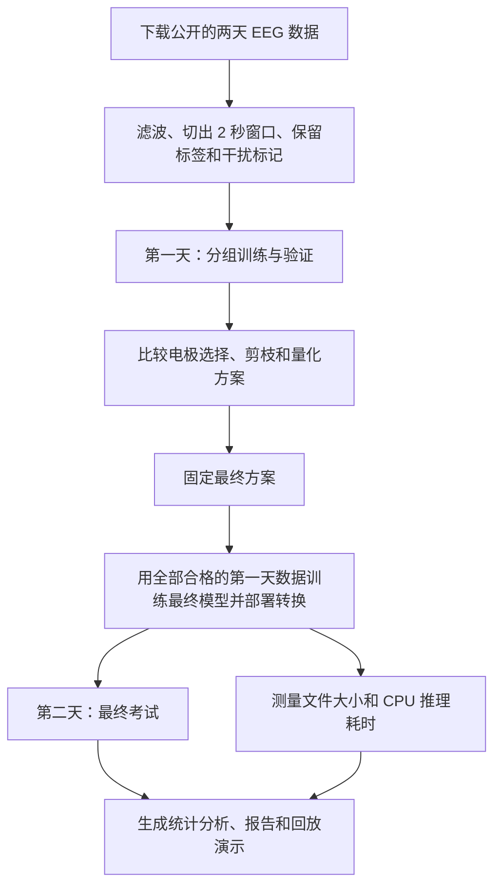

# 从零读懂这个脑电项目

这是一份不要求机器学习或脑科学基础的入门说明。先看例子，再认识术语；不用先读代码。

**整个项目想回答：能不能用更少的脑电电极、更小的识别模型，仍然比较准确地判断一个人在想象哪种运动？**

## 1. 先想象一个使用场景

一个人戴着脑电帽，坐在电脑前。屏幕提示他“想象右手运动”。他在脑中想象这个动作，帽子上的电极记录头皮电信号，电脑尝试判断这段信号对应哪种运动。

这里有三个角色：

| 角色 | 负责什么 | 可以怎样理解 |
| --- | --- | --- |
| 电极 | 从不同位置记录信号 | 放在不同位置的“麦克风” |
| EEG 数据 | 电极记录下来的电信号 | 麦克风录下来的声音 |
| 识别模型 | 根据这些信号判断类别 | 听录音、判断内容的识别器 |

“麦克风”只是比喻，电极实际记录的是电压变化。头皮 EEG 混合了很多来源，不能把一个电极直接当成某个脑区的独立开关。

**运动想象**就是在脑中想象运动。这个任务只需要从四个预先规定的类别中选一个：左手、右手、双脚、舌头。四选一的模型不能由此理解人的任意想法。

## 2. 数据集是怎么来的？

### 数据由谁提供，项目怎样拿到它？

项目使用已经公开的 **BCI Competition IV 2a** 数据集，在下载工具中也叫 **BNCI 2014-001**。这是同一个数据集的两个名称。

原始研究团队先完成真人脑电实验，把记录整理为公开数据。本项目通过 Python 工具 **MOABB** 下载其中的 `.mat` 文件，再自行处理、训练和测试。本项目没有重新招募这 9 位受试者。

可以把 MOABB 理解成“帮你找到并下载脑电数据的工具”。真正的脑电来自原来的实验记录。

### 原来的实验怎么做？

受试者坐在屏幕前，看到不同方向的箭头后，按要求想象左手、右手、双脚或舌头运动，同时记录 EEG。

例如：

> 屏幕提示“左手” → 受试者想象左手运动 → 记录这一段 EEG → 给它配上“左手”标签。

**标签**就是训练和评分时使用的参考答案，来自实验提示。标签记录的是“这一轮被要求想象什么”，并不是仪器直接读取了受试者脑中的真实想法。

### 数据有多少？

| 内容 | 数量与含义 |
| --- | --- |
| 受试者 | 9 人 |
| 记录天数 | 每人两天，称为两个 session |
| 每天的实验 | 6 组，每组 48 次任务 |
| 每人每天 | 288 次任务，每类各 72 次 |
| 总任务数 | 9 × 2 × 288 = **5,184 次** |
| EEG 通道 | 22 路，可以理解为 22 个记录位置 |
| 采样率 | 250 Hz，即每路每秒记录 250 个数 |

一次任务叫一个 **trial**；连续做的一组任务叫一个 **run**；这里一天的记录叫一个 **session**。

原始记录还包含 3 路眼电，用于记录与眼睛活动有关的信号。本项目只把 22 路 EEG 作为分类输入。

## 3. 一大段脑电，怎样变成一道“练习题”？

原始脑电是连续信号，模型需要大小固定的小片段。项目做了下面几件事。

**第一，滤波：突出要研究的频率范围。**

项目保留 4–38 Hz 的信号成分，可以粗略理解为调节录音的频率范围。滤波能减弱某些不需要的成分，但无法保证把所有干扰都清除。

这里使用因果滤波：处理当前时刻时，只使用当前和过去的信号。这使处理方式适合按时间顺序到来的数据。

**第二，切窗：每次任务取固定的 2 秒。**

把提示出现的时刻记为 0：

```text
提示出现           开始取数据                       结束取数据
0 秒               0.5 秒                           2.5 秒
                    └──────── 取这 2 秒 ─────────────┘
```

每路每秒 250 个数，2 秒就是 500 个数。因此，一道题的输入是：

> **22 路 EEG × 每路 500 个数**，外加一个“左手 / 右手 / 双脚 / 舌头”的标签。

把它想成一张 22 行、500 列的数字表：每行一个电极，每列一个时间点。

**第三，按专家标记处理明显受干扰的试次。**

眼动、肌肉活动等可能污染 EEG。数据集有专家提供的伪迹标记；“伪迹”可以理解为混进脑电记录里的干扰。

主分析在训练、验证、测试时排除这些被标记的试次。排除后，第一天合计 **2,328 次**，第二天合计 **2,368 次**。项目还用同样的最终模型测试第二天的全部试次，作为补充观察。

**第四，归一化：把每路信号调整到更便于模型学习的数值尺度。**

用于调整的平均值和波动大小，只从训练数据计算。考试数据不能参与制定这个调整规则。

## 4. EEGNet 是怎样“学会判断”的？

**EEGNet** 是一个适合 EEG 的小型神经网络。可以把它理解为一个可以反复练习的模式识别器。

训练时，它反复经历：

```text
看一段脑电 → 猜一个类别 → 对照标签 → 调整内部数字 → 继续下一题
```

这些可调整的内部数字叫 **参数**或**权重**。调整它们，就会改变模型怎样提取和组合信号里的线索。

例如，模型看到一段“右手”脑电却猜成“左手”，训练过程就会调整权重，尝试减少类似错误。这不是人手写出一条“看到某个波形就选右手”的固定规则。

训练时走完一遍训练集，叫一个 **epoch**，可理解为把整套练习题练一遍。主实验通过验证选择了 **475 个 epoch** 的基础训练预算。

训练结束后，把新脑电交给模型，让它输出判断，叫 **推理**。训练负责学习；推理负责使用学到的规则。

## 5. 为什么要把第一天和第二天分开？

如果边看考试答案边修改模型，最后的高分就不能说明它会处理新数据。

本项目这样安排：

| 数据用途 | 学习上的比喻 | 本项目怎么做 |
| --- | --- | --- |
| 训练 | 做练习并对答案 | 用第一天的一部分数据学习权重 |
| 验证 | 做模拟考试、比较方案 | 用第一天暂时留出的一部分数据比较方法 |
| 测试 | 做最终考试 | 方案固定后，用第二天的数据评分 |

第一天分成三折验证：每次用 4 个完整 run 训练、2 个完整 run 验证，轮换三次。按完整实验组划分，能减少相邻试次被随意拆散带来的问题。

电极选择、归一化和量化校准也必须遵守这个界限。**数据泄漏**就是让本来应留给考试的信息提前影响了学习或方案选择。

最后，每位受试者都用自己的第一天数据训练，再用自己的第二天数据测试。这个实验检验的是“同一个人换一天还能不能用”。直接给一个从没参与训练的新用户使用，是另一个需要单独验证的问题。

## 6. 第一种精简：电极选择

22 个电极带来的信息可能有重复。电极越多，实际设备的佩戴、连接和信号处理也可能越复杂，所以项目尝试只用 **16 个或 8 个电极**。

继续用麦克风的比喻：有的麦克风录到关键内容，有的录到的内容和旁边那支很像。现在只能留 16 支，该选谁？

| 方法名称 | 容易懂的意思 |
| --- | --- |
| `full-22` | 22 个全用，作为参照 |
| `relevance`：仅相关性 | 优先留下最有助于区分四类任务的电极 |
| `proposed`：冗余感知 | 既看是否有用，也尽量避免重复选择相似信息 |
| `weightnorm`：空间权重 | 参考全电极模型学到的空间权重大小来排名 |
| `random`：随机 | 随机选，看看精心选择是否有帮助 |

“冗余”就是信息重复。例如两支麦克风总录到很相似的内容，第二支可能增加的线索较少。这个项目用两个频段的信号能量特征，估计电极的有用程度和重复程度；这只是对冗余的一种具体估计。

选好电极后，会用所选输入**重新训练模型**。每个人可以选出不同的电极集合。

这里是在原本已记录好的 22 路数据上做选择实验。它提供了减少电极的研究依据；实际只佩戴 16 个电极的硬件系统仍需另行验证。

## 7. 第二种精简：剪枝是什么？

**剪枝，就是删掉神经网络里选定的一部分结构，让模型本身变小。**

把 EEGNet 想成一组共同工作的“小检测器”。它们从信号中提取不同线索，再把线索交给最后的分类器。有些检测器可能可以被删掉，剩余部分再练习适应。

本项目具体做法是：

1. 找到网络后面一个指定卷积层里的 **16 个输出滤波器**。“滤波器”在这里指可学习的特征检测器。
2. 把每个滤波器的权重绝对值加起来，作为排序依据。
3. 删除总和较小的 25% 或 50%，分别保留 **12 个或 8 个**。
4. 同时删去后续层中对应的连接，实际缩小网络张量。
5. 用较小的学习步长，再训练 **100 个 epoch**，让剩余结构适应变化；这叫**微调**。

权重绝对值小只是本项目采用的删除标准，不保证被删的部分完全没用。

**“剪枝 50%”的分母是这个指定层的 16 个滤波器。** 不能把它读成“所有电极减少一半”或“整个模型的全部参数减少一半”。

电极选择发生在输入端，剪枝发生在模型内部：

| 操作 | 麦克风与识别器的比喻 |
| --- | --- |
| 电极选择 | 少接几支麦克风 |
| 结构剪枝 | 减少识别器内部的一部分检测器 |

本项目执行的是实际删除结构。如果只把一些权重改成 0，却仍保留原来的大矩阵，文件大小和计算耗时就未必会相应减少。

## 8. 第三种精简：INT8 量化是什么？

**INT8 量化，就是把模型中的一部分数值，改用更省空间的 8 位整数近似表示和计算。**

先认识两个词：

| 名称 | 含义 | 一个数占用的空间 |
| --- | --- | --- |
| FP32 | 32 位浮点数，可以表示带小数的数值 | 4 字节 |
| INT8 | 8 位整数；本项目使用有符号数，范围 −128 到 127 | 1 字节 |

可以把量化理解为换一把刻度更粗的尺子。原来的尺子能区分很细的变化，新尺子只能用有限的刻度，保存起来更省。

### 一个小例子

假设我们约定：一个整数刻度代表 **0.01**。那么：

| 原来的数 | 保存的整数刻度 | 换回近似数值 |
| --- | ---: | ---: |
| 0.237 | 24 | 0.24 |
| −0.436 | −44 | −0.44 |
| 1.120 | 112 | 1.12 |

这里保存的是整数刻度，同时还要保存“每格是多少”的比例尺。这个例子只说明原理；真实模型会使用不同的比例尺，还可能需要零点偏移。

**量化会产生近似误差，但预测类别未必改变。** 例如原来判断“右手”的分数明显最高，轻微数值变化后，它仍可能最高；接近的两个类别则可能交换次序。

### 本项目怎样量化？

流程是：先训练浮点模型，再导出为 ONNX，最后做量化。这叫**训练后量化（PTQ）**。

量化前还需要**校准**：给模型看一些训练脑电，观察内部数值大致落在什么范围，再决定比例尺。可以理解为先看要量的东西多大，再选尺子的刻度。校准不使用第二天的测试数据。

ONNX 可以理解为一种通用的模型文件格式；**ONNX Runtime** 是读取它并执行推理的软件。

本项目量化后的模型仍有浮点运算，外部输入仍是 FP32 数组。INT8 主要改变图内可量化部分的数值表示。

### 为什么一个数省了四分之三，整个文件却没缩小四倍？

因为模型文件还保存网络结构、比例尺和其他信息，也有仍使用浮点的部分。

就像把书的正文压缩了，封面、目录和说明页仍占空间。这里的“单个数占用”“参数存储”“整个模型文件”“运行进程内存”，分别是不同的东西。

### 为什么量化后不一定更快？

整数计算能否加速，取决于芯片、模型结构和运行软件；整数与浮点之间的转换也有开销。本项目的 M4 CPU 测量中，全电极 INT8 模型比相应 FP32 模型约慢 **28%**。

所以，省存储和跑得快，要分别测量。

## 9. 把三个操作放在一起看

| 方法 | 改变什么 | 本项目中的例子 | 可能付出的代价 |
| --- | --- | --- | --- |
| 电极选择 | 输入信息的来源数量 | 22 路 → 16 路或 8 路 | 少看了一些信号 |
| 剪枝 | 模型内部的结构数量 | 指定层 16 个滤波器 → 12 个或 8 个 | 少了一些提取特征的能力 |
| INT8 量化 | 部分数值的表示精细程度 | FP32 → INT8 | 多了近似误差 |

三种操作可以组合，目标是寻找准确率与成本之间的合适取舍。

整个实验路线如下：



主实验一共比较 **17 种配置**，每种都评价 FP32 和 INT8。最终训练使用 3 个随机种子，相当于换三次随机初始化再练习，以减少只看一次训练的偶然性。

汇总结果时，先平均同一个人的三个种子，再平均 9 个人。重复训练不会把 9 位受试者变成 27 位独立受试者。

## 10. 结果到底说明了什么？

### 最后选出的方案

最终方案叫 **`relevance-16-prune50` INT8**，名字可以拆开读：

> 按相关性选 16 个电极 → 指定层剪枝 50% → 做 INT8 量化。

它根据第一天的验证结果选出。选择规则先要求准确率距离全电极 FP32 基线不超过 2 个百分点，再优先考虑更少电极、更少参数存储和更高准确率。第二天只负责评价。

注意：最后选出的用的是 `relevance`。项目提出的 `proposed` 方法没有显示出相对强对照的可靠优势。

### 先记住这张结果表

下面的准确率来自第二天无专家伪迹标记的试次，按前面介绍的方式平均。

| 比较内容 | 全 22 电极、FP32 | 最终 16 电极、剪枝、INT8 |
| --- | ---: | ---: |
| 平均准确率 | **65.04%** | **65.01%** |
| ONNX 内参数等固定数值的存储 | 9,576 字节 | 2,420 字节 |
| 完整 ONNX 文件 | 28,022 字节 | 26,029 字节 |

四类均匀随机猜，期望准确率是 25%；约 65% 表示模型学到了一些区分线索，但依然会出错。表中的 65% 是跨人的平均值，不能理解成每个人都恰好达到这个水平。

参数等固定数值的存储变为原来的约 **四分之一**，完整文件却只减少约 **7.1%**。这就是为什么必须说清楚“到底缩小了什么”。

### 平均值很接近，为什么还不能说完全没损失？

65.01% 与 65.04% 相差 **−0.03 个百分点**。但有人进步，有人退步，**9 人中有 4 人下降超过 2 个百分点**。

项目还按受试者反复重采样，估计这个平均差的不确定性，得到 95% 区间 **[−2.16, +2.40] 个百分点**。这种方法叫 bootstrap，可以理解为反复改变“这次抽到哪些受试者”，看看平均差会怎样变化。

这个区间表明估计仍有不确定性。它不能证明两个方案等效，也不能保证每个用户都不受影响。

### 为什么后来又加做实验？

原来的剪枝模型多训练了 100 个 epoch，而未剪枝基础模型没有。像是一个学生换了教材后又多复习了 100 遍：最后的成绩变化，同时混入了“换教材”和“多复习”的影响。

补充实验让未剪枝、剪枝 25%、剪枝 50% 的分支都额外训练 100 个 epoch，再比较它们。

在 **relevance-16、INT8** 这个具体条件下，剪枝 50% 比同样额外训练的未剪枝分支低 **1.56 个百分点**，95% 区间为 **[−2.86, −0.42]**。这说明“相对原基础模型平均准确率接近”不能被解释成“剪枝没有代价”。

这是看到主测试结果后追加的补充实验；它保留独立来源，也没有用来改选历史最终方案。

## 11. 项目已经做到了哪一步？

项目已完成从公开数据下载、预处理、训练、比较、量化、跨天测试到性能测量的研究流程，并生成报告、图表、幻灯片和录制脑电回放。

回放演示使用以前录好的 EEG：按时间喂入模型，再显示判断。真人并没有根据模型反馈继续操作，所以它展示的是数据回放推理。

另外，模型计算可以少于 1 毫秒，但仍需要先收集那段 **2 秒脑电**；本项目的决策窗口到提示后 2.5 秒才结束。

按当前项目文档记录的状态，原主实验结果和预测保留，但当前副本缺少主实验原权重；可用模型来自后来独立重建的补充实验。可以阅读历史结果，也可以使用补充模型，但应区分两者来源。

## 12. 用三个小问题检查自己是否理解

**电极从 22 个减到 16 个，这叫剪枝吗？**

在本项目里叫电极选择：它减少输入来源。剪枝减少的是网络内部结构。

**INT8 会把 EEG 标签从四类变成八类吗？**

不会。“8”指每个相关数值使用 8 个二进制位，类别始终是左手、右手、双脚、舌头四类。

**两个模型平均准确率都是约 65%，就能随便互换吗？**

还需要看每个人的变化、不确定性、存储、速度和实际使用条件。本项目观察到平均接近，同时也观察到部分受试者明显下降。

## 继续阅读与数据来源

- [项目 README](../README.md)：完整项目说明、参数和运行命令。
- [正式研究报告](REPORT.md)：详细结果与分析。
- [数据数量与原始文件哈希](../results/data_summary.csv)：本项目实际使用的数据记录。
- [主分析准确率表](../results/analysis/conditions_primary.csv)与[效率表](../results/analysis/efficiency.csv)：本文主实验数字的来源。
- [补充实验配对比较](../results/supplementary/matched_budget/paired_comparisons.csv)：等训练预算下的剪枝结果。
- [BCI Competition IV 官方页面](http://www.bbci.de/competition/iv/)：公开数据集的原始介绍入口。

本文是帮助理解的简化说明；比喻只解释概念，具体方法以项目代码、冻结配置和正式报告为准。
