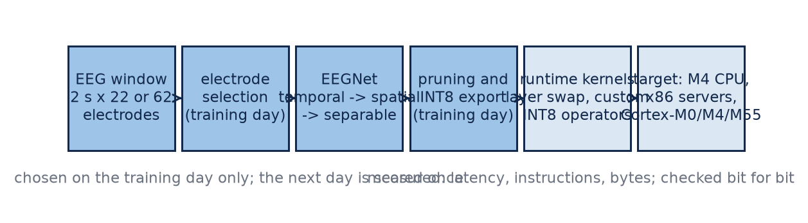
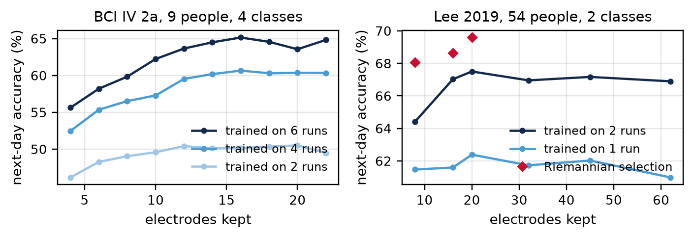
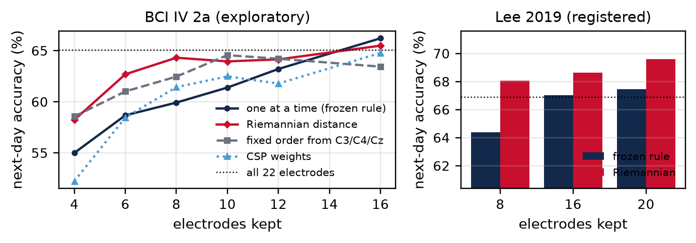
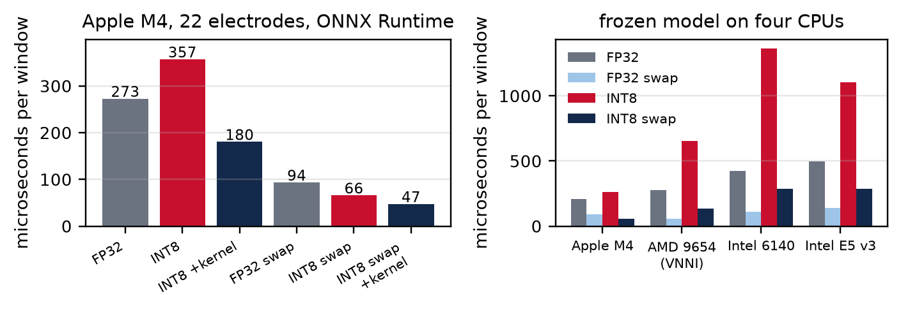
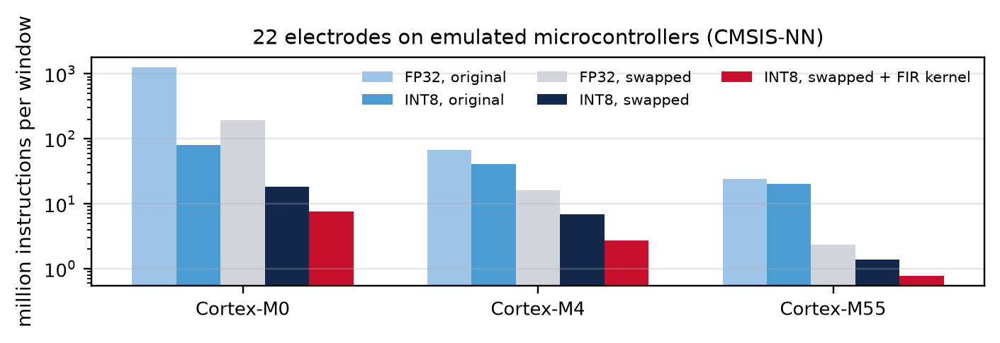

# EEG Channel Selection and Model Compression for Motor-Imagery BCI: Why 16 Electrodes Suffice and What Makes 8-Bit Inference Fast

**Peiye Li** | **[email address: to be filled in by the author]** | COMP 690-193, Fall 2026 (individual project)

**Contributions.** **[To be written by the author.]**

**Overlap with other courses or research.** **[To be written by the author.]**

**Abstract.** Wearable brain-computer interfaces must decode motor-imagery EEG on small processors, where every electrode, bit and multiply costs power. We study a compact decoder (EEGNet) on BCI Competition IV 2a (9 people, two days) under a protocol frozen before scoring the test day, and retest the main findings on Lee et al. 2019 (54 people) with predictions registered before scoring. Keeping the 16 most relevant of 22 electrodes does not lower next-day accuracy (+0.32 points); so do 45 and 16 of 62 electrodes on the new people. Every extra input costs accuracy through the part the other inputs cannot predict, mostly because the network memorizes its training trials with it; the dropped electrodes add about as much as they cost, yet after pretraining on 45 other people all 62 beat a shared 16 by 4.5 points. Choosing electrodes jointly (Riemannian distance) beats one-at-a-time relevance by 3.7 points at 8 electrodes on the new people. Eight-bit integers keep accuracy, but exported INT8 ran slower than float until we reordered two layers and wrote the two missing kernels (then 5.7x faster than the original float). On emulated microcontrollers, our filter-bank kernel cuts instructions 1.5-2.8x. INT8 accuracy can depend on the CPU.

## 1. Introduction

A motor-imagery brain-computer interface (BCI) turns imagined movements, such as of the left or the right hand, into commands. The signal is scalp EEG: microvolt rhythms over the sensorimotor cortex whose power changes with the imagined movement. A practical, wearable BCI has to decode this on a small processor with a battery, so the electrodes (each one adds setup time, cost and front-end power), the bits of each number and the multiply-accumulates per decision are the budget. This project asks how far a compact decoder can be reduced along those three axes before next-day accuracy suffers, and what actually limits speed on real hardware.

Compact networks such as EEGNet [1] made deep decoding of EEG small enough for embedded use, and 8-bit versions have run on low-power processors [2, 3, 4]. Most evaluations, however, (i) score on data from the same recording day or tune on the test day, (ii) report parameter counts instead of measured time, (iii) assume that 8-bit integers make a network faster, and (iv) rest on nine people, the size of the standard BCI IV 2a benchmark. We address each: every choice is made on the training day only and the next day is scored once; latency is measured in interleaved rounds and microcontroller cost is counted instruction by instruction in emulation; integer pipelines are checked bit for bit against reference arithmetic; and the main findings are tested again on a second two-day dataset of 54 people with the predictions written down before the new test days were scored.

The systems principles we use are measurement before belief (a cheaper model is not faster until a timer says so), making the common case fast (the network's most frequent layer shape gets a dedicated kernel instead of a general path), co-design of model and kernel (reordering two linear layers changes the cost by up to 8x without changing a single prediction), matching arithmetic to hardware (the width of the integer accumulator decides whether INT8 is exact), and scale-out for statistical power (about 59,000 trainings on a cluster turn single-seed anecdotes into intervals).

**Contributions.**

1. A frozen, auditable pipeline on BCI IV 2a (electrode selection, structured pruning, INT8 export) in which every reported number is regenerated from stored records.
2. Evidence that 16 of 22 electrodes suffice, replicated prospectively on 54 new people, and a mechanism: an extra input costs what the other inputs cannot predict, mostly because EEGNet memorizes its training trials with that part; measured for the dropped electrodes, where it cancels what they add, and tested with copies, mixes, shared noise, noise redrawn every epoch, longer training, two sparsity penalties, and pretraining on other people, which removes most of the cost.
3. A joint (Riemannian) electrode-selection rule that beats the frozen rule, found on BCI IV 2a and confirmed prospectively on Lee 2019.
4. A systems account of INT8 on CPUs: why it was slower (a missing grouped-convolution kernel), two custom ONNX Runtime kernels that are bit-exact on 459 models, a layer reordering, and a cross-CPU accuracy difference traced to 16-bit accumulation on x86 CPUs without VNNI, with a fix.
5. Microcontroller deployment in emulation (Cortex-M0, M4, M55): CMSIS-NN [5] reproduced bit for bit, and a dedicated INT8 filter-bank kernel for the temporal layer that the library lacks.

**Results in brief.** The frozen configuration (16 electrodes, half of the last layer's filters pruned, INT8) scored 65.01% against 65.04% for all 22 electrodes in float; the mean difference is -0.03 points, but 4 of 9 people lost more than 2 points. On 54 new people, 45 and 16 of 62 electrodes were within the registered 2-point margin (+0.29 and +0.18 points). Eight-bit arithmetic changed accuracy by -0.10 points; with both kernels and the layer swap the decoder needs 47 us per window on the Apple M4 instead of 273 us.

## 2. Background

**Motor imagery and the data.** Imagining a hand movement lowers the power of the mu (8-12 Hz) and beta (13-30 Hz) rhythms over the opposite hemisphere's motor cortex; imagined foot movements act near the midline. BCI Competition IV 2a [6] recorded 9 people on two days with 22 electrodes at 250 Hz: four classes (left hand, right hand, feet, tongue), 288 trials per day. Lee et al. 2019 [7] recorded 54 people on two days with 62 electrodes: two classes (left and right hand), 100 offline and 100 online trials per day. The second day is the test: EEG drifts between sessions (electrode placement, impedance, attention), so a decoder trained on day 1 and scored on day 2 is the honest measure of what a user would experience.

**EEGNet.** EEGNet-8,2 [1] filters each electrode in time with 8 kernels of 64 taps, mixes the electrodes with 2 spatial filters per temporal filter (a grouped convolution spanning every electrode), and then applies a separable convolution, pooling and a small dense layer, with batch normalization after each convolution stage. With 22 electrodes it has 2,420 parameters and 5.9 million multiply-accumulates (MACs) per 2-s window; the temporal filters on every electrode account for most of them.

**Integer inference.** INT8 inference stores weights as 8-bit integers with a scale (per output channel), maps activations to 8 bits with a scale and zero point, accumulates products in 32-bit integers and rescales the sums with a fixed-point multiplier [8]. ONNX Runtime executes such graphs on CPUs; CMSIS-NN [5] implements the TensorFlow Lite version of the same arithmetic on Arm Cortex-M microcontrollers. How fast and how exactly this runs depends on the hardware: Arm dot-product instructions and x86 AVX-512 VNNI add 8-bit products straight into 32-bit sums, whereas x86 CPUs without VNNI first add pairs of products in a saturating 16-bit register. On microcontrollers, the Cortex-M0 has no SIMD at all, the M4's SMLAD performs two 16-bit MACs per instruction, and the M55's Helium vectors perform sixteen 8-bit MACs.

## 3. Related work

**Compact and embedded decoders.** EEGNet [1] is the common compact baseline for EEG. Q-EEGNet [2] quantized it to 8 bits for a parallel ultra-low-power processor, EEG-TCNet [3] ran a temporal convolutional decoder on an embedded RISC-V MCU, and MI-BMInet [4] combined channel selection with a small network for edge deployment. Those works report what fits and how fast it runs; ours asks, in addition, why fewer electrodes do not hurt, and where the runtime, not the hardware, sets the speed.

**Electrode selection.** Reviews group channel-selection methods into filter, wrapper and embedded approaches and stress that most are evaluated on few people [9, 10]. Riemannian geometry on spatial covariance matrices is a strong family of motor-imagery decoders [11]; we use its distance between class covariances as a selection criterion and compare it with one-at-a-time relevance, CSP weights, wrappers and a learned selection layer.

**Compression and alignment.** Pruning and quantization are standard model compression [12, 13]; we prune whole filters so the dense network shrinks. Euclidean alignment [14] whitens each session's data to reduce the shift between days without labels; we test it on both datasets and dissect why it fails on one.

**Runtimes for integer inference.** ONNX Runtime's documentation notes that quantized models are not always faster [15]; TensorFlow Lite Micro [16] and CMSIS-NN [5] are the usual path on Cortex-M. We locate the specific operator shapes for which these libraries fall back to general code paths and supply the missing kernels.

## 4. Approach and system design

**Frozen protocol.** All model choices use session 1 only, with three run-grouped validation folds (two of the six runs held out each time, so validation sees the drift within a day). The training budget (475 epochs) was fixed by a rule on the 22-electrode validation curves before any selection result existed; the configuration to deploy was frozen on 3 November, before session 2 was scored, and session 2 was then scored once. Code reads session 2 only through a guarded loader, and a lint check fails if any other file opens it.

**Electrode selection.** Each electrode's relevance is how well its log band power separates the classes on the training day; a greedy ranking can subtract a redundancy penalty for electrodes whose power fluctuates with those already chosen. The frozen rule keeps the 16 most relevant electrodes of each person. Later studies compare joint criteria: the Riemannian distance between class-mean covariance matrices of the chosen set, CSP filter weights, a wrapper that drops electrodes one at a time with a fast decoder, a fixed anatomical order, rankings borrowed from other people, and a learned (concrete) selection layer.

**Compression.** Structured pruning removes the half of the final pointwise convolution's 16 filters with the smallest L1 norm and fine-tunes for 100 epochs at a tenth of the learning rate. INT8 export uses ONNX Runtime static quantization (QDQ format, per-channel weights) calibrated on session 1. The bit-width study folds batch normalization into the convolutions and simulates any integer grid in float arithmetic; its 8-bit setting agrees with the real ONNX Runtime INT8 graph on 99.3% of next-day trials.

**Runtime kernels.** Two changes make INT8 fast without changing predictions. First, the temporal and spatial convolutions are both linear before the first nonlinearity, so their order can be swapped: mixing electrodes first leaves 16 signals to filter instead of 8 per electrode, 3.4-8.0x fewer MACs (8 to 22 electrodes). Second, where ONNX Runtime had no fast INT8 path, we wrote custom operators in C with NEON intrinsics for the grouped spatial convolution and for the swapped network's first convolution; they replace only those nodes in the runtime's own optimized graph and follow its rounding exactly. On microcontrollers we built the network with CMSIS-NN v8.0.0 and added an INT8 FIR filter-bank kernel for the temporal layer with plain-C, DSP (SMLAD) and Helium (VMLADAVA) paths, compiled with Arm GNU Toolchain 15.3 and run on QEMU 11 boards with a plugin that counts instructions per layer.

**Experiment infrastructure.** Each study after the midterm writes a plan before it runs: the jobs, the contrasts, the predictions for the new dataset, and the SHA-256 of every source file that decides its numbers. A study refuses to resume if a pinned file changed, and a lint check rejects edits to pinned files. The 58,626 trainings on the UNC Longleaf cluster ran as SLURM arrays of these plans; every record was copied back and every table and figure in this report is rebuilt from the records by one command (Artifacts).

## 5. Experimental setup

**Data and preprocessing.** Each run is band-passed causally (4th-order Butterworth, 4-38 Hz) and cut into one 2-s window per trial, 0.5-2.5 s after the cue. BCI IV 2a trials flagged by the dataset's experts as artifacts are left out of training and of the primary score; Lee 2019 is downsampled from 1000 to 250 Hz after the same filter and uses every trial.

**Training and scoring.** Adam (learning rate 0.001, batch 64), 475 epochs, the paper's dropout of 0.5, and each electrode standardized with training-day statistics. Each condition is trained with 3-10 seeds per person. The primary metric is next-day accuracy; held-out runs of the training day are a second, same-day measure. Seeds are averaged within each person first; the 95% interval is a percentile bootstrap over people (10,000 resamples), which says what another group of people might show. The seed error, what retraining the same people would show, is reported separately where it matters.

**Hardware.** Latency: an Apple M4 Mac mini (ONNX Runtime 1.31.1, one thread, one window at a time, all versions interleaved in 15 rounds of 500 runs, system load recorded) and Longleaf CPUs: AMD EPYC 9654 (with AVX-512 VNNI) and, without VNNI, AMD EPYC 75F3 and 7702, Intel Xeon Gold 6140 and Xeon E5-2680 v3. Microcontrollers: emulated Cortex-M0 (no DSP, no FPU), Cortex-M4F (DSP, FPU) and Cortex-M55 (Helium). QEMU counts instructions; it does not model cycles or memory wait states.

**Registered and exploratory results.** BCI IV 2a results after the freeze are exploratory: they were planned after the test day had been scored. On Lee 2019, each study wrote its predictions and their decision rule into its plan before any of its models was scored on that dataset's test day; these are reported as holding or not, with the rule unchanged. Appendix A lists all of them.

## 6. Results

### 6.1 Fewer electrodes keep accuracy, on 9 and on 54 people

Retrained on the same hardware with 10 seeds, the 16 most relevant electrodes scored +0.32 points against all 22 [-0.42, +1.04] (the archived models, partly trained on the M4's GPU, had suggested +1.31; a different training device acts like a different seed). On the 54 people of Lee 2019, the registered test H1 (45 of 62 electrodes within 2 points of all 62) holds: +0.29 [-0.83, +1.46]; so does H1b with only 16 electrodes, +0.18 [-1.41, +1.80]. The mean hides spread: 24 of 54 people lost more than 2 points with 16 electrodes, and about as many gained. Accuracy rises with the number of electrodes and then flattens (Figure 2): on 2a from 55.6% with 4 to 65.1% with 16 and 64.8% with 22; on Lee 2019 from 64.4% with 8 to 67.5% with 20 and 66.9% with 62. Halving the training data did not move the plateau (registered tests D1 and D2 do not hold), so the plateau is not set by the amount of data.

### 6.2 Why 16 are enough: an extra input costs what the others cannot predict

Every extra input costs accuracy. Independent band-limited noise added to the 16 most relevant electrodes lowers next-day accuracy steadily with the number of inputs (Figure 3, left): -0.89 points per input on 2a and -0.32 on Lee 2019, about 2% of the accuracy above chance per input on both. The cost does not shrink with three times more training data (registered C2 does not hold; the effect goes the other way), and it is as large on held-out runs of the training day as on the next day, so it is a failure to generalize to new trials, not a day-to-day shift.

What costs is the part of an input that the other inputs cannot predict (Figure 3, right; registered K1, K2 and K3 all hold, Appendix A). With 6 extra inputs on 2a and 46 on Lee 2019, accuracy changes by -1.14 and +0.62 points with copies of kept electrodes, -2.24 and -1.83 with one noise waveform repeated, -5.81 and -8.33 with copies whose variance is half noise, and -7.29 and -13.33 with independent noise. The real dropped electrodes are mostly predictable: a linear fit from the 16 kept ones leaves only 4% (2a) and 29% (Lee 2019) of their variance on held-out runs unexplained. To measure what they add and what they cost, we replaced each trial's unexplained part (the residual of that fit) with another trial's, which keeps its size and its correlation across electrodes but not its relation to the trial. On Lee 2019 these inputs cost -4.12 [-5.31, -3.02] points against the 16 alone (registered S2 holds), the real residuals add +4.30 [+3.09, +5.50] over them (S1 holds), and the prediction alone costs nothing visible (+0.27; S3 holds): information and cost cancel (+0.18). On 2a the cost is -1.50 and the information +0.34 next day (+2.20 on held-out runs of the training day). With the unexplained part present the Lee 2019 networks fit 99% of their training trials; with the 16 alone 96%, and with the prediction added 96%. Across the 54 people the unexplained share did not predict who paid more (S4 does not hold, rho -0.08), although a person's cost repeats between halves of the seeds (rho +0.49). Comparing the real electrodes with noise in their place (+4.64 points; noise there costs -4.96, registered P3 holds) credits them for being predictable and overstates both.

EEGNet does not learn to ignore these inputs. After training, six noise inputs still make up 38% of each spatial filter's output variance, against 43% at initialization; with 16 noise inputs 62% against 60%. Setting their weights to zero after training recovers only 12-19% of the loss, so the damage is done during training: the filters learned from the electrodes are worse. A group-lasso penalty on each input's weights did not help (registered G1, G2 do not hold), and the reason is architectural: a batch norm follows the spatial filters, so the overall scale of a filter's weights does not matter and the penalty is minimized by shrinking every weight together (Appendix B).

**Testing the explanation.** Four more studies, each with registered predictions on Lee 2019, test the account above. *Training four times longer* (1,900 epochs) changed neither: the noise cost moved by +0.52 [-0.40, +1.49] (L1 does not hold), all 62 electrodes did not beat 16 (L2 does not hold), and the noise models' held-out accuracy did not rise after epoch 475 (L3 does not hold; curves in Appendix B). *A penalty no rescaling can lower* (filters scaled to unit length before the per-input norm) did not switch the noise off either: at no strength did the noise inputs' median norm fall below a third of the electrodes' (ratios 0.48-1.78; N3 does not hold), and the noise cost changed by +1.19 [-0.24, +2.63] (N1 does not hold; N2 does not hold). So scale invariance is not the whole reason. *The same noise drawn afresh in every training epoch* (all else unchanged) is switched off: its weights fall to 0.19 of the electrodes' (median; 8% of the spatial filters' output, against 1.07 and 86% with recorded noise; F3 holds), and the cost of 46 noise inputs falls from -13.33 to -1.15 points (F1 holds), though not to zero (F2 does not hold, [-2.12, -0.23]); on 2a it falls by 74% and 70% with 6 and 16. Recorded noise is the same in every epoch, and the network uses it to remember its training trials: with their own noise the Lee 2019 models classify 100% of them correctly, with noise they have not seen 61.5%. So most of the cost of noise inputs (91% on Lee 2019) is the network memorizing content that repeats; noise that changes, it largely learns to ignore. *Pretraining on 45 other people, then fine-tuning on the person's training day* (the same electrodes for everyone; 'a shared 16' is the best 16 on the pretraining people): with all 62 electrodes, next-day accuracy rises from 66.9% to 74.5% (T1 +7.65 [+5.39, +9.94], holds); the 46 noise inputs cost -2.17 points instead of -12.08 (T2 holds); and all 62 electrodes beat a shared 16 by +4.53 [+2.84, +6.44] (T3 holds), which they did not from scratch (+1.19). With enough data the network does use the extra electrodes; three times more of the person's own (C2) was not enough. On 2a, eight other people were too few: pretraining lowered accuracy with all 22 electrodes by 9.2 points.

### 6.3 How to choose: jointly, not one at a time

The frozen rule ranks electrodes one at a time. Its redundancy penalty changed little: with 10 seeds, redundancy-aware 16 against relevance-only 16 is +0.28 [-0.42, +1.06], because relevance differences are several times larger than the penalty. Joint criteria do better with few electrodes (Figure 4). With 8 electrodes on 2a, the Riemannian distance criterion reached 64.3% against 59.9% for the frozen rule (exploratory; it was better at 4, 6, 8 and 10 electrodes, with 48 comparisons made after the test results were known). Registered on Lee 2019 before scoring, it won at 8 electrodes by +3.66 [+2.10, +5.27] (37 of 54 people better), at 16 by +1.60 and at 20 by +2.12; all three hold. With 8 Riemannian electrodes, Lee 2019 accuracy (68.1%) exceeds all 62 electrodes (66.9%).

Training a model on each of the 511 combinations of nine scalp regions (session 1 only for the ranking) gives exact Shapley values of each region's contribution. The motor and somatosensory strips, the central midline and the parietal region contribute 5-6.4 points each (left motor 6.1, right somatosensory 5.0, central midline 5.0, parietal 6.4); the frontal regions contribute least (midline front 1.4). Split by class, the data recover the textbook layout without being told it: the left hand depends on the right hemisphere, the right hand on the left, and the feet on the midline. Choosing whole regions, however, was no better than choosing single electrodes.

### 6.4 How many bits: eight

Simulated over all 459 models, 16-bit weights and activations change accuracy by -0.02 points and 8-bit by -0.10 (no person loses 2 points); 4-bit weights change it by -5.39 and 4 bits everywhere by -36.44, near chance. INT16 therefore buys nothing, and it was slower than FP32 on every CPU we timed. Below 8 bits the first casualties are the raw input and the temporal layer's output, which still carry the signal's full amplitude range. A mixed precision map chosen on the training day (8 bits only where a layer is sensitive, 4 elsewhere) changes accuracy by -0.49 points with 41% fewer weight bytes than 8 bits; the same map, moved unchanged to Lee 2019, kept its accuracy (registered H4b holds). These sub-8-bit results are simulated integer grids, not timed on low-bit hardware.

### 6.5 INT8 on CPUs: missing kernels, layer order, and the accumulator

Exported INT8 was slower than FP32 on the M4 (357 against 273 us for 22 electrodes, Figure 5) although every layer has fewer bytes. Profiling on the M4 showed that ONNX Runtime's INT8 convolution has fast paths only for ordinary and one-filter-per-channel depthwise convolutions; EEGNet's spatial layer (8 groups of 2 filters spanning every electrode) falls to a general path that copies each group into a buffer and multiplies a 2-column matrix: 14.6 times slower than FP32 for that layer. The M4 itself executes 8-bit arithmetic well: the temporal layer was 1.58x faster in INT8. A map of 38 synthetic convolutions shows these fast paths only on the M4: INT8 beat FP32 for 6 shapes there and for at most 1 on four x86 CPUs (Appendix B). Our custom kernel for that layer brings INT8 to 180 us; swapping the two layers helps every version, and a second kernel for the swapped network's first layer gives 47 us, 5.7x faster than the original FP32 and 2.0x faster than the fastest FP32. Both kernels reproduce the runtime's own INT8 logits exactly on all 459 models (459 x 288 = 132,192 predictions each). The frozen model takes 44 us. Pruning saves almost nothing in time: halving the last layer removes 0.3% of the MACs in the original order and 2.2% in the swapped one.

Accuracy, too, depends on the processor. The same INT8 files gave identical predictions on the M4 and the AMD 9654 (VNNI), but on x86 CPUs without VNNI 457 of 459 models changed and accuracy fell by 3.97 points: their 8-bit kernel adds two 8-bit products in a saturating 16-bit register, as ONNX Runtime documents [15]. Restricting weights to 7 bits (the runtime's reduce_range option, which its documentation recommends for these CPUs) removes the overflow; the 459 models then agree on every tested CPU and lose 0.17 points against FP32. Reading the integer tensors each machine actually computes confirms this: on x86 the runtime always uses unsigned 8-bit activations, VNNI makes that exact, and without VNNI the first difference is in the temporal convolution, where every output that differs is a predicted 16-bit overflow; 7-bit weights are needed in every layer, and our kernels, rewritten for x86, are exact there too (Appendix B).

### 6.6 Microcontrollers: CMSIS-NN and the missing filter-bank kernel

On emulated Cortex-M cores, CMSIS-NN's INT8 network reproduced our NumPy integer reference bit for bit in 136 of 136 builds, and its next-day accuracy differs from FP32 by -0.32 to +0.30 points. INT8 needs 10-16x fewer instructions than FP32 on the M0, which has no floating-point unit, but only 1.2-2.3x fewer on the M4 and M55, because both libraries spend most instructions moving data. Swapping the layers cuts the M4's INT8 count from 40.8 to 6.9 million instructions per window (Figure 6).

With the layers swapped, the temporal layer (16 FIR filters of 64 taps) still took 5.5 of the M4's 6.9 million instructions, 10.7 per MAC, since CMSIS-NN treats it as a general depthwise convolution. Our filter-bank kernel brings that layer to 2.47 instructions per MAC on the M4 (best case 0.5), 0.87 on the M55 (best case 1/16) and 7.2 on the M0, and the whole network to 2.70 (M4), 0.78 (M55) and 7.62 (M0) million instructions, 1.5-2.8x fewer across all builds. All 136 of 136 builds give logits identical to the reference. On the M55 it also removes a 32 KB scratch buffer the library needed. These are instruction counts, not time or energy.

### 6.7 What did not work, and why

- *Pruning at a matched budget.* Against an unpruned model fine-tuned for the same 100 epochs, pruning half of the last layer changed accuracy by -1.59 points [-2.86, -0.49] on the 16-electrode base; it saves bytes, not time.
- *Day-to-day alignment.* Whitening each day helped 2a on average but hurt Lee 2019's 62 electrodes (registered H5: -5.51 [-7.88, -3.29]). The harm is not a day-to-day effect: within one day it is -4.02 [-6.27, -2.05] (M1). Nor is the covariance badly estimated (Ledoit-Wolf coefficient 0.0061, M3). But 49 of its 62 directions carry less than 1% of the largest one's variance, and whitening scales them all to unit variance: many inputs the others cannot predict, as in Section 6.2. Keeping those directions without amplifying them removes 102% of the harm and shrinking the covariance by 10% removes 88%; dropping them removes 48%, because it also drops signal (M2, which asked for half, falls just short).
- *Channel dropout.* Dropping random electrodes in training cost 11.07 points on 2a and 2.74 on Lee 2019. Re-estimating the batch norms with every electrode present recovers only 14% of the loss on Lee 2019 (B1 does not hold), so the damage is in the learned filters, not in mismatched statistics; a smaller p costs less (B2 holds). Dropout does buy robustness: with one electrode replaced by its training mean on the next day, the 2a models lose 14.8 points on average without dropout and 1.9 with p = 0.05; on Lee 2019 0.81 against 0.32 (B3 holds, +0.49 [+0.28, +0.72]).
- *Who benefits.* On 2a, people decoded worst with all electrodes seemed to gain most from fewer; measured on separate trials in 54 people the correlation is -0.007 (registered H3 does not hold), so it was noise plus regression to the mean.
- *Letting the network choose.* A learned selection layer was the worst selection method, and neither a group lasso nor a scale-free penalty on the inputs switched the noise inputs off (Section 6.2).

## 7. Conclusion

A small EEG decoder can lose a quarter of its electrodes, three quarters of its bits and most of its latency without losing average next-day accuracy, but none of that comes for free from the model alone. Fewer electrodes work because the network pays for the part of every input that the others cannot predict, mostly by memorizing its training trials with it, and the dropped electrodes add about as much as they cost, until enough data from other people lets the network use them; choosing them jointly matters most when few are kept, and that result held on 54 new people. INT8 is accurate, but whether it is fast is decided by the runtime's kernels and the order of two layers, and whether it is exact by the processor's accumulator. Two lessons carry over beyond EEG: measure each claimed saving on the target, and when a model's most common layer shape falls to a general path, a short dedicated kernel can matter more than any further compression. Future work: pretraining across many users so that more electrodes pay off, electrode selection learned on such data, and timing on physical microcontrollers.

## References

1. V. J. Lawhern et al. EEGNet: a compact convolutional neural network for EEG-based brain-computer interfaces. J. Neural Eng. 15(5):056013, 2018.
2. T. Schneider, X. Wang, M. Hersche, L. Cavigelli, L. Benini. Q-EEGNet: an energy-efficient 8-bit quantized parallel EEGNet implementation for edge motor-imagery brain-machine interfaces. Proc. IEEE Int. Conf. Smart Computing (SMARTCOMP), pp. 284-289, 2020.
3. T. M. Ingolfsson et al. EEG-TCNet: an accurate temporal convolutional network for embedded motor-imagery brain-machine interfaces. Proc. IEEE Int. Conf. Systems, Man, and Cybernetics (SMC), pp. 2958-2965, 2020.
4. X. Wang, M. Hersche, M. Magno, L. Benini. MI-BMInet: an efficient convolutional neural network for motor imagery brain-machine interfaces with EEG channel selection. IEEE Sensors J. 24(6):8835-8847, 2024.
5. L. Lai, N. Suda, V. Chandra. CMSIS-NN: efficient neural network kernels for Arm Cortex-M CPUs. arXiv:1801.06601, 2018.
6. M. Tangermann et al. Review of the BCI Competition IV. Front. Neurosci. 6:55, 2012.
7. M.-H. Lee et al. EEG dataset and OpenBMI toolbox for three BCI paradigms: an investigation into BCI illiteracy. GigaScience 8(5):giz002, 2019.
8. B. Jacob et al. Quantization and training of neural networks for efficient integer-arithmetic-only inference. Proc. IEEE/CVF Conf. Computer Vision and Pattern Recognition (CVPR), pp. 2704-2713, 2018.
9. T. Alotaiby, F. E. A. El-Samie, S. A. Alshebeili, I. Ahmad. A review of channel selection algorithms for EEG signal processing. EURASIP J. Adv. Signal Process. 2015:66, 2015.
10. Abdullah, I. Faye, M. R. Islam. EEG channel selection techniques in motor imagery applications: a review and new perspectives. Bioengineering 9(12):726, 2022.
11. A. Barachant, S. Bonnet, M. Congedo, C. Jutten. Multiclass brain-computer interface classification by Riemannian geometry. IEEE Trans. Biomed. Eng. 59(4):920-928, 2012.
12. S. Han, H. Mao, W. J. Dally. Deep compression: compressing deep neural networks with pruning, trained quantization and Huffman coding. ICLR, 2016.
13. H. Li, A. Kadav, I. Durdanovic, H. Samet, H. P. Graf. Pruning filters for efficient ConvNets. ICLR, 2017.
14. H. He, D. Wu. Transfer learning for brain-computer interfaces: a Euclidean space data alignment approach. IEEE Trans. Biomed. Eng. 67(2):399-410, 2020.
15. ONNX Runtime. Quantize ONNX models (documentation). https://onnxruntime.ai/docs/performance/model-optimizations/quantization.html, accessed 2026.
16. R. David et al. TensorFlow Lite Micro: embedded machine learning for TinyML systems. Proc. Machine Learning and Systems 3 (MLSys), pp. 800-811, 2021.
17. O. Ledoit, M. Wolf. A well-conditioned estimator for large-dimensional covariance matrices. J. Multivariate Anal. 88(2):365-411, 2004.

## Artifacts

**Code and records.** The public repository https://github.com/lipeiye/comp690-final-project holds the package (`src/mibci/`), every study script and its plan, all result records (`results/`), the C kernels (`kernels/`, `mcu/`), and this report's generator.

**Push-button rebuild of every table and figure (minutes, no EEG data needed):**

`python3 scripts/rebuild_all_tables.py` regenerates every analysis table and figure and this report from the stored records into a sandbox and compares them byte for byte with the repository (`python3 tools/golden.py --all` does the same check).

**Rerunning the experiments.** `scripts/prepare_data.py` and `scripts/prepare_lee2019.py` download and cache the two datasets (about 65 GB for Lee 2019); `scripts/run_all.sh` reruns the frozen main study (about 8 hours on an M4 Mac mini); each later study runs as `scripts/<name>_study.py --stage plan|train|evaluate` on a SLURM cluster through `tools/longleaf.py`. The post-midterm studies used 58,626 trainings and about 7,452 CPU hours. The microcontroller studies need the Arm GNU Toolchain, CMSIS-NN v8.0.0 and QEMU; their exact versions are recorded in each plan.

## Appendix A. Predictions registered on Lee 2019 before scoring

| test | prediction | estimate (points) | result |
|---|---|---:|---|
| H1 | 45 of 62 electrodes within 2 points of all 62 | +0.29 | holds |
| H1b | 16 of 62 within 2 points | +0.18 | holds |
| H2 | relevance beats random at 16 | +2.38 | holds |
| H3 | worse decoders gain more from fewer electrodes | -0.007 (rho) | does not hold |
| H4 | 8-bit integers keep accuracy (three montages) | +0.05, +0.02, +0.06 | holds |
| H5 | day-to-day alignment helps | -5.51 | does not hold |
| R1-R3 | Riemannian beats relevance at 8, 16, 20 | +3.66, +1.60, +2.12 | holds |
| P3 | noise in place of dropped electrodes hurts | -4.77 | holds |
| C1 | the cost grows with the number of useless inputs | +9.80 | holds |
| C2 | the cost is larger with fewer training trials | +2.49 | does not hold |
| K1 | Copies cost less than independent noise | +13.95 | holds |
| K2 | Half noise lies between copies and noise | +8.95, +5.00 | holds |
| K3 | One shared noise waveform costs less than independent noise inputs | +11.50 | holds |
| S1 | The dropped electrodes' unpredictable part carries information | +4.30 | holds |
| S2 | A residual unrelated to the trial still costs accuracy | -4.12 | holds |
| S3 | An input the kept electrodes predict completely has no visible cost | +0.27 | holds |
| S4 | The less of the dropped electrodes the kept ones predict, the larger a person's cost | -0.08 (rho) | does not hold |
| L1 | Training four times as long shrinks the cost of the 46 noise inputs | +0.52 | does not hold |
| L2 | Trained four times as long, all 62 electrodes beat the 16 most relevant | +0.68 | does not hold |
| L3 | With noise inputs, held-out accuracy of the training day is still rising after epoch 475 | +0.19 | does not hold |
| N1 | With the scale-free penalty, inputs that carry nothing cost less | +1.19 | does not hold |
| N2 | With the scale-free penalty, all electrodes beat the 16 most relevant | -0.12 | does not hold |
| N3 | Some strength switches the noise inputs off without costing held-out accuracy |  | does not hold |
| F1 | Noise that never repeats costs less than noise that repeats in every epoch | +12.18 | holds |
| F2 | Noise that never repeats has no visible cost | -1.15 | does not hold |
| F3 | The network turns noise that never repeats down | -0.88 (weight ratio) | holds |
| T1 | With all 62 electrodes, pretraining plus fine-tuning beats training from scratch | +7.65 | holds |
| T2 | After pretraining and fine-tuning, the 46 noise inputs cost less than when training from scratch | +9.91 | holds |
| T3 | After pretraining and fine-tuning, all 62 electrodes beat the shared 16 | +4.53 | holds |
| B1 | Re-estimating the batch norms recovers next-day accuracy of the p = 0.2 models | +0.38 | does not hold |
| B2 | p = 0.05 costs less than p = 0.2 | +2.45 | holds |
| B3 | A model trained with channel dropout loses less when one electrode fails | +0.49 | holds |

Studies still running when this report was built add their tests when they finish.

## Appendix B. Supporting details

**Group lasso (Section 6.2).** With the penalty, median weight norms fell from 0.30 to 0.035 for electrodes and from 0.18 to 0.026 for noise inputs; the noise-to-electrode ratio stayed between 0.50 and 0.75, so every weight shrank together.

**Training curves (Section 6.2).** With 46 noise inputs the Lee 2019 models fitted their training trials fastest (training loss 0.03 at epoch 475, against 0.14 without noise) yet stayed near chance on held-out runs of the same day (51.6% at epoch 475, 51.7% at 1,900); held-out accuracy never rose and then fell.

**Where INT8 is fast (Section 6.5).** 38 single convolutions (G groups of M filters; 22x1 spatial or 1x64 temporal kernels), exported and quantized as the decoder, timed at batch 1 on one thread. On the M4, INT8 beat FP32 for 6 shapes: the ungrouped temporal convolutions with at least two filters and the depthwise ones over at least 8 channels. On the four x86 CPUs it beat FP32 for at most 1 shape, by at most 6%, and the swapped network's depthwise temporal layer was 1.9-3.7x slower in INT8 than in FP32.

**Where INT8 differs without VNNI (Section 6.5).** Reading the integer tensors of the graph each machine actually runs (a Gold 6140 without VNNI against the AMD 9654, 18 models), the first difference is in the temporal convolution in 18 of 18, and every output that differs there (1.88 million of 43.9 million) is one whose adjacent pair of unsigned-by-signed 8-bit products leaves the 16-bit range (100%; the pairing predicts 2.10 million). On x86 the runtime rewrites the graph with unsigned 8-bit activations whether or not the CPU has VNNI, and VNNI makes that arithmetic exact. The errors grow layer by layer (83% of logits differ); 7-bit weights in any single layer leave 7-15% of training-day predictions different, and only all five make the machines agree. Rewritten for the unsigned activations x86 uses, our grouped-convolution kernel reproduces the runtime's INT8 exactly on the AMD 9654 (459/459 models) and, by computing that one layer exactly, cuts the Gold 6140's loss from 3.97 to 1.88 points. As plain C it makes x86 INT8 faster (725 to 392 us on the AMD 9654) but not faster than FP32 (297 us).

**The kernels on x86 (Section 6.5).** Rewritten for the unsigned activations x86 uses, our grouped-convolution kernel reproduces the runtime's INT8 exactly on the AMD 9654 (459/459 models) and, by computing that one layer exactly, cuts the Gold 6140's loss from 3.97 to 1.88 points. As plain C it makes x86 INT8 faster (725 to 392 us on the AMD 9654) but not faster than FP32 (297 us).

## Ethical, legal, societal and broader implications

**Data.** Both datasets are public recordings released for research. Lee et al. [7] report approval by the Korea University Institutional Review Board and written informed consent from all participants; the published descriptions of BCI Competition IV 2a [6] do not report consent or ethics approval, and we rely on the organizers' public release for research use. This project collected no new human data and redistributes no EEG; it stores trained models and derived records only.

**Privacy.** EEG can identify a person and can reveal health information. A decoder trained on one person's EEG encodes that person's signals; models trained on real users should be treated as personal data (stored encrypted, deleted with the account, never pooled for pretraining without consent).

**Validity and harm.** Average accuracy hides individual losses: the frozen configuration lost more than 2 points for 4 of 9 people, and with 16 of 62 electrodes 24 of 54 people lost that much. A deployed BCI should therefore be validated per user, with the full montage as a fallback. Results come from laboratory recordings on two days; they do not establish performance for patients, over months, or in closed-loop use (our replay of recorded EEG is not online control). INT8 accuracy changed on some x86 CPUs, so integer models must be checked on the hardware that will run them; the runtime's documented 7-bit option removed the difference here. Electrodes also fail in use: on 2a one failed electrode cost a model trained without channel dropout 14.8 points on average and one trained with p = 0.05 1.9 (Section 6.7), so a deployed decoder should be trained for it or detect failed electrodes and fall back.

**Compute.** The studies used about 7,452 CPU hours on a shared university cluster and modest local computing. We reused trained models and records wherever possible instead of retraining.
