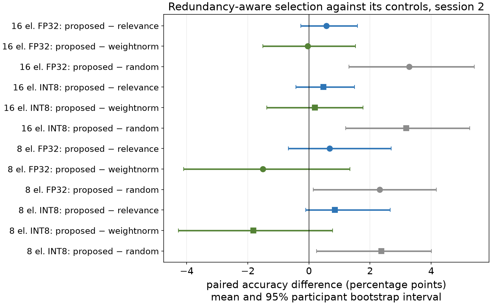
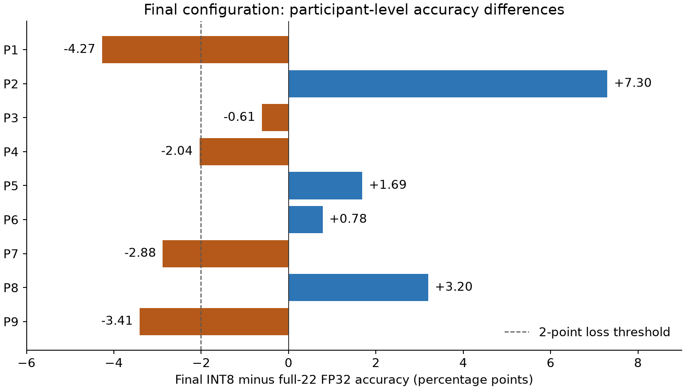
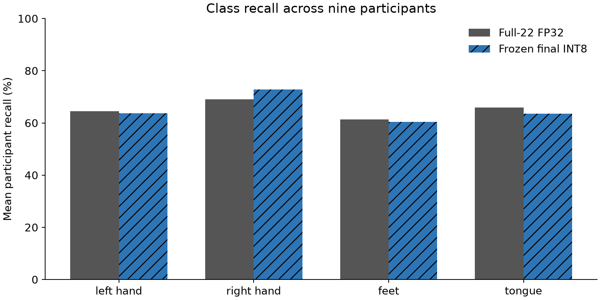
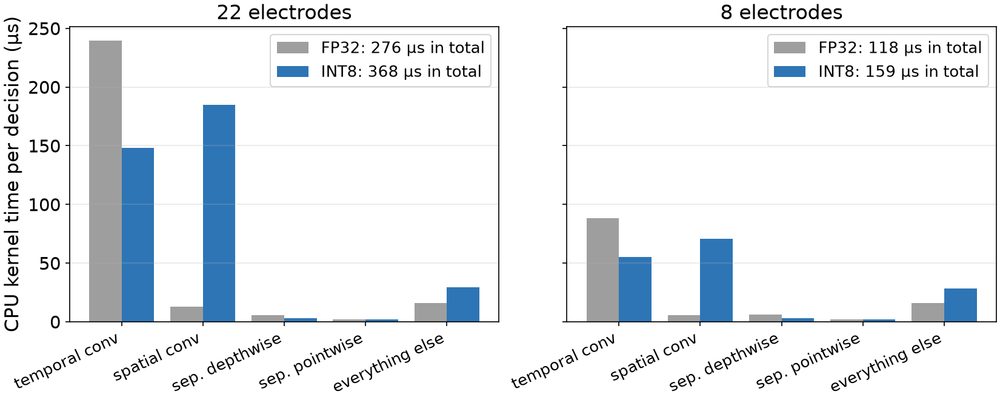
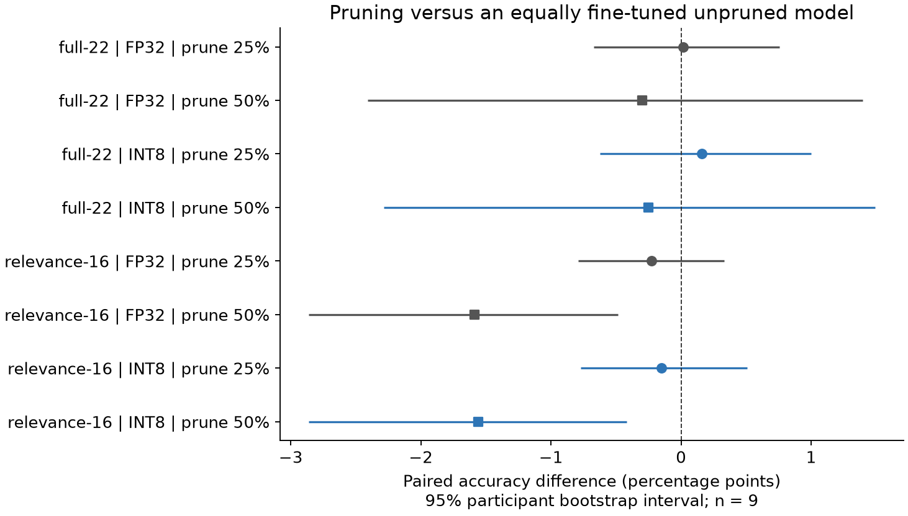

# Fewer EEG electrodes preserve average decoding accuracy, while INT8 does not improve M4 CPU latency

Peiye Li · COMP 690-193 · Fall 2026  
Local report assembled from retained experiment evidence; maintenance date: 2026-11-04.

## Executive summary

The frozen 16-electrode, 50%-pruned INT8 configuration reached **65.01%** held-out-session accuracy, compared with **65.04%** for the full 22-electrode FP32 baseline. The mean paired difference was **-0.03 percentage points**, with a 95% participant bootstrap interval of **[-2.16, +2.40]**. This is close average performance, not proof of equivalence: **4/9 participants lost more than two points**.

Redundancy-aware electrode selection did not show a clear advantage over relevance-only or spatial-weight selection. It outperformed the mean of three fixed random subsets, but most comparisons against the stronger controls had intervals crossing zero. The results support a controlled negative finding about this particular redundancy proxy, rather than a new superior selection algorithm.

Initializer bytes fell by approximately 4.0x, but the complete ONNX file shrank by only 7.1%. INT8 inference of the full model was about 28% slower than FP32 on the measured Apple M4 CPU. The large activation-memory ratio is an analytical tensor estimate; actual ONNX Runtime memory and MCU SRAM were not measured in the historical experiment.

The added **M5 matched-budget reproduction** found that 50% pruning of the relevance-16 INT8 model reduced mean accuracy by **1.56 percentage points** against an unpruned model given the same 100 extra epochs (95% exploratory interval **[-2.86, -0.42]**). Thus, similar performance to the original shorter-trained baseline does not imply pruning is accuracy-free. This supplementary analysis was added after test outcomes were known; it preserves the historical finalist.

## 1. Research question and relation to prior work

The question is whether EEG electrodes selected for both class relevance and low band-power redundancy preserve four-class motor-imagery information across recording days, and whether any advantage survives INT8 quantization. Electrode count describes physical measurements; pruning removes learned internal features. Their costs and information loss should be evaluated separately.

EEGNet uses depthwise and separable convolutions for compact EEG decoding [1]. Q-EEGNet studies an 8-bit, hardware-aware embedded EEGNet implementation [2]. MI-BMInet combines spatial-filter channel selection, quantization and embedded evaluation [3]. The present project is a controlled software comparison within one fixed EEGNet pipeline. The spatial-weight baseline is inspired by MI-BMInet; it is not a reproduction of that architecture or its deployment results.

## 2. Data and experimental protocol

BCI Competition IV 2a / BNCI 2014-001 contains nine participants, two recording sessions on different days, 22 EEG channels at 250 Hz and four classes: left hand, right hand, feet and tongue. Each session has 288 trials in six runs. EOG is excluded. The primary analysis removes expert-flagged artifacts, while the secondary analysis evaluates the same models on all trials. Counts and source-file SHA-256 values are retained in [data_summary.csv](../results/data_summary.csv).

Each run is processed with a causal fourth-order Butterworth 4–38 Hz band-pass, resetting state at run boundaries. Each trial supplies a two-second window from 0.5 to 2.5 seconds after the cue. Normalization uses training-partition channel means and standard deviations only.

Session 1 supplies training and three validation folds, each holding out two complete runs. Channel rankings, normalization and PTQ calibration are fitted only to the applicable training partition. Session 2 is the final test day. The source code requires an explicit final-evaluation flag to load it. The retained [frozen configuration](../results/frozen_config.json) fixes the training budget at 475 epochs and seeds at 0, 1 and 2. The stored validation-table hash can be checked; this consistency check is not independent proof of the original chronology.

The decoder is Braindecode 2.0.0 EEGNet with F1=8, D=2, F2=16, temporal kernel 64, dropout 0.5 and max-norm constraints. Adam uses learning rate 1e-3, batch size 64 and the same fixed epoch budget for the electrode-selection conditions. The 22-channel model has 2,420 trainable parameters.

For selection, Welch log power is calculated in 8–13 Hz and 13–30 Hz bands. Relevance is the average multiclass Fisher score, scaled to 0–1 across electrodes. Redundancy is the mean absolute Spearman correlation across bands. Greedy selection maximizes relevance minus 0.5 times mean redundancy to the already chosen electrodes. Controls use relevance alone, spatial-weight L2 norms and three fixed random subsets. Models are retrained with 16 or 8 electrodes. These feature correlations do not identify shared neural sources.

Static INT8 PTQ uses ONNX QDQ format, signed activations, per-channel weights and training-only min-max calibration. The original bounded pruning comparison drops 25% or 50% of final pointwise filters by L1 norm, slices BatchNorm and classifier tensors, and adds 100 fine-tuning epochs at 1e-4. The original unpruned baseline lacks those extra epochs, so pruning-versus-baseline accuracy differences confound removal and additional optimization.

The finalist was chosen using validation: fewest electrodes within two points of full-channel FP32 accuracy, then fewest parameter bytes, then highest accuracy. Test accuracy never changes this historical choice. Accuracy, macro-F1, per-class recall and confusion matrices are retained. Seeds are averaged within participant; participants, not seeds or trials, are the nine independent resampling units. Paired intervals use 10,000 percentile bootstrap resamples and seed 690. Intervals are exploratory and are not adjusted for all comparisons.

## 3. Held-out-session decoding results

| Condition | Precision | Accuracy (%) | Macro-F1 (%) | Difference vs baseline (pp) | 95% paired interval (pp) |
| --- | --- | --- | --- | --- | --- |
| full-22 | fp32 | 65.04 | 64.36 | +0.00 | [+0.00, +0.00] |
| full-22 | int8 | 65.30 | 64.64 | +0.26 | [+0.07, +0.47] |
| proposed-16 | fp32 | 66.78 | 66.09 | +1.74 | [-0.46, +4.06] |
| relevance-16 | fp32 | 66.21 | 65.47 | +1.17 | [-1.27, +3.75] |
| weightnorm-16 | fp32 | 66.82 | 66.29 | +1.78 | [-0.98, +4.63] |
| proposed-8 | fp32 | 60.59 | 59.71 | -4.45 | [-7.59, -1.05] |
| relevance-16-prune50 | int8 | 65.01 | 64.47 | -0.03 | [-2.16, +2.40] |

The full tables include all 17 conditions in both precisions: [primary](../results/analysis/conditions_primary.csv) and [secondary](../results/analysis/conditions_secondary.csv). These are within-participant transfers to another session, not tests on previously unseen people. Differences below are percentage points, not relative percentage changes.

### 3.1 Redundancy-aware selection against its controls

| Electrodes | Precision | Control | Proposed minus control (pp) | 95% paired interval (pp) |
| --- | --- | --- | --- | --- |
| 16 | fp32 | relevance | +0.58 | [-0.26, +1.58] |
| 16 | fp32 | weightnorm | -0.04 | [-1.50, +1.53] |
| 16 | fp32 | random | +3.28 | [+1.31, +5.41] |
| 16 | int8 | relevance | +0.47 | [-0.42, +1.50] |
| 16 | int8 | weightnorm | +0.20 | [-1.38, +1.77] |
| 16 | int8 | random | +3.18 | [+1.21, +5.26] |
| 8 | fp32 | relevance | +0.68 | [-0.67, +2.70] |
| 8 | fp32 | weightnorm | -1.51 | [-4.10, +1.34] |
| 8 | fp32 | random | +2.32 | [+0.15, +4.17] |
| 8 | int8 | relevance | +0.85 | [-0.10, +2.66] |
| 8 | int8 | weightnorm | -1.81 | [-4.27, +0.78] |
| 8 | int8 | random | +2.37 | [+0.25, +4.01] |

The redundancy term often leaves the selected set unchanged: in the final seed-0 rankings, proposed and relevance-only subsets are identical for 6/9 participants at 16 electrodes and 7/9 at 8. The small observed advantages against relevance-only cannot establish a reliable improvement, while spatial-weight ranking is competitive. Beating three random subsets supports task-aware selection in this setting; it does not establish superiority to stronger channel-selection algorithms or robustness over all possible random layouts.

### 3.2 Participant variation changes the interpretation of the mean

| Participant | Full-22 FP32 (%) | Frozen final INT8 (%) | Difference (pp) |
| --- | --- | --- | --- |
| 1 | 81.02 | 76.75 | -4.27 |
| 2 | 38.87 | 46.17 | +7.30 |
| 3 | 83.64 | 83.03 | -0.61 |
| 4 | 49.85 | 47.81 | -2.04 |
| 5 | 43.96 | 45.65 | +1.69 |
| 6 | 49.92 | 50.70 | +0.78 |
| 7 | 76.77 | 73.89 | -2.88 |
| 8 | 77.86 | 81.06 | +3.20 |
| 9 | 83.46 | 80.05 | -3.41 |

The losses are concentrated in participants P1, P4, P7, P9. A similar group mean can coexist with useful gains for some people and material losses for others. The exploratory interval does not establish a two-point noninferiority margin. Electrode lists are fitted separately per person, so this experiment does not validate a universal headset layout.

The observed path to the final model can also be decomposed arithmetically:

| Participant | 22 to 16 electrodes + retraining (pp) | Pruning + 100 extra epochs (pp) | INT8 conversion (pp) |
| --- | --- | --- | --- |
| 1 | -3.44 | -0.47 | -0.36 |
| 2 | +8.72 | -2.01 | +0.59 |
| 3 | +2.07 | -2.68 | +0.00 |
| 4 | -0.43 | -1.32 | -0.29 |
| 5 | +4.47 | -2.42 | -0.36 |
| 6 | +1.55 | -0.93 | +0.16 |
| 7 | -5.05 | +1.81 | +0.36 |
| 8 | +1.23 | +1.84 | +0.13 |
| 9 | +1.39 | -4.80 | +0.00 |

These columns sum to each participant's final difference up to displayed rounding. They are an accounting of observed conditions, not a causal decomposition: electrode models were retrained, and the original pruning step also adds optimization. The matched-budget experiment below addresses the latter confounding explicitly.

### 3.3 Class-specific outcomes

| Class | Baseline recall (%) | Final recall (%) | Difference (pp) |
| --- | --- | --- | --- |
| left hand | 64.43 | 63.64 | -0.80 |
| right hand | 68.99 | 72.86 | +3.87 |
| feet | 61.34 | 60.42 | -0.92 |
| tongue | 65.84 | 63.60 | -2.24 |

Class recall is averaged within participant rather than pooled across all trials. These descriptive differences help locate errors; they do not establish a causal neural mechanism or a statistically reliable class-specific effect. The retained [confusion matrices](../results/analysis/fig_confusion.png) show the complementary pooled error pattern.

## 4. Efficiency: storage, modeled tensors and measured time

| Quantity | Full-22 FP32 | Frozen final INT8 | Interpretation |
| --- | --- | --- | --- |
| Initializer/parameter bytes | 9576 | 2420 | 3.96x ratio; includes initializers such as scales |
| Serialized ONNX bytes | 28022 | 26029 | 7.11% file reduction |
| Modeled peak activation bytes | 396704 | 72144 | 5.50x ratio under uniform-precision tensor assumptions |
| Actual ONNX float32 input bytes | 44000 | 32000 | Both graph interfaces accept float32; quantization is internal |
| Median CPU latency (ms) | 0.2799 | 0.2571 | Historical batch-1, one-thread measurement |
| MACs | 5885088 | 4281312 | Analytical convolution/dense multiply-accumulate count |

The historical measurement used the author's Apple M4 **Mac mini**, ONNX Runtime 1.31.1, batch size one and one inference thread, with 100 warm-up calls and 1,000 timed calls. The original hardware record does not establish the RAM capacity; the machine type is corrected from the author's clarification. Preprocessing is timed separately. These are local CPU measurements, not end-to-end remote-serving latency.

The finalist is about 8% faster than full-22 FP32, but about 25% slower than the unpruned relevance-16 FP32 model (0.257 versus 0.206 ms). Its small speed advantage over the full-channel baseline comes from a smaller input, not evidence that INT8 accelerated this decoder. The validation decision rule prioritizes electrode count and initializer bytes under an accuracy tolerance; it does not select the lowest-latency configuration.

Initializer bytes include weights, biases and quantization metadata. The serialized file also contains the graph and other metadata, explaining why a nearly fourfold initializer reduction produces only a small complete-file reduction.

Activation bytes are estimated under a layer-input-plus-output schedule with uniform four-byte FP32 or one-byte INT8 tensors. The real QDQ graph includes float operations and conversion buffers; both input interfaces receive float32 arrays. The historical `input_bytes` field for INT8 describes the modeled quantized tensor, not the actual interface buffer. New benchmark code records those separately. The estimate excludes live mixed-precision tensors, allocator behavior, runtime overhead and kernel workspaces. It is neither a measured runtime peak nor verified MCU SRAM usage.

The isolated-process tool `scripts/benchmark_memory.py` can measure process RSS separately. Its lifetime peak includes Python, ORT, graph initialization and input arrays; even that measurement must not be labeled tensor memory or MCU SRAM.

The profiler attributes the INT8 slowdown mainly to the grouped spatial convolution: about 185 microseconds versus 12.8 microseconds in FP32. This observation identifies an expensive quantized operator on this runtime; it does not prove an integer kernel is missing. The optimized graph in fact contains QLinearConv operators. Reduced electrode count lowers the expensive early temporal-convolution work, while pruning only the late pointwise filters changes MACs very little. This explains why parameter count alone predicts latency poorly here. ONNX Runtime documents the dependence of quantization performance on hardware, model structure and conversion overhead [4].

The decoder needs a two-second observation window and makes its primary decision 2.5 seconds after the cue plus processing time. Sub-millisecond compute does not imply sub-millisecond intention-to-action latency.

### 4.1 Additional isolated-process measurements on the M5 reproduction

| Model | Precision | Baseline RSS (MiB) | After session (MiB) | After inference (MiB) | Lifetime peak (MiB) |
| --- | --- | --- | --- | --- | --- |
| Full-22 | fp32 | 48.25 | 55.27 | 57.38 | 57.38 |
| Full-22 | int8 | 48.30 | 55.84 | 58.69 | 58.69 |
| 16 electrodes, 50% pruned | fp32 | 48.31 | 55.31 | 56.97 | 56.97 |
| 16 electrodes, 50% pruned | int8 | 48.28 | 55.75 | 57.91 | 57.91 |

Each row is one fresh process without PyTorch, using 100 warm-up and 1,000 inference calls. These are M5 measurements of independently reproduced models, not replacements for the historical M4 timing. Process RSS includes interpreter, runtime, graph setup, input arrays and allocator overhead; its lifetime high-water mark is not incremental tensor memory or MCU SRAM. No uncertainty interval or pure activation-memory compression ratio is inferred from these process measurements.

## 5. Supplementary matched-budget pruning comparison

The additional experiment has been executed as **independent reproduction**, after the original test results were known. Both historical pruning bases and all nine participants/three seeds were retained; no finalist was reselected. Every base was branched into 0%, 25% and 50% pruning, all with the same 100-epoch, 1e-4 Adam fine-tuning budget.

| Base | Precision | Branch A | Branch B | A minus B (pp) | 95% paired interval (pp) |
| --- | --- | --- | --- | --- | --- |
| full-22 | fp32 | 0 | base | +0.40 | [-0.63, +1.67] |
| full-22 | fp32 | 25 | 0 | +0.01 | [-0.67, +0.76] |
| full-22 | fp32 | 50 | 0 | -0.30 | [-2.41, +1.39] |
| full-22 | fp32 | 25 | base | +0.42 | [-0.87, +1.98] |
| full-22 | fp32 | 50 | base | +0.10 | [-2.44, +2.48] |
| full-22 | int8 | 0 | base | +0.29 | [-0.56, +1.26] |
| full-22 | int8 | 25 | 0 | +0.16 | [-0.62, +1.00] |
| full-22 | int8 | 50 | 0 | -0.25 | [-2.28, +1.49] |
| full-22 | int8 | 25 | base | +0.45 | [-0.68, +1.97] |
| full-22 | int8 | 50 | base | +0.04 | [-2.18, +2.17] |
| relevance-16 | fp32 | 0 | base | +0.25 | [-0.36, +0.87] |
| relevance-16 | fp32 | 25 | 0 | -0.23 | [-0.79, +0.33] |
| relevance-16 | fp32 | 50 | 0 | -1.59 | [-2.86, -0.49] |
| relevance-16 | fp32 | 25 | base | +0.03 | [-0.80, +0.88] |
| relevance-16 | fp32 | 50 | base | -1.33 | [-2.65, +0.00] |
| relevance-16 | int8 | 0 | base | +0.43 | [-0.20, +1.14] |
| relevance-16 | int8 | 25 | 0 | -0.15 | [-0.77, +0.51] |
| relevance-16 | int8 | 50 | 0 | -1.56 | [-2.86, -0.42] |
| relevance-16 | int8 | 25 | base | +0.28 | [-0.52, +1.21] |
| relevance-16 | int8 | 50 | base | -1.13 | [-2.59, +0.32] |

Here `base` is the 475-epoch model with the recorded origin; `0` is unpruned plus 100 more epochs; `25` and `50` are equally fine-tuned pruned branches. The `0 - base` contrast estimates the extra-training effect. The `25/50 - 0` contrasts compare structural pruning at equal fine-tuning budgets. Intervals are exploratory participant-level bootstrap intervals. See the [supplementary protocol](../results/supplementary/matched_budget/protocol.json) and [all paired comparisons](../results/supplementary/matched_budget/paired_comparisons.csv).

For relevance-16 INT8, the 50%-pruned branch differed from the equally fine-tuned unpruned branch by -1.56 points, with a 95% interval [-2.86, -0.42]. This isolates the structural comparison within the recorded fine-tuning procedure more closely than the original baseline contrast. It remains a post-test, nine-participant reproduction on different hardware and does not replace the original study.

Across 324 model/precision pairs comparable with a historical condition, mean full-trial prediction agreement was 99.40% (range 96.18–100.00%). Agreement is a reproduction diagnostic, not proof of identical weights; mismatching runs remain included.

## 6. Demonstration and claim boundaries

The [recorded replay](../results/demo/replay_participant3.mp4) streams prerecorded EEG at 250 Hz through causal preprocessing and displays predictions, cursor movement and compute time. The recorded participant cannot respond to the feedback. This validates a replay implementation, not online closed-loop control, asynchronous intent detection, power consumption or clinical utility.

Nine participants and one dataset limit uncertainty and generalization. Removing artifacts is an expert-assisted offline primary analysis; the all-trials secondary analysis is retained to expose that dependency. There is no MCU latency, SRAM or energy measurement, and no claim about implants or new users. A negative result for one fixed band-power redundancy penalty does not rule out other redundancy measures. The original pruning accuracy comparison needs the matched-budget control above.

## 7. Reproducibility and delivery

The repository retains fixed splits, channel lists, seeds, source hashes, configuration, predictions and measurement scripts. See [reproduction instructions](REPRODUCIBILITY.md), [work log](WORK_LOG.md), [supplementary protocol](SUPPLEMENTARY_PROTOCOL.md) and the [machine-readable audit](../results/maintenance/audit.json). The local [slide deck](../presentation/index.html) replaces private blob references with packaged project assets.

Original missing weights must be restored or independently reproduced in separate paths. New artifact checks refuse to silently retrain over historical records when model files are missing. Matching predictions from a reproduction do not prove identical original weights. Cross-backend bitwise equality is not promised; preserve the recorded software and per-participant device allocation [5].

## References and evidence

1. Lawhern et al. EEGNet: a compact convolutional neural network for EEG-based brain-computer interfaces. J. Neural Eng. 15, 056013 (2018). [Author paper](https://arxiv.org/abs/1611.08024), DOI 10.1088/1741-2552/aace8c.
2. Schneider et al. Q-EEGNet: an Energy-Efficient 8-bit Quantized Parallel EEGNet Implementation for Edge Motor-Imagery Brain–Machine Interfaces (2020). [Author paper](https://arxiv.org/abs/2004.11690).
3. Wang et al. MI-BMInet: An Efficient Convolutional Neural Network for Motor Imagery Brain–Machine Interfaces with EEG Channel Selection. [Author paper](https://arxiv.org/abs/2203.14592).
4. ONNX Runtime. [Quantize ONNX models](https://onnxruntime.ai/docs/performance/model-optimizations/quantization.html), including mixed graph representation and performance limitations.
5. PyTorch. [Reproducibility](https://docs.pytorch.org/docs/stable/notes/randomness.html).

Numerical claims are derived from the linked local CSV/JSON evidence and the reproducible generator `scripts/build_report.py`. The audit verifies internal consistency, not independent provenance of the original training run. The full original result tables and figures remain available under `results/analysis/`; no historical result was replaced by this report.
