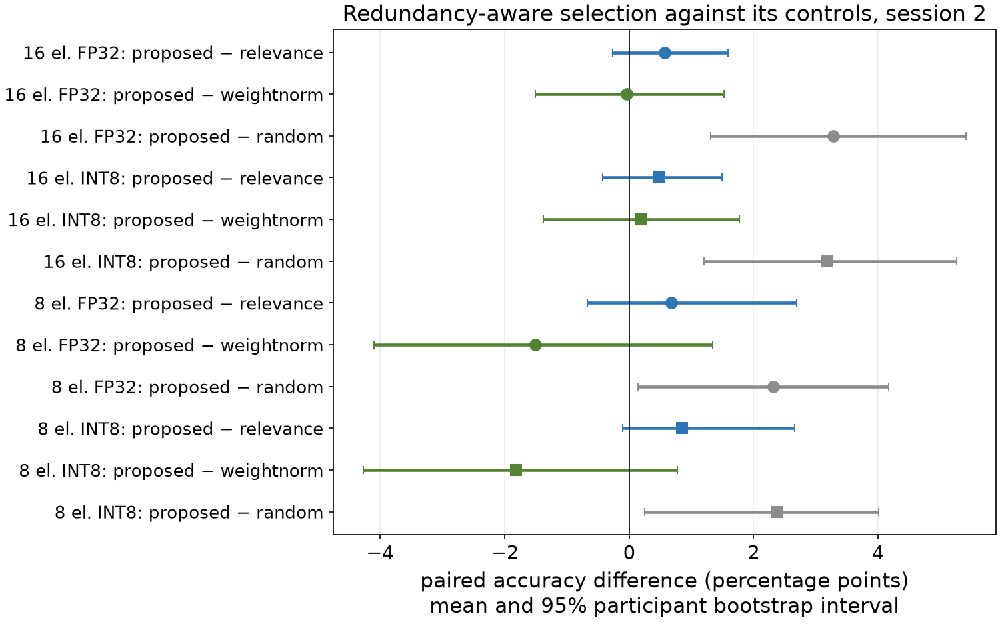
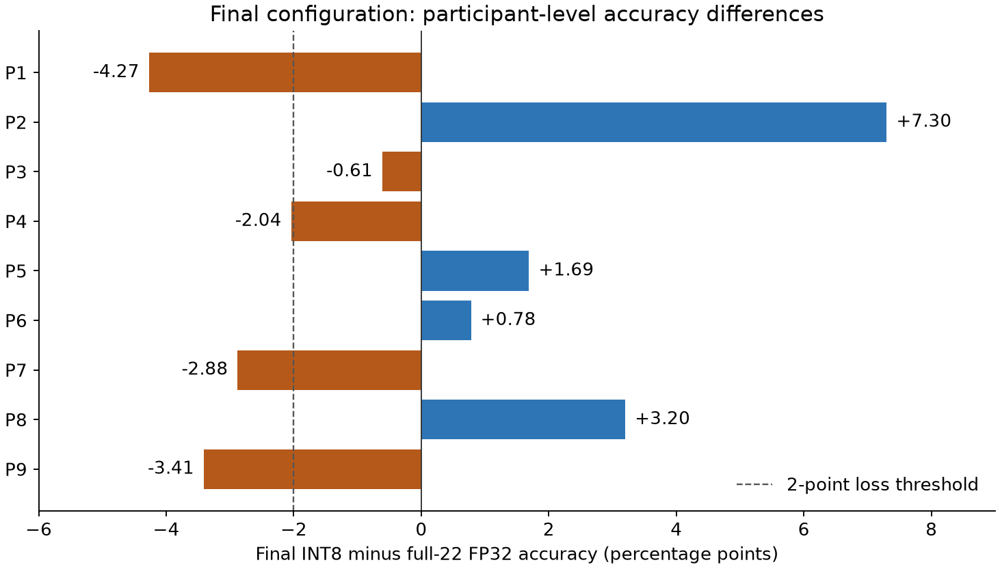
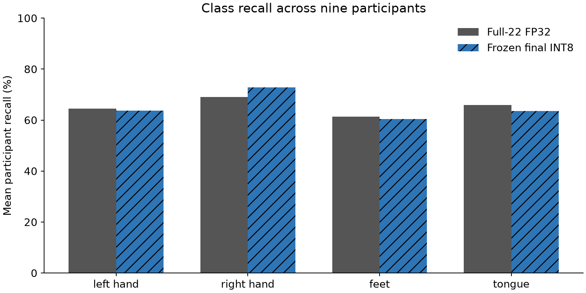
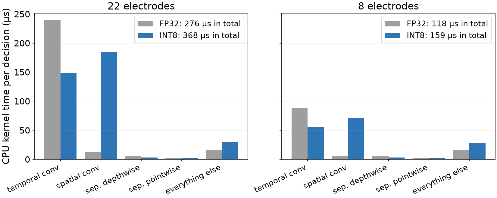
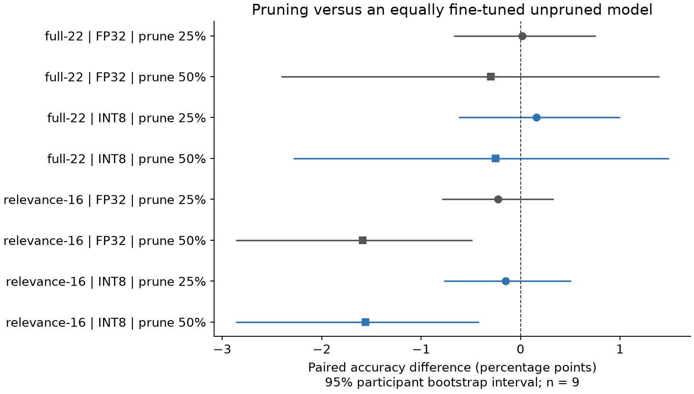
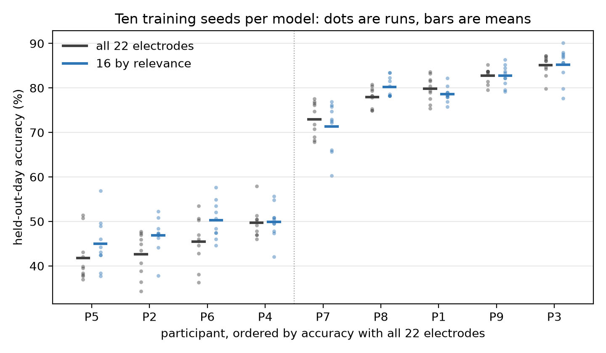
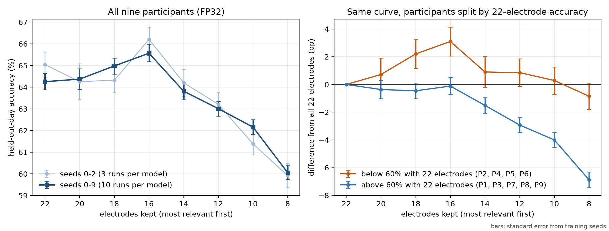
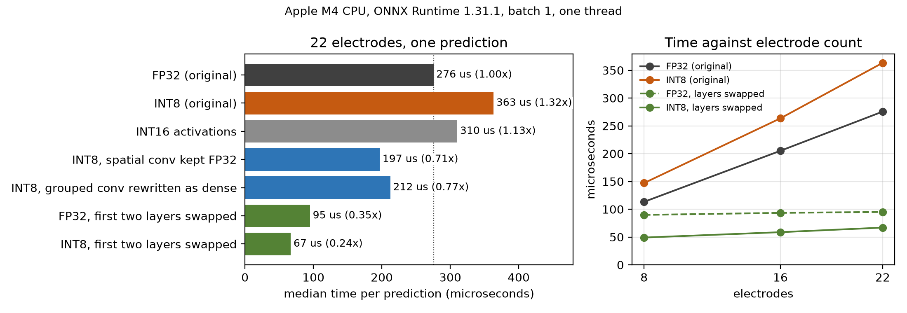

# Fewer EEG electrodes preserve average decoding accuracy; exported INT8 is slower on the M4 until two layers are swapped

Peiye Li · COMP 690-193 · Fall 2026  
Local report assembled from retained experiment evidence; maintenance date: 2026-11-12.

## Executive summary

The frozen 16-electrode, 50%-pruned INT8 configuration reached **65.01%** held-out-session accuracy, compared with **65.04%** for the full 22-electrode FP32 baseline. The mean paired difference was **-0.03 percentage points**, with a 95% participant bootstrap interval of **[-2.16, +2.40]**. This is close average performance, not proof of equivalence: **4/9 participants lost more than two points**.

Redundancy-aware electrode selection did not show a clear advantage over relevance-only or spatial-weight selection. It outperformed the mean of three fixed random subsets, but most comparisons against the stronger controls had intervals crossing zero. The results support a controlled negative finding about this particular redundancy proxy, rather than a new superior selection algorithm.

Initializer bytes fell by approximately 4.0x, but the complete ONNX file shrank by only 7.1%. INT8 inference of the full model was about 28% slower than FP32 on the measured Apple M4 CPU. The large activation-memory ratio is an analytical tensor estimate; actual ONNX Runtime memory and MCU SRAM were not measured in the historical experiment.

The added **M5 matched-budget reproduction** found that 50% pruning of the relevance-16 INT8 model reduced mean accuracy by **1.56 percentage points** against an unpruned model given the same 100 extra epochs (95% exploratory interval **[-2.86, -0.42]**). Thus, similar performance to the original shorter-trained baseline does not imply pruning is accuracy-free. This supplementary analysis was added after test outcomes were known; it preserves the historical finalist.

**Added after the midterm review (post-test, exploratory).** With ten training seeds per model, 16 relevance-selected electrodes score **+1.31 points** against all 22 (95% participant interval [-0.11, +2.80]). Seven new seeds reproduce the archived difference (+1.38 against +1.17), so it is not seed luck, but it comes from the four participants who score below 60% with 22 electrodes (+3.1 ± 1.0 points; the other five: -0.1 ± 0.6). The INT8 slowdown comes from ONNX Runtime's kernel for the grouped spatial convolution, not from the M4: swapping EEGNet's first two layers, an exact rewrite that needs no retraining, runs in **0.095 ms** in FP32 and **0.067 ms** in INT8 against 0.276 ms for the exported FP32 graph, with accuracy unchanged (-0.06 points over all conditions). Sixteen-bit quantization was slower than FP32 (1.13x). INT8 loses 0.1 points against floating point and INT16 adds nothing; widths chosen per tensor from training-day data keep accuracy within 0.5 points with 41% fewer weight bytes than INT8 (simulated). The same INT8 files lose accuracy on x86 processors without VNNI (-4.0 points); 7-bit weights make the results identical on every processor tested. Exact Shapley values over all 511 region sets recover the motor map from the data: each hand is decoded mainly from the opposite hemisphere and the feet from the midline, while frontal regions add least. Choosing electrodes jointly keeps 8 electrodes at 64.3% (Riemannian rule), +4.4 points above the frozen rule and -0.7 from all 22 (exploratory). On 54 new people (Lee et al. 2019), with hypotheses fixed before scoring: fewer electrodes did not hurt on average, INT8 and the BCI IV 2a precision map lost almost nothing, and Riemannian selection beat the frozen rule at 8, 16 and 20 electrodes (+3.7 points at 8); the 'worst decoders gain most' pattern and day-to-day alignment did not replicate. These additions explain the frozen results; they do not change the frozen configuration.

## 1. Research question and relation to prior work

The question is whether EEG electrodes selected for both class relevance and low band-power redundancy preserve four-class motor-imagery information across recording days, and whether any advantage survives INT8 quantization. Electrode count describes physical measurements; pruning removes learned internal features. Their costs and information loss should be evaluated separately.

EEGNet uses depthwise and separable convolutions for compact EEG decoding [1]. Q-EEGNet studies an 8-bit, hardware-aware embedded EEGNet implementation [2]. MI-BMInet combines spatial-filter channel selection, quantization and embedded evaluation [3]. The present project is a controlled software comparison within one fixed EEGNet pipeline. The spatial-weight baseline is inspired by MI-BMInet; it is not a reproduction of that architecture or its deployment results.

## 2. Data and experimental protocol

BCI Competition IV 2a / BNCI 2014-001 contains nine participants, two recording sessions on different days, 22 EEG channels at 250 Hz and four classes: left hand, right hand, feet and tongue. Each session has 288 trials in six runs. EOG is excluded. The primary analysis removes expert-flagged artifacts, while the secondary analysis evaluates the same models on all trials. Counts and source-file SHA-256 values are retained in [data_summary.csv](../results/data_summary.csv).

Each run is processed with a causal fourth-order Butterworth 4–38 Hz band-pass, resetting state at run boundaries. Each trial supplies a two-second window from 0.5 to 2.5 seconds after the cue. Normalization uses training-partition channel means and standard deviations only.

Session 1 supplies training and three validation folds, each holding out two complete runs. Channel rankings, normalization and PTQ calibration are fitted only to the applicable training partition. Session 2 is the final test day. The source code requires an explicit final-evaluation flag to load it. The retained [frozen configuration](../results/frozen_config.json) fixes the training budget at 475 epochs and seeds at 0, 1 and 2. The stored validation-table hash can be checked; this consistency check is not independent proof of the original chronology.

The decoder is Braindecode 2.0.0 EEGNet with F1=8, D=2, F2=16, temporal kernel 64, dropout 0.5 and max-norm constraints. Adam uses learning rate 1e-3, batch size 64 and the same fixed epoch budget for the electrode-selection conditions. The 22-channel model has 2,420 trainable parameters.

For selection, Welch log power is calculated in 8–13 Hz and 13–30 Hz bands. Relevance is the average multiclass Fisher score, scaled to 0–1 across electrodes. Redundancy is the mean absolute Spearman correlation across bands. Greedy selection maximizes relevance minus 0.5 times mean redundancy to the already chosen electrodes. Controls use relevance alone, spatial-weight L2 norms and three fixed random subsets. Models are retrained with 16 or 8 electrodes. These feature correlations do not identify shared neural sources.

Static INT8 PTQ uses ONNX QDQ format, signed activations, per-channel weights and training-only min-max calibration. The original bounded pruning comparison drops 25% or 50% of final pointwise filters by L1 norm, slices BatchNorm and classifier tensors, and adds 100 fine-tuning epochs at 1e-4. The original unpruned baseline lacks those extra epochs, so pruning-versus-baseline accuracy differences confound removal and additional optimization.

The finalist was chosen using validation: fewest electrodes within two points of full-channel FP32 accuracy, then fewest parameter bytes, then highest accuracy. Test accuracy never changes this historical choice. Accuracy, macro-F1, per-class recall and confusion matrices are retained. Seeds are averaged within participant; participants, not seeds or trials, are the nine independent resampling units. Paired intervals use 10,000 percentile bootstrap resamples and seed 690. Intervals are exploratory and are not adjusted for all comparisons.

## 3. Held-out-session decoding results

| Condition | Precision | Accuracy (%) | Macro-F1 (%) | Difference vs baseline (pp) | 95% paired interval (pp) |
| --- | --- | --- | --- | --- | --- |
| full-22 | fp32 | 65.04 | 64.36 | +0.00 | [+0.00, +0.00] |
| full-22 | int8 | 65.30 | 64.64 | +0.26 | [+0.07, +0.47] |
| proposed-16 | fp32 | 66.78 | 66.09 | +1.74 | [-0.46, +4.06] |
| relevance-16 | fp32 | 66.21 | 65.47 | +1.17 | [-1.27, +3.75] |
| weightnorm-16 | fp32 | 66.82 | 66.29 | +1.78 | [-0.98, +4.63] |
| proposed-8 | fp32 | 60.59 | 59.71 | -4.45 | [-7.59, -1.05] |
| relevance-16-prune50 | int8 | 65.01 | 64.47 | -0.03 | [-2.16, +2.40] |

The full tables include all 17 conditions in both precisions: [primary](../results/analysis/conditions_primary.csv) and [secondary](../results/analysis/conditions_secondary.csv). These are within-participant transfers to another session, not tests on previously unseen people. Differences below are percentage points, not relative percentage changes.

### 3.1 Redundancy-aware selection against its controls

| Electrodes | Precision | Control | Proposed minus control (pp) | 95% paired interval (pp) |
| --- | --- | --- | --- | --- |
| 16 | fp32 | relevance | +0.58 | [-0.26, +1.58] |
| 16 | fp32 | weightnorm | -0.04 | [-1.50, +1.53] |
| 16 | fp32 | random | +3.28 | [+1.31, +5.41] |
| 16 | int8 | relevance | +0.47 | [-0.42, +1.50] |
| 16 | int8 | weightnorm | +0.20 | [-1.38, +1.77] |
| 16 | int8 | random | +3.18 | [+1.21, +5.26] |
| 8 | fp32 | relevance | +0.68 | [-0.67, +2.70] |
| 8 | fp32 | weightnorm | -1.51 | [-4.10, +1.34] |
| 8 | fp32 | random | +2.32 | [+0.15, +4.17] |
| 8 | int8 | relevance | +0.85 | [-0.10, +2.66] |
| 8 | int8 | weightnorm | -1.81 | [-4.27, +0.78] |
| 8 | int8 | random | +2.37 | [+0.25, +4.01] |

The redundancy term often leaves the selected set unchanged: in the final seed-0 rankings, proposed and relevance-only subsets are identical for 6/9 participants at 16 electrodes and 7/9 at 8. The small observed advantages against relevance-only cannot establish a reliable improvement, while spatial-weight ranking is competitive. Beating three random subsets supports task-aware selection in this setting; it does not establish superiority to stronger channel-selection algorithms or robustness over all possible random layouts.

### 3.2 Participant variation changes the interpretation of the mean

| Participant | Full-22 FP32 (%) | Frozen final INT8 (%) | Difference (pp) |
| --- | --- | --- | --- |
| 1 | 81.02 | 76.75 | -4.27 |
| 2 | 38.87 | 46.17 | +7.30 |
| 3 | 83.64 | 83.03 | -0.61 |
| 4 | 49.85 | 47.81 | -2.04 |
| 5 | 43.96 | 45.65 | +1.69 |
| 6 | 49.92 | 50.70 | +0.78 |
| 7 | 76.77 | 73.89 | -2.88 |
| 8 | 77.86 | 81.06 | +3.20 |
| 9 | 83.46 | 80.05 | -3.41 |

The losses are concentrated in participants P1, P4, P7, P9. A similar group mean can coexist with useful gains for some people and material losses for others. The exploratory interval does not establish a two-point noninferiority margin. Electrode lists are fitted separately per person, so this experiment does not validate a universal headset layout.

The observed path to the final model can also be decomposed arithmetically:

| Participant | 22 to 16 electrodes + retraining (pp) | Pruning + 100 extra epochs (pp) | INT8 conversion (pp) |
| --- | --- | --- | --- |
| 1 | -3.44 | -0.47 | -0.36 |
| 2 | +8.72 | -2.01 | +0.59 |
| 3 | +2.07 | -2.68 | +0.00 |
| 4 | -0.43 | -1.32 | -0.29 |
| 5 | +4.47 | -2.42 | -0.36 |
| 6 | +1.55 | -0.93 | +0.16 |
| 7 | -5.05 | +1.81 | +0.36 |
| 8 | +1.23 | +1.84 | +0.13 |
| 9 | +1.39 | -4.80 | +0.00 |

These columns sum to each participant's final difference up to displayed rounding. They are an accounting of observed conditions, not a causal decomposition: electrode models were retrained, and the original pruning step also adds optimization. The matched-budget experiment below addresses the latter confounding explicitly.

### 3.3 Class-specific outcomes

| Class | Baseline recall (%) | Final recall (%) | Difference (pp) |
| --- | --- | --- | --- |
| left hand | 64.43 | 63.64 | -0.80 |
| right hand | 68.99 | 72.86 | +3.87 |
| feet | 61.34 | 60.42 | -0.92 |
| tongue | 65.84 | 63.60 | -2.24 |

Class recall is averaged within participant rather than pooled across all trials. These descriptive differences help locate errors; they do not establish a causal neural mechanism or a statistically reliable class-specific effect. The retained [confusion matrices](../results/analysis/fig_confusion.png) show the complementary pooled error pattern.

## 4. Efficiency: storage, modeled tensors and measured time

| Quantity | Full-22 FP32 | Frozen final INT8 | Interpretation |
| --- | --- | --- | --- |
| Initializer/parameter bytes | 9576 | 2420 | 3.96x ratio; includes initializers such as scales |
| Serialized ONNX bytes | 28022 | 26029 | 7.11% file reduction |
| Modeled peak activation bytes | 396704 | 72144 | 5.50x ratio under uniform-precision tensor assumptions |
| Actual ONNX float32 input bytes | 44000 | 32000 | Both graph interfaces accept float32; quantization is internal |
| Median CPU latency (ms) | 0.2799 | 0.2571 | Historical batch-1, one-thread measurement |
| MACs | 5885088 | 4281312 | Analytical convolution/dense multiply-accumulate count |

The historical measurement used the author's Apple M4 **Mac mini**, ONNX Runtime 1.31.1, batch size one and one inference thread, with 100 warm-up calls and 1,000 timed calls. The original hardware record does not establish the RAM capacity; the machine type is corrected from the author's clarification. Preprocessing is timed separately. These are local CPU measurements, not end-to-end remote-serving latency.

The finalist is about 8% faster than full-22 FP32, but about 25% slower than the unpruned relevance-16 FP32 model (0.257 versus 0.206 ms). Its small speed advantage over the full-channel baseline comes from a smaller input, not evidence that INT8 accelerated this decoder. The validation decision rule prioritizes electrode count and initializer bytes under an accuracy tolerance; it does not select the lowest-latency configuration.

Initializer bytes include weights, biases and quantization metadata. The serialized file also contains the graph and other metadata, explaining why a nearly fourfold initializer reduction produces only a small complete-file reduction.

Activation bytes are estimated under a layer-input-plus-output schedule with uniform four-byte FP32 or one-byte INT8 tensors. The real QDQ graph includes float operations and conversion buffers; both input interfaces receive float32 arrays. The historical `input_bytes` field for INT8 describes the modeled quantized tensor, not the actual interface buffer. New benchmark code records those separately. The estimate excludes live mixed-precision tensors, allocator behavior, runtime overhead and kernel workspaces. It is neither a measured runtime peak nor verified MCU SRAM usage.

The isolated-process tool `scripts/benchmark_memory.py` can measure process RSS separately. Its lifetime peak includes Python, ORT, graph initialization and input arrays; even that measurement must not be labeled tensor memory or MCU SRAM.

The profiler attributes the INT8 slowdown mainly to the grouped spatial convolution: about 185 microseconds versus 12.8 microseconds in FP32. This observation identifies an expensive quantized operator on this runtime; it does not prove an integer kernel is missing. The optimized graph in fact contains QLinearConv operators. Reduced electrode count lowers the expensive early temporal-convolution work, while pruning only the late pointwise filters changes MACs very little. This explains why parameter count alone predicts latency poorly here. ONNX Runtime documents the dependence of quantization performance on hardware, model structure and conversion overhead [4]. Section 6.4 follows this observation up after the midterm review: it traces the cost to the runtime's generic path for grouped convolutions and measures variants that avoid it. It also shows that the link between electrode count and computation described here holds only for the exported layer order.

The decoder needs a two-second observation window and makes its primary decision 2.5 seconds after the cue plus processing time. Sub-millisecond compute does not imply sub-millisecond intention-to-action latency.

### 4.1 Additional isolated-process measurements on the M5 reproduction

| Model | Precision | Baseline RSS (MiB) | After session (MiB) | After inference (MiB) | Lifetime peak (MiB) |
| --- | --- | --- | --- | --- | --- |
| Full-22 | fp32 | 48.25 | 55.27 | 57.38 | 57.38 |
| Full-22 | int8 | 48.30 | 55.84 | 58.69 | 58.69 |
| 16 electrodes, 50% pruned | fp32 | 48.31 | 55.31 | 56.97 | 56.97 |
| 16 electrodes, 50% pruned | int8 | 48.28 | 55.75 | 57.91 | 57.91 |

Each row is one fresh process without PyTorch, using 100 warm-up and 1,000 inference calls. These are M5 measurements of independently reproduced models, not replacements for the historical M4 timing. Process RSS includes interpreter, runtime, graph setup, input arrays and allocator overhead; its lifetime high-water mark is not incremental tensor memory or MCU SRAM. No uncertainty interval or pure activation-memory compression ratio is inferred from these process measurements.

## 5. Supplementary matched-budget pruning comparison

The additional experiment has been executed as **independent reproduction**, after the original test results were known. Both historical pruning bases and all nine participants/three seeds were retained; no finalist was reselected. Every base was branched into 0%, 25% and 50% pruning, all with the same 100-epoch, 1e-4 Adam fine-tuning budget.

| Base | Precision | Branch A | Branch B | A minus B (pp) | 95% paired interval (pp) |
| --- | --- | --- | --- | --- | --- |
| full-22 | fp32 | 0 | base | +0.40 | [-0.63, +1.67] |
| full-22 | fp32 | 25 | 0 | +0.01 | [-0.67, +0.76] |
| full-22 | fp32 | 50 | 0 | -0.30 | [-2.41, +1.39] |
| full-22 | fp32 | 25 | base | +0.42 | [-0.87, +1.98] |
| full-22 | fp32 | 50 | base | +0.10 | [-2.44, +2.48] |
| full-22 | int8 | 0 | base | +0.29 | [-0.56, +1.26] |
| full-22 | int8 | 25 | 0 | +0.16 | [-0.62, +1.00] |
| full-22 | int8 | 50 | 0 | -0.25 | [-2.28, +1.49] |
| full-22 | int8 | 25 | base | +0.45 | [-0.68, +1.97] |
| full-22 | int8 | 50 | base | +0.04 | [-2.18, +2.17] |
| relevance-16 | fp32 | 0 | base | +0.25 | [-0.36, +0.87] |
| relevance-16 | fp32 | 25 | 0 | -0.23 | [-0.79, +0.33] |
| relevance-16 | fp32 | 50 | 0 | -1.59 | [-2.86, -0.49] |
| relevance-16 | fp32 | 25 | base | +0.03 | [-0.80, +0.88] |
| relevance-16 | fp32 | 50 | base | -1.33 | [-2.65, +0.00] |
| relevance-16 | int8 | 0 | base | +0.43 | [-0.20, +1.14] |
| relevance-16 | int8 | 25 | 0 | -0.15 | [-0.77, +0.51] |
| relevance-16 | int8 | 50 | 0 | -1.56 | [-2.86, -0.42] |
| relevance-16 | int8 | 25 | base | +0.28 | [-0.52, +1.21] |
| relevance-16 | int8 | 50 | base | -1.13 | [-2.59, +0.32] |

Here `base` is the 475-epoch model with the recorded origin; `0` is unpruned plus 100 more epochs; `25` and `50` are equally fine-tuned pruned branches. The `0 - base` contrast estimates the extra-training effect. The `25/50 - 0` contrasts compare structural pruning at equal fine-tuning budgets. Intervals are exploratory participant-level bootstrap intervals. See the [supplementary protocol](../results/supplementary/matched_budget/protocol.json) and [all paired comparisons](../results/supplementary/matched_budget/paired_comparisons.csv).

For relevance-16 INT8, the 50%-pruned branch differed from the equally fine-tuned unpruned branch by -1.56 points, with a 95% interval [-2.86, -0.42]. This isolates the structural comparison within the recorded fine-tuning procedure more closely than the original baseline contrast. It remains a post-test, nine-participant reproduction on different hardware and does not replace the original study.

Across 324 model/precision pairs comparable with a historical condition, mean full-trial prediction agreement was 99.40% (range 96.18–100.00%). Agreement is a reproduction diagnostic, not proof of identical weights; mismatching runs remain included.

## 6. Studies added after the midterm review

All analyses in this section were added after the midterm review of 9 November 2026, when the session-2 results were already known. They are exploratory, live under `results/supplementary/`, and leave the frozen configuration and every historical record unchanged.

### 6.1 How electrodes are chosen, and what the rule removes

Selection is neither random nor based on an anatomical atlas. For each participant, electrodes are ranked from that participant's training-day band power by the rule in Section 2, and the network is retrained on the kept electrodes. The frozen configuration uses the relevance-only variant: the 16 electrodes with the highest Fisher score. Random subsets exist only as a control. Although the rule receives no anatomical information, its choices are anatomically structured. Across participants, 33 of the 54 removed electrode slots at 16 electrodes fall on Fz and the fronto-central row, which hold 6 of the 22 electrodes.

| Scalp row | Electrodes | Times removed at 16 | Share of all removals |
| --- | --- | --- | --- |
| frontal (Fz) | 1 | 7/9 | 13% |
| fronto-central (FC) | 5 | 26/45 | 48% |
| central (C) | 7 | 10/63 | 19% |
| centro-parietal (CP) | 5 | 4/45 | 7% |
| parietal (P) | 3 | 3/27 | 6% |
| parieto-occipital (POz) | 1 | 4/9 | 7% |

Kept for all nine participants: CP3, P1, P2. The removed electrodes carry less class information on both days: their mean Fisher score is 0.063 against 0.135 for kept electrodes on the training day, and 0.096 against 0.187 on the held-out day. Six electrodes are 27% of the montage but hold 14% of the summed Fisher score on the training day and 18% on the held-out day. Their day-to-day change in band power is no larger than that of kept electrodes (0.40 against 0.40 within-day standard deviations), so removing unstable electrodes is not the explanation for the result below. The held-out-day figures are a post-test description and fed no selection.

### 6.2 Sixteen against 22 electrodes: is the difference real, and where does it come from?

In the frozen analysis, 16 selected electrodes scored 1.2 to 1.8 points above all 22, with intervals that include zero. One training run moves by about 3.5 points with the seed alone (standard deviation of single runs within a participant), and each model had three seeds. Seven more seeds were therefore trained for the 22-, 16- and 8-electrode models, with the same recipe and device allocation. Two archived runs trained again gave the archived predictions on 100% of held-out-day trials, so the pipeline itself has not drifted.

| Comparison (FP32) | Seeds 0-2 (archived) | Seeds 3-9 (new) | All ten seeds | Seed standard error | Participants better/worse |
| --- | --- | --- | --- | --- | --- |
| relevance-16 minus full-22 | +1.17 [-1.27, +3.75] | +1.38 [+0.09, +2.84] | +1.31 [-0.11, +2.80] | 0.57 | 6/3 |
| proposed-16 minus full-22 | +1.74 [-0.46, +4.06] | +1.52 [-0.02, +3.08] | +1.59 [+0.03, +3.02] | 0.55 | 7/2 |
| relevance-8 minus full-22 | -5.12 [-8.66, -1.33] | -3.80 [-6.67, -0.61] | -4.20 [-7.15, -1.04] | 0.49 | 2/7 |
| proposed-16 minus relevance-16 | +0.58 [-0.26, +1.58] | +0.15 [-0.56, +0.86] | +0.28 [-0.42, +1.06] | 0.35 | 2/1 |
| proposed-8 minus relevance-8 | +0.68 [-0.67, +2.70] | +0.47 [+0.00, +1.36] | +0.53 [-0.14, +1.74] | 0.24 | 1/1 |

Differences are percentage points. Brackets are 95% intervals that resample the nine participants: they say how far the mean could move with nine other people. The seed standard error holds the participants fixed and says how far the ten-seed mean could move if the same models were trained again. The new seeds are an independent draw of training randomness, not new participants.

**The difference is not seed luck.** The seven new seeds reproduce it (+1.38 points, against +1.17 for the archived three), and the ten-seed value of +1.31 is 2.3 seed standard errors from zero. A three-seed estimate of this difference carries about ±1.7 points of seed noise, which is why the original run could not settle it. Averaging the class probabilities of the ten seeds of each model into one prediction removes most run-to-run variance, and the difference does not shrink: 67.9% with 22 electrodes and 69.8% with 16 (+1.9 points).

**It is not established for other people.** The interval that resamples participants runs from -0.11 to +2.80 points, so it still reaches zero. Nine participants cannot show that the gain would appear in new users.

**It is uneven across participants.** The four participants who score below 60% with all 22 electrodes (P2, P4, P5, P6; 42-50%) gain +3.1 ± 1.0 points on average from the 16-electrode subset. The five who score above it (P1, P3, P7, P8, P9; 73-85%) change by -0.1 ± 0.6. Here ± is the standard error from training seeds. The rank correlation between a participant's 22-electrode accuracy and the gain is -0.67 (n = 9, p = 0.05). The grouping was made after seeing the results, so it describes these participants and is not a tested hypothesis.

**Accuracy against electrode count.** Subsets are the first k electrodes of the same relevance order, and every count has ten seeds.

| Electrodes | Seeds | Accuracy (%) | Minus 22 electrodes (pp) [95% interval] | Seed standard error | Lower group, minus 22 (pp) | Upper group, minus 22 (pp) |
| --- | --- | --- | --- | --- | --- | --- |
| 22 | 10 | 64.25 | 0 |  | 0 | 0 |
| 20 | 10 | 64.37 | +0.12 [-0.66, +0.97] | 0.61 | +0.7 ± 1.2 | -0.4 ± 0.7 |
| 18 | 10 | 64.98 | +0.73 [-0.45, +2.05] | 0.52 | +2.2 ± 1.0 | -0.5 ± 0.6 |
| 16 | 10 | 65.57 | +1.31 [-0.11, +2.80] | 0.57 | +3.1 ± 1.0 | -0.1 ± 0.6 |
| 14 | 10 | 63.81 | -0.44 [-1.86, +0.95] | 0.56 | +0.9 ± 1.1 | -1.5 ± 0.6 |
| 12 | 10 | 63.01 | -1.24 [-3.14, +0.64] | 0.51 | +0.9 ± 1.0 | -2.9 ± 0.5 |
| 10 | 10 | 62.16 | -2.10 [-3.98, -0.16] | 0.55 | +0.3 ± 1.0 | -4.0 ± 0.5 |
| 8 | 10 | 60.06 | -4.20 [-7.15, -1.04] | 0.49 | -0.8 ± 1.0 | -6.9 ± 0.6 |

The two group columns compare against the ten-seed 22-electrode accuracy of the same participants.

With ten seeds at every count, mean accuracy rises slightly while the six least relevant electrodes are removed (+0.1, +0.7, +1.3 points at 20, 18 and 16 electrodes) and falls once more are removed (-0.4, -1.2, -2.1, -4.2 at 14, 12, 10 and 8). Sixteen is the top of a gentle hump, not an isolated point; the three-seed curve looked more jagged because each of its points carried about one point of seed noise. The two groups explain the shape. The upper group stays level down to 16 electrodes (-0.4, -0.5, -0.1) and then loses accuracy at every step (-1.5, -2.9, -4.0, -6.9): its first six removals cost nothing and the later ones do. The lower group gains most at 18 and 16 electrodes (+2.2, +3.1) and stays within about a point of its 22-electrode accuracy at the other counts (+0.7, +0.9, +0.9, +0.3, -0.8). Sixteen is therefore not a special number. It is the count at which removals have not yet cost the participants whose models work, while those whose models barely work are at their best. The interval that resamples participants excludes zero only at 10 and 8 electrodes.

**Which electrodes are removed matters.** Keeping the 16 least relevant electrodes instead of the 16 most relevant gives -4.85 [-9.55, -1.12] points against all 22. Three fixed random 16-electrode subsets change the upper group by -2.9 ± 0.7 points and the lower group by +1.9 ± 1.2; the least relevant subset changes them by -5.3 ± 0.9 and -2.6 ± 1.2. For participants whose models work, only the relevance-selected subset keeps the accuracy of the full montage.

**Fit to the training day.** Models with 22 electrodes fit the training day slightly better and the held-out day worse: 93.2% and 64.3% with 22 electrodes, 92.4% and 65.6% with 16. The gap between the two days is 29.0 points with 22 electrodes and 26.9 with 16. In the lower group it falls from 42.6 to 38.5 points; in the upper group it is 18.1 and 17.5.

**One of the gains is an amplitude effect.** Participant 2's held-out-day signals are about 1.5 times larger than on the training day on every electrode; the other eight participants are within about 10%. As a diagnostic outside the frozen protocol, the same models were scored again after rescaling the held-out-day input to the training amplitude. This uses session-2 statistics but no labels.

| Input scaling | 22 electrodes (%) | 16 by relevance (%) | 16 minus 22 (pp) [95% interval] | Participant 2: 22 electrodes (%) | Participant 2: 16 electrodes (%) |
| --- | --- | --- | --- | --- | --- |
| As evaluated | 64.25 | 65.57 | +1.31 [-0.11, +2.80] | 42.7 | 46.9 |
| One gain for the recording | 64.17 | 64.70 | +0.53 [-0.79, +1.96] | 35.3 | 35.7 |
| Each electrode re-standardized | 64.35 | 64.98 | +0.62 [-0.91, +2.15] | 35.7 | 37.5 |

With matched amplitude, participant 2 scores 35.3% with 22 electrodes and 35.7% with 16, so that participant's gain of +4.2 points exists only when the input lies outside the range the models were trained on. The nine-participant difference falls from +1.31 to +0.53 points. The rescaling is not a proposed change to the pipeline: it lowers participant 2's accuracy and raises participant 7's, and it needs statistics of the test recording.

**Reading.** The removed electrodes are mostly frontal and carry about half the class information of the kept ones (Section 6.1), so participants whose models work lose nothing. Participants whose models barely work are in a different regime: their networks fit the training day at 84-92% and reach 42-50% on the other day, so most of what they learn does not transfer. An earlier version of this report read the gain as fewer inputs leaving less room to fit the training trials, the motive reviews of EEG channel selection give [7, 8]. The later studies in Section 6.12 do not support that reading: the dropped electrodes do carry information, every added input costs about as much, and the cost does not shrink with three times more training data; on 54 new people, the participants decoded worst did not gain most (Section 6.11). Two claims are supported. Sixteen relevance-selected electrodes are not worse than all 22 on average, and the gain of about one point is reproducible for these nine participants.

### 6.3 Would a different redundancy measure change the selection?

Band power rises and falls together over the whole scalp, so every electrode looks similarly redundant. The planned follow-up was to remove that shared component before measuring redundancy and retrain. A check on training-day data alone, with no training and without reading session 2, shows that this would change little:

| Redundancy measure | Mean abs. correlation | Penalty | Participants whose 16 change | Most electrodes swapped | Participants whose 8 change | Most electrodes swapped | Spread of relevance / spread of penalty |
| --- | --- | --- | --- | --- | --- | --- | --- |
| Spearman on log band power (as used) | 0.74 | 0.5 | 3/9 | 2 | 2/9 | 1 | 4.0 |
| Spearman on log band power (as used) | 0.74 | 1.0 | 7/9 | 2 | 4/9 | 3 | 2.1 |
| Same, after removing the scalp-average log power per trial | 0.39 | 0.5 | 4/9 | 1 | 2/9 | 1 | 3.4 |
| Same, after removing the scalp-average log power per trial | 0.39 | 1.0 | 7/9 | 2 | 6/9 | 2 | 1.9 |

The last column compares, across the remaining candidates at each greedy step, the standard deviation of the relevance score with that of the penalty term. Relevance varies several times more than the penalty, so the order is decided almost entirely by relevance, whichever redundancy measure is used. The negative result in Section 3.1 is therefore a property of this relevance-minus-penalty rule, not only of the correlation measure, and no retraining was spent on the alternative measure.

### 6.4 Why INT8 was slower on the M4, and what avoids it

The slowdown is a property of one runtime kernel, not of the processor. The M4 reports the 8-bit dot-product and matrix-multiply instruction sets (FEAT_DotProd and FEAT_I8MM), and within the same INT8 model the temporal convolution is faster than in FP32. Only the spatial convolution is slow. ONNX Runtime 1.31.1 has fast INT8 paths for ordinary convolutions and for depthwise convolutions with exactly one filter per input channel; EEGNet's spatial layer has eight groups with two filters each, so it takes the generic path that gathers each group's input and calls a narrow matrix product [6].

| Variant (22 electrodes) | Median time (ms) | Relative to FP32 | Accuracy minus FP32, all conditions (pp) | Parameter bytes |
| --- | --- | --- | --- | --- |
| FP32, as exported | 0.276 | 1.00x | 0 | 9,576 |
| INT8, as exported | 0.363 | 1.32x | -0.06 [-0.13, +0.01] | 3,260 |
| INT8, unsigned activations | 0.363 | 1.32x | not scored | 3,260 |
| INT8, per-tensor weights | 0.362 | 1.31x | not scored | 2,665 |
| INT8, QOperator format | 0.365 | 1.33x | not scored | 2,918 |
| 16-bit activations, 8-bit weights | 0.310 | 1.13x | -0.02 [-0.06, +0.03] | 3,268 |
| 16-bit activations and weights | 0.310 | 1.12x | -0.01 [-0.03, 0.00] | 5,664 |
| INT8, spatial convolution left in FP32 | 0.197 | 0.71x | -0.07 [-0.14, -0.02] | 4,103 |
| INT8, grouped convolution rewritten as dense | 0.212 | 0.77x | -0.06 [-0.13, +0.01] | 5,724 |
| FP32, first two layers swapped | 0.095 | 0.35x | 0.00, same predictions | 11,592 |
| INT8, first two layers swapped | 0.067 | 0.24x | -0.06 [-0.12, 0.00] | 3,716 |

Times are batch-1, single-thread medians on the original Apple M4 Mac mini (Mac16,10) with ONNX Runtime 1.31.1, for the archived participant-1, seed-0 model. All variants of one architecture were timed in 15 interleaved rounds of 500 calls; the load average was 9 before and 3 after, with this project's training jobs suspended for the measurement. Accuracy is the mean over all 17 conditions and 459 archived models, seeds averaged within participant.

Changing quantization settings does not help, because the same kernel runs. Sixteen-bit quantization does not help either: the CPU provider has no 16-bit convolution kernel, so the graph executes the four float convolutions plus extra quantize and dequantize steps. Three changes do help, none of which needs retraining. Leaving the one slow layer in FP32 (mixed precision) removes the penalty. Rewriting the grouped convolution as an ordinary convolution with zeros outside each group's block gives logits **identical** to the archived INT8 graph on every session-2 trial of all 459 models, while the layer runs about five times faster. Swapping the first two layers goes further.

EEGNet's temporal and spatial convolutions are both linear and only BatchNorm lies between them, so they commute: applying the 16 spatial filters first and the temporal filters second computes the same function. MI-BMInet builds this order into its architecture to save memory and computation [3]; here it is applied to the already trained EEGNet as a graph rewrite. In FP32 the swapped graph reproduces the archived predictions for all 459 models (largest logit difference 4e-06; lowest prediction agreement 100%).

| Electrodes | MACs, as exported | MACs, swapped | Peak activation values, as exported | Peak activation values, swapped | FP32 as exported (ms) | INT8 swapped (ms) |
| --- | --- | --- | --- | --- | --- | --- |
| 22 | 5,885,088 | 754,496 | 99,176 | 19,000 | 0.276 | 0.067 |
| 16 | 4,297,920 | 706,496 | 72,144 | 16,032 | 0.204 | 0.057 |
| 8 | 2,181,696 | 642,496 | 40,080 | 16,032 | 0.113 | 0.049 |

The swap stores the temporal filters twice, which adds 504 values. It also changes one argument of this report. With the exported layer order, the temporal convolution runs on every electrode, so fewer electrodes mean proportionally less computation. After the swap, the electrode count only affects the small spatial layer: going from 22 to 8 electrodes removes 15% of the multiply-accumulates instead of 63%. The case for fewer electrodes then rests on hardware and set-up cost, not on computation.

For the frozen configuration's architecture, INT8 takes 0.263 ms as exported and 0.058 ms after the swap. The frozen configuration itself is unchanged; these are post-test engineering measurements on a desktop CPU and say nothing about microcontroller latency.

One more option is specific to this machine: Apple's CoreML backend, which can also use the GPU and the Neural Engine. It was timed on the same model with the same interleaved rounds (load average 3). Restricted to the CPU, CoreML runs the exported FP32 graph in 0.134 ms against 0.271 ms for the CPU provider, but CoreML manages its own threads, so this is not a single-thread number. With the GPU and the Neural Engine allowed it takes 0.286 ms. CoreML accepts only 3 to 4 nodes of the INT8 graphs and leaves the rest to the CPU provider, which makes them slower (0.402 ms as exported, 0.151 ms swapped). No CoreML configuration beats the swapped graphs on the plain CPU provider (0.093 ms in FP32, 0.067 ms in INT8), so the layer swap remains the improvement that suits this machine.

### 6.5 The frozen configuration next to what the later studies make available

The frozen configuration is unchanged and remains the final result of the planned study. The table places it next to variants built from the same archived models (seeds 0-2), so the trade-offs can be read in one place.

| Model | Accuracy (%) | Minus full-22 FP32 (pp) | Median time (ms) | Parameter bytes | MACs | Peak activation values |
| --- | --- | --- | --- | --- | --- | --- |
| 22 electrodes, FP32, as exported (baseline) | 65.04 | 0 | 0.276 | 9,576 | 5,885,088 | 99,176 |
| Frozen final: 16 electrodes, 50% pruned, INT8, as exported | 65.01 | -0.03 | 0.263 | 2,420 | 4,281,312 | 72,144 |
| Frozen final with the first two layers swapped, INT8 | 64.97 | -0.07 | 0.058 | 2,876 | 689,888 | 16,032 |
| 16 electrodes, not pruned, layers swapped, INT8 | 65.95 | +0.91 | 0.057 | 3,620 | 706,496 | 16,032 |
| 22 electrodes, not pruned, layers swapped, INT8 | 65.28 | +0.24 | 0.067 | 3,716 | 754,496 | 19,000 |
| 8 electrodes (redundancy-aware), not pruned, layers swapped, INT8 | 60.45 | -4.59 | 0.049 | 3,492 | 642,496 | 16,032 |

Once the layers are swapped, pruning the last layer no longer buys time (0.058 ms pruned, 0.057 ms unpruned) and saves 744 parameter bytes, while the matched-budget comparison in Section 5 attributes 1.56 points of accuracy to it. Going from 22 to 16 electrodes then saves 10 microseconds per decision, so its value is in hardware and set-up, not in computation. If a deployment were chosen today, 16 unpruned electrodes with swapped layers in INT8 would be the natural candidate. That is an observation made after the test results were known. It is not a new final configuration, and its accuracy carries the same participant-level uncertainty as every other row.

### 6.6 How many bits the decoder needs, on any processor

The review asked whether 16-bit integers would do better than INT8. Speed belongs to a runtime and a processor; the number of bits a decoder needs does not, so it was measured without either. Every archived final model (459: 17 conditions, 9 participants, 3 seeds) was rounded to integer grids of each width and evaluated in floating point (`scripts/quant_study.py`, `mibci.fakequant`). The simulated 8-bit network agrees with the archived ONNX Runtime INT8 predictions on 99.29% of session-2 trials, so it stands in for the deployed INT8.

| Method | Bit widths | Accuracy (%) | Minus reference (pp) [95%] | Lose > 2 pp |
| --- | --- | --- | --- | --- |
| Rounding only | 16-bit weights and activations (INT16) | 63.22 | -0.02 [-0.03, -0.00] | 0/9 |
| Rounding only | 8-bit weights and activations (INT8) | 63.14 | -0.10 [-0.17, -0.03] | 0/9 |
| Rounding only | 4-bit weights, 8-bit activations | 57.85 | -5.39 [-7.70, -3.43] | 8/9 |
| Rounding only | 4-bit weights and activations | 26.79 | -36.44 [-47.19, -25.74] | 9/9 |
| Rounding only | Widths per tensor from training-day sensitivity, pooled over participants | 62.75 | -0.49 [-0.74, -0.27] | 0/9 |
| Rounding only | Widths per tensor from each model's own training-day sensitivity | 60.79 | -2.45 [-3.95, -1.29] | 3/9 |
| Fine-tuned with the rounding (4 architectures) | 8-bit weights and activations | 64.30 | -0.08 [-0.23, +0.08] | 0/9 |
| Fine-tuned with the rounding (4 architectures) | 4-bit weights, 8-bit activations | 63.57 | -0.81 [-1.21, -0.37] | 0/9 |
| Fine-tuned with the rounding (4 architectures) | 4-bit, but 8-bit input and temporal-filter output | 62.46 | -1.92 [-2.72, -1.20] | 5/9 |
| Fine-tuned with the rounding (4 architectures) | 4-bit weights and activations | 51.16 | -13.22 [-16.54, -9.95] | 9/9 |

Accuracy is on artifact-free session-2 trials, pooled over conditions. The reference is the same models in floating point; for the fine-tuned rows it is the same 100 epochs of fine-tuning without rounding, because extra training alone changes accuracy.

Sixteen bits buys nothing over eight: INT8 loses 0.10 points and no participant loses more than 2. Below eight bits, two activations break first: rounding the input alone to 4 bits costs 40.3 points of training-day accuracy and the temporal filters' output 49.2, against at most 2.1 for any other activation; among the weights, the spatial filters' (5.9). The tensors break in nearly the same order on both days (Spearman 0.89 over 20 single-tensor tests), so widths can be chosen from the training day. Pooled over participants with a threshold of 0.5 points, that choice keeps 8 bits for the spatial filters' weights and for seven of the ten activation tensors and rounds the rest to 4. Without retraining it loses 0.49 points, no participant loses more than 2, and the weights take 1,336 bytes on average instead of 2,275 at INT8 (for the frozen final architecture 1,088 instead of 1,776, losing 0.39 points). Widths read from each model's own training day lose more (2.45 points): one participant's training trials are too few to choose bit widths. Fine-tuning with the rounding in the loop brings 4-bit weights with 8-bit activations to within 0.81 points of its control.

Bit widths below 8 are simulated: nothing below 8 bits ran on a low-bit kernel or was timed. The 0.5-point threshold was picked after the bit-width study's session-2 results were known, so the per-tensor widths are an exploratory result (`results/supplementary/quant_rule_study/summary.md`).

### 6.7 The same INT8 files on other processors

**Speed.** The frozen final graph (16 electrodes, 50% pruned) was timed on Longleaf nodes with `scripts/hw_latency.py`, next to the M4 numbers of Section 6.4 (microseconds per decision, median; ratios to the same machine's FP32):

| Machine | CPU | FP32 | INT8 as exported | INT16 activations | INT8, layers swapped | FP32, layers swapped |
| --- | --- | --- | --- | --- | --- | --- |
| m4-int8-study | Apple M4 | 207 | 263 (1.27x) | 238 (1.15x) | 58 | 92 |
| c151411 | AMD EPYC 9654 96-Core Processor | 277 | 656 (2.37x) | 335 (1.21x) | 135 | 58 |
| c151417 | AMD EPYC 9654 96-Core Processor | 234 | 580 (2.48x) | 281 (1.20x) | 113 | 48 |
| intel-no-avx512 | Intel Xeon CPU E5-2680 v3 @ 2.50GHz | 496 | 1106 (2.23x) | 641 (1.29x) | 286 | 142 |
| c0309 | Intel Xeon Gold 6140 CPU @ 2.30GHz | 423 | 1366 (3.23x) | 616 (1.46x) | 287 | 110 |
| c0315 | Intel Xeon Gold 6140 CPU @ 2.30GHz | 426 | 1393 (3.27x) | 621 (1.46x) | 291 | 111 |

INT8 as exported is slower than FP32 on every processor measured, including the AMD EPYC 9654, whose AVX-512 VNNI multiplies 8-bit integers in hardware, so the M4 has no special problem: the slow path is the runtime's grouped spatial convolution. Swapping the first two layers speeds INT8 up everywhere; on the M4 it is then faster than FP32, but on the x86 servers FP32 with the same swap is faster still. INT16 activations are slower than FP32 on every machine. Times on shared servers are noisy; ratios within one machine are more reliable than times across machines.

**Accuracy.** The archived FP32 and INT8 files of all 459 final models were scored again on session 2 on each processor and compared with the predictions archived on the M4 (`scripts/int8_portability.py`):

| CPU | 8-bit related extensions | FP32 models changed | INT8 models changed | INT8 accuracy change (pp) | 7-bit weights: accuracy vs FP32 (pp) |
| --- | --- | --- | --- | --- | --- |
| AMD EPYC 75F3 32-Core Processor | AVX2 | 0/459 | 457/459 | -3.97 |  |
| AMD EPYC 9654 96-Core Processor | AVX-512, AVX-512 VNNI, AVX2 | 0/459 | 0/459 | +0.00 | -0.17 |
| Intel Xeon CPU E5-2680 v3 @ 2.50GHz | AVX2 | 0/459 | 457/459 | -3.97 |  |
| Intel Xeon Gold 6140 CPU @ 2.30GHz | AVX-512, AVX2 | 0/459 | 457/459 | -3.97 | -0.17 |
| Apple M4 | DotProd, I8MM | 0/459 | 0/459 | +0.00 | -0.17 |
| AMD EPYC 7702 64-Core Processor | AVX2 | 0/459 | 457/459 | -3.97 | -0.17 |

FP32 gives the same predictions everywhere. INT8 reproduces every prediction on the M4 and the AMD EPYC 9654, but on every processor without VNNI it changes predictions in nearly every model and costs 3.97 points on average. This is what the documented behaviour of ONNX Runtime's x86 8-bit kernels predicts: without VNNI they add pairs of 8-bit products in 16 bits (VPMADDUBSW), which can saturate, while Arm dot products and VNNI accumulate in 32 bits. ONNX Runtime documents 7-bit weights (reduce_range) as the remedy; with them every one of the 459 models gives the same accuracy and agreement on all four processors tested, at a small cost against FP32. So whether INT8 keeps its accuracy depends on the processor, not only how fast it runs. These checks ran after the test results were known and concern deployment, not the frozen analysis.

### 6.8 Aligning the two recording days without labels

Euclidean alignment (He and Wu 2019) multiplies each recording day by the inverse square root of that day's average spatial covariance, so that the electrodes co-vary the same way on both days; it needs no labels. Models were retrained with the frozen recipe on aligned session-1 trials and scored on aligned session-2 trials, paired with the archived unaligned model of the same participant, seed and electrodes (`scripts/alignment_study.py`):

| Electrodes | Session 2 | Trials scored | Aligned (%) | Unaligned (%) | Difference (pp) [95%] | Better/worse |
| --- | --- | --- | --- | --- | --- | --- |
| full-22 | aligned with all of session 2 | all artifact-free trials | 66.24 | 65.04 | +1.20 [-4.20, +6.28] | 6/3 |
| full-22 | aligned with its first run (48 trials) | artifact-free trials of runs 2-6 | 65.07 | 64.93 | +0.14 [-4.69, +4.85] | 5/4 |
| relevance-16 | aligned with all of session 2 | all artifact-free trials | 68.73 | 66.21 | +2.53 [-0.04, +4.75] | 8/1 |
| relevance-16 | aligned with its first run (48 trials) | artifact-free trials of runs 2-6 | 68.07 | 66.30 | +1.77 [-1.39, +4.76] | 6/3 |
| relevance-8 | aligned with all of session 2 | all artifact-free trials | 61.95 | 59.92 | +2.03 [+0.32, +3.83] | 7/2 |
| relevance-8 | aligned with its first run (48 trials) | artifact-free trials of runs 2-6 | 60.47 | 59.31 | +1.16 [-0.81, +3.00] | 7/2 |

Alignment helps on average, but it moves individual participants in both directions (with all 22 electrodes, from -13.6 to +11.2 points). The interval for all 22 electrodes includes losses of several points, and with nine participants the study cannot say whether alignment helps a new user. It uses unlabeled session-2 trials, which the frozen protocol does not, and it was planned after the test results were known. The second dataset tests it prospectively (Section 6.11).

### 6.9 Which scalp regions carry the motor-imagery signal

The review asked whether electrodes should be chosen by functional brain region. The 22 electrodes were grouped into nine regions (left and right premotor, motor and somatosensory rows, the midline front and centre, and parietal; `mibci.regions`), and every one of the 511 non-empty sets of regions was trained for every participant: 13,797 cross-validation runs on session 1 (three folds per set) and 4,599 final models scored on session 2 (`scripts/region_study.py`). With all 511 sets the Shapley value of each region can be computed exactly: the accuracy it adds when it joins the other regions, averaged over every set it can join. Cross-validation values use session 1 only and are test-free; session-2 values are exploratory.

| Region | Electrodes | Adds, session-1 CV (pp) [95%] | Per electrode (pp) | Adds, session 2 (pp) [95%] |
| --- | --- | --- | --- | --- |
| L-premotor | FC3 FC1 | +2.35 [+1.31, +3.42] | +1.17 | +2.43 [+1.33, +3.62] |
| L-motor | C5 C3 C1 | +6.08 [+3.72, +8.19] | +2.03 | +5.83 [+3.39, +8.53] |
| L-somatosensory | CP3 CP1 | +5.16 [+3.60, +6.72] | +2.58 | +5.76 [+4.13, +7.32] |
| R-premotor | FC2 FC4 | +1.39 [+0.50, +2.24] | +0.69 | +2.28 [+1.16, +3.37] |
| R-motor | C2 C4 C6 | +5.70 [+3.83, +7.50] | +1.90 | +5.99 [+4.19, +7.84] |
| R-somatosensory | CP2 CP4 | +5.05 [+3.38, +6.85] | +2.52 | +5.54 [+3.82, +7.16] |
| mid-front | Fz FCz | +1.39 [+0.90, +1.89] | +0.69 | +1.53 [+0.78, +2.19] |
| mid-centre | Cz CPz | +4.99 [+3.45, +6.74] | +2.50 | +5.23 [+3.94, +6.61] |
| parietal | P1 Pz P2 POz | +6.39 [+3.82, +9.13] | +1.60 | +7.78 [+5.99, +9.60] |

The values of the nine regions add up to each participant's all-22 accuracy minus chance (to within 6e-14 points). The motor, somatosensory, midline-centre and parietal regions each add about 5 to 8 points; mid-front, R-premotor and L-premotor add the least, and per electrode the frontal ones carry least, which is where the frozen relevance rule removed most electrodes (Section 6.1). Splitting each region's value by class recovers the motor map from the data alone (session-1 cross-validation, points of class recall):

| Region | Left hand | Right hand | Feet | Tongue |
| --- | --- | --- | --- | --- |
| L-premotor | +0.4 | +4.9 | +1.3 | +2.7 |
| L-motor | +2.3 | +12.1 | +3.6 | +6.0 |
| L-somatosensory | +2.5 | +8.3 | +3.0 | +6.6 |
| R-premotor | +2.4 | +1.3 | +0.1 | +1.7 |
| R-motor | +10.9 | +2.6 | +3.9 | +5.5 |
| R-somatosensory | +11.3 | +1.4 | +3.2 | +4.5 |
| mid-front | -0.4 | +2.8 | +0.2 | +2.8 |
| mid-centre | +1.9 | +3.0 | +9.0 | +6.2 |
| parietal | +6.8 | +4.9 | +7.4 | +6.4 |

The left hand is decoded mostly from R-somatosensory, the right hand from L-motor and the feet from mid-centre: each hand from the opposite hemisphere and the feet from the vertex, as the motor homunculus predicts. Neighbouring regions overlap: the most negative interactions (two regions adding less together than separately) are L-somatosensory with parietal (-4.5), R-motor with parietal (-4.4) and R-motor with R-somatosensory (-4.4).

As a selection rule, whole regions did not beat single electrodes. Chosen by each participant's training-day cross-validation, the best region set within a budget of 8 to 20 electrodes scored -3.6 to +2.0 points against the frozen rule's top electrodes of the same count (seed 0), below it at 14 and 16 electrodes and with intervals including zero elsewhere. With at most 16 electrodes, the region set with each participant's best training-day cross-validation scores 64.8% on session 2 (-2.6 points from all 22), while the set that would have been best on session 2 itself scores 73.2% (+5.8). That ceiling is picked with the test day out of hundreds of noisy values, so it overstates what any rule could reach. The gap shows that training-day cross-validation ranks region sets poorly for the next day, through day-to-day change, the noise of ranking 511 sets on a few hundred trials, or both.

Training hardware matters for the comparisons with archived runs. The study's all-22 model (seed 0) agrees with the archived full-22 seed-0 model on 50-100% of session-2 trials: almost fully for participants 7-9, whose archived models were trained on the M4's CPU like these on Longleaf's, and much less for participants 1-6, whose archived models were trained on its GPU. Comparisons between new and archived models therefore carry extra seed-like variation; the control in Section 6.10 retrained the archived references on the same hardware and found no systematic shift in accuracy.

### 6.10 Choosing electrodes together instead of one at a time

The frozen rule scores each electrode on its own. A motor-imagery decoder works through spatial filters, which combine electrodes, so `scripts/selection_study.py` compared rules that judge electrodes jointly, a fixed physiological order, and montages taken from other people. Every ranking used session 1 only; the population montages of a participant use only the other eight participants' rankings. Each subset was trained with the frozen recipe (seeds 0-2) and scored once on session 2 (1,350 new runs):

| Method | 4 electrodes (%) | 6 electrodes (%) | 8 electrodes (%) | 10 electrodes (%) | 12 electrodes (%) | 16 electrodes (%) |
| --- | --- | --- | --- | --- | --- | --- |
| Relevance, one electrode at a time (frozen rule) | 55.0 | 58.7 | 59.9 | 61.4 | 63.2 | 66.2 |
| Riemannian distance between class covariances | 58.2 | 62.7 | 64.3 | 63.9 | 64.1 | 65.5 |
| Common spatial patterns | 52.2 | 58.5 | 61.4 | 62.5 | 61.8 | 64.8 |
| Wrapper: backward elimination with a fast decoder | 58.9 | 60.7 | 63.3 | 63.4 | 64.4 | 64.9 |
| Learned selector in front of EEGNet | 51.9 | 54.2 | 60.6 | 60.4 | 60.5 | 65.0 |
| Fixed order around C3, Cz, C4 (no data) | 58.6 | 61.0 | 62.5 | 64.6 | 64.2 | 63.4 |
| Population: other eight participants' relevance | 54.9 | 57.8 | 58.6 | 62.0 | 62.1 | 63.6 |
| Population: other eight participants' Riemannian | 58.6 | 59.9 | 59.5 | 60.8 | 62.6 | 65.1 |
| Population: other eight participants' wrapper | 53.2 | 56.5 | 59.6 | 60.3 | 61.4 | 63.4 |

All 22 electrodes: 65.0%. At 16 electrodes the frozen rule is still the best of the nine. Below that it loses accuracy fastest (from 16 to 8 electrodes it drops 6.3 points, the most of the nine methods): at 8 electrodes the Riemannian rule (Barachant and Bonnet 2011), which keeps the subset whose class-average covariance matrices stay farthest apart, reaches 64.3%, +4.39 [+1.99, +6.97] points above the frozen rule (8 participants better, 1 worse) and -0.73 [-3.60, +2.22] points from all 22 electrodes; its 8-electrode subsets share 3.9 of their 8 electrodes with the frozen rule's on average. Intervals entirely above the frozen rule: the Riemannian rule at 4, 6, 8 and 10, the wrapper at 8 and 10 and the fixed order at 8 and 10 electrodes. Even the fixed order around the hand and foot areas, which uses no data at all, is among them. Averaged over the six counts, the learned selector scores lowest (58.8%, against 60.7% for the frozen rule), and a montage borrowed from the other eight participants scores below the person's own montage from the same method in 16 of 18 cases.

These are 48 comparisons with the frozen rule on nine people, chosen after the test results were known; about one interval in twenty would exclude zero by chance alone, and the best method at each count is picked after the fact. The Riemannian advantage holds at each of 4, 6, 8 and 10 electrodes, with 6 to 8 of the nine participants gaining at each count, but it is an exploratory result that would need a prospective test on new people (`results/supplementary/selection_study/summary.md`).

The relevance and all-22 references came from the archived runs, which the M4 trained (on its GPU for participants 1-6), while this study trained on Longleaf CPUs. Section 6.9 found that training hardware changes individual models like a new seed, so `scripts/selection_control_study.py` retrained those 135 references on Longleaf with the same electrodes, recipe and seeds. Retrained minus archived ranges from -1.0 to +0.7 points across the five conditions, every interval including zero: hardware changes individual predictions but did not shift accuracy one way. Against the retrained references, the Riemannian rule at 8 electrodes is +5.38 [+3.66, +7.21] points (9 participants better, 0 worse). The finding was then tested prospectively on 54 new people (Section 6.11): Riemannian selection beat the frozen rule at 8 (+3.66 [+2.10, +5.27]), 16 (+1.60 [+0.31, +2.88]) and 20 electrodes (+2.12 [+1.11, +3.11]).

### 6.11 A second two-day dataset: 54 people (Lee et al. 2019)

Every BCI IV 2a result above comes from nine people, and every post-test result was seen before it was explained. To test what carries over, a second two-day dataset was added: Lee et al. (2019, OpenBMI), 54 people, left- against right-hand imagery (chance 50%), 62 electrodes, 100 offline and 100 online trials per day, preprocessed like BCI IV 2a (`mibci.lee2019`). Hypotheses, conditions and tests were written into a plan at 09:54 on 2026-11-21, before any Lee2019 session-2 trial was scored (`scripts/replication_study.py`; 1,944 models: 12 conditions, 54 people, 3 seeds, the frozen recipe). The Riemannian result of Section 6.10 was added as a second plan at 10:32, while the first study's scoring was held so that no session-2 trial had been scored (`scripts/replication_riemann_study.py`; 486 more models). Each hypothesis is tested exactly as its plan states; accuracy is on all session-2 trials, seeds averaged within each participant, with the 95% participant bootstrap interval.

|  | Contrast | Estimate (pp) [95%] | Better/worse | Test in the plan | Met |
| --- | --- | --- | --- | --- | --- |
| H1 | relevance-45 minus full-62, FP32 | +0.29 [-0.83, +1.46] | 21/32 | interval lower bound above -2 pp | yes |
| H1b | relevance-16 minus full-62, FP32 | +0.18 [-1.41, +1.80] | 26/28 | interval lower bound above -2 pp | yes |
| H2 | relevance-16 minus random-16 (mean of its three lists), FP32 | +2.38 [+0.56, +4.28] | 30/23 | interval lower bound above 0 | yes |
| H2b | relevance-45 minus random-45, FP32 | +0.75 [-0.35, +1.85] | 27/24 | interval lower bound above 0 | no |
| H3 | Spearman rho between full-62 accuracy on the session-2 offline run and relevance-45 minus full-62 on the online run (separate trials, so measurement noise cannot make the correlation) | rho -0.007, one-sided p = 0.49 |  | rho below 0, one-sided permutation p < 0.05 (10,000 permutations, seed 690) | no |
| H3b | as H3 with relevance-16 | rho +0.043, one-sided p = 0.62 |  | rho below 0, one-sided permutation p < 0.05 | no |
| H4 | full-62: simulated 8/8 minus simulated float | +0.05 [-0.18, +0.28] | 24/24 | in each: interval lower bound above -0.5 pp and no participant losing more than 2 pp | yes |
| H4 | relevance-45: simulated 8/8 minus simulated float | +0.02 [-0.18, +0.20] | 28/22 | in each: interval lower bound above -0.5 pp and no participant losing more than 2 pp | yes |
| H4 | relevance-16: simulated 8/8 minus simulated float | +0.06 [-0.13, +0.25] | 26/23 | in each: interval lower bound above -0.5 pp and no participant losing more than 2 pp | yes |
| H4b | full-62: the BCI IV 2a precision map minus 8/8 | -0.17 [-0.40, +0.05] | 22/27 | in both: interval lower bound above -2 pp | yes |
| H4b | relevance-16: the BCI IV 2a precision map minus 8/8 | -0.11 [-0.33, +0.11] | 17/28 | in both: interval lower bound above -2 pp | yes |
| H5 | full-62: aligned minus unaligned (session 2 aligned on its offline run; online run) | -5.51 [-7.88, -3.29] | 12/42 | interval lower bound above 0 | no |
| H5b | full-62: aligned minus unaligned (session 2 aligned with all its trials; all) | -4.58 [-6.69, -2.71] | 12/42 | interval lower bound above 0, each | no |
| H5b | relevance-45: aligned minus unaligned (session 2 aligned on its offline run; online run) | -2.91 [-4.91, -0.96] | 19/32 | interval lower bound above 0, each | no |
| H5b | relevance-45: aligned minus unaligned (session 2 aligned with all its trials; all) | -2.06 [-3.86, -0.28] | 24/29 | interval lower bound above 0, each | no |
| H5b | relevance-16: aligned minus unaligned (session 2 aligned on its offline run; online run) | -0.65 [-1.94, +0.60] | 25/26 | interval lower bound above 0, each | no |
| H5b | relevance-16: aligned minus unaligned (session 2 aligned with all its trials; all) | +0.37 [-0.44, +1.18] | 30/23 | interval lower bound above 0, each | no |
| R1 | riemann-8 minus relevance-8, FP32, all session-2 trials | +3.66 [+2.10, +5.27] | 37/17 | 95% participant bootstrap interval lower bound above 0 | yes |
| R2 | riemann-16 minus relevance-16 | +1.60 [+0.31, +2.88] | 39/15 | interval lower bound above 0 | yes |
| R3 | riemann-20 minus relevance-20 | +2.12 [+1.11, +3.11] | 36/17 | interval lower bound above 0 | yes |

What held:

- **Fewer electrodes did not hurt on average.** The 45 most relevant of 62 electrodes, the share the frozen BCI IV 2a configuration kept, and even 16 of 62, stayed within the 2-point margin of all 62 (67.15% and 67.04% against 66.86%). The average hides a wide spread: at 16 electrodes 24 of 54 people lose more than 2 points and about as many gain.
- **Relevance beats random picks at 16 electrodes,** though not clearly at 45, where a random set already keeps nearly three quarters of the montage.
- **8-bit integer arithmetic lost nothing measurable** (simulated, every participant within 2 points), and the precision map read from BCI IV 2a's training day carried over to a different dataset, montage and task, at about 0.1-0.2 points below uniform 8 bits.
- **Choosing electrodes jointly beat choosing them one at a time** at 8, 16 and 20 electrodes. With 8 Riemannian electrodes the decoder reached 68.1%, above the 66.9% of all 62 (a comparison the plan did not test); with 20, 69.6%.

What did not hold:

- **The people decoded worst did not gain most from fewer electrodes.** With baseline and gain measured on different trials (the offline and online runs of session 2), the correlation is essentially zero. The BCI IV 2a pattern (rho -0.67 in nine people, both quantities from the same trials) is best read as noise and regression to the mean, and Section 6.2's account of who benefits should not be generalized.
- **Day-to-day alignment hurt.** With all 62 electrodes it cost 5.5 points (42 of 54 people worse); the loss shrinks with fewer electrodes and is not distinguishable from zero at 16. BCI IV 2a's average gain (Section 6.8) did not carry over. A later study (Section 6.12) tests one possible reason: whitening with a 62-electrode covariance estimated from 100 trials amplifies directions that carry mostly noise.

Among the first plan's conditions, motor-20 scored highest (68.1%); Riemannian-20 from the second plan reached 69.6%. Both are descriptive. One dataset, one two-class task and 54 people: the results describe this cohort, and a 'met' non-inferiority test bounds the average loss without showing that two conditions are equal. Participants 50 and 51 each have one electrode that is exactly zero in some session-1 trials; the plan ranks it last.

### 6.12 Later studies: why 16 electrodes are enough

The [course report](COURSE_REPORT.pdf) (`docs/COURSE_REPORT.md`, built by `scripts/build_course_report.py`) is the current account of every study; this section only corrects the reading in Section 6.2.

**Every extra input costs accuracy.** Independent band-limited noise added to the 16 kept electrodes costs -0.89 points per input on BCI IV 2a and -0.32 on Lee 2019, steadily with the number of inputs, and the cost does not shrink with three times more training data (2a: -0.84 per input with 2 of 6 runs, -0.89 with all 6; registered C2 on Lee 2019 does not hold, the effect going the other way). So the cost is not that more inputs leave more room to fit the training trials. Noise in place of the six dropped electrodes costs -4.96 [-6.55, -3.57] points against the 16 alone (Lee 2019, registered P3: -4.77, holds).

**What costs is the part of an input the others cannot predict** (`scripts/input_kind_study.py`). With 6 extra inputs on 2a and 46 on Lee 2019, accuracy changes by -1.14 and +0.62 points with copies of kept electrodes, -2.24 and -1.83 with one noise waveform repeated and -7.29 and -13.33 with independent noise; mixes of a copy and noise lie in between. The real dropped electrodes are mostly predictable: a linear fit from the 16 kept ones leaves 4% (2a) and 29% (Lee 2019) of their variance on held-out runs unexplained. Measured directly (`scripts/residual_surrogate_study.py`: the prediction from the kept electrodes plus another trial's residual in place of the real dropped electrodes), the unexplained part costs -1.50 [-2.29, -0.70] points on 2a and -4.12 [-5.31, -3.02] on Lee 2019 (registered S2 holds), and the real residual adds +0.34 [-0.53, +1.18] and +4.30 [+3.09, +5.50] over it (S1 holds); the prediction alone costs nothing visible (S3 holds). On Lee 2019 the two cancel; the linear interpolation on the mixes' curve had estimated a cost of about 1.7 and 4.5 points. An earlier draft compared the real electrodes with noise in their place and called the difference their information; that comparison also credits them for being predictable, so it overstated both their information and their cost.

**EEGNet does not learn to ignore a recorded input it cannot use.** After training, six noise inputs still make up 38% of each spatial filter's output variance, against 43% at initialization, and zeroing their weights after training recovers only 12-19% of the loss. A group-lasso penalty on each input's weights did not help (registered G1: does not hold; G2: does not hold) because a batch norm follows the spatial filters. Recorded noise is the same in every epoch, so the network can use it to remember the training trials; drawn afresh in every epoch, the same noise is largely switched off (`scripts/fresh_noise_study.py`, below).

**Tests of this account,** each with predictions registered on Lee 2019 before its models were scored:

- *The kind of extra input (copies, mixes of copy and noise, one shared noise waveform)* (`scripts/input_kind_study.py`): K1 (Copies cost less than independent noise): +13.95 [+10.65, +17.46] points, holds; K2 (Half noise lies between copies and noise), holds; K3 (One shared noise waveform costs less than independent noise inputs): +11.50 [+8.27, +14.86] points, holds.
- *Training four times longer* (`scripts/long_training_study.py`): L1 (Training four times as long shrinks the cost of the 46 noise inputs): +0.52 [-0.40, +1.49] points, does not hold; L2 (Trained four times as long, all 62 electrodes beat the 16 most relevant): +0.68 [-0.61, +1.94] points, does not hold; L3 (With noise inputs, held-out accuracy of the training day is still rising after epoch 475): +0.19 [-0.48, +0.85] points, does not hold.
- *A per-input penalty that the batch norm cannot undo* (`scripts/scalefree_penalty_study.py`): N1 (With the scale-free penalty, inputs that carry nothing cost less): +1.19 [-0.24, +2.63] points, does not hold; N2 (With the scale-free penalty, all electrodes beat the 16 most relevant): -0.12 [-1.65, +1.38] points, does not hold; N3 (Some strength switches the noise inputs off without costing held-out accuracy), does not hold.
- *The same noise inputs drawn afresh in every training epoch* (`scripts/fresh_noise_study.py`): F1 (Noise that never repeats costs less than noise that repeats in every epoch): +12.18 [+8.77, +15.70] points, holds; F2 (Noise that never repeats has no visible cost): -1.15 [-2.12, -0.23] points, does not hold; F3 (The network turns noise that never repeats down): -0.88 [-0.92, -0.85] (weight ratio), holds.
- *The dropped electrodes with another trial's unpredictable part* (`scripts/residual_surrogate_study.py`): S1 (The dropped electrodes' unpredictable part carries information): +4.30 [+3.09, +5.50] points, holds; S2 (A residual unrelated to the trial still costs accuracy): -4.12 [-5.31, -3.02] points, holds; S3 (An input the kept electrodes predict completely has no visible cost): +0.27 [-0.49, +1.02] points, holds; S4 (The less of the dropped electrodes the kept ones predict, the larger a person's cost): -0.08 [-0.34, +0.20] (Spearman correlation), does not hold.
- *Pretraining on the other people of the same dataset* (`scripts/pretrain_study.py`): T1 (With all 62 electrodes, pretraining plus fine-tuning beats training from scratch): +7.65 [+5.39, +9.94] points, holds; T2 (After pretraining and fine-tuning, the 46 noise inputs cost less than when training from scratch): +9.91 [+6.72, +13.36] points, holds; T3 (After pretraining and fine-tuning, all 62 electrodes beat the shared 16): +4.53 [+2.84, +6.44] points, holds.
- *Channel dropout and broken electrodes* (`scripts/chdrop_study.py`): B1 (Re-estimating the batch norms recovers next-day accuracy of the p = 0.2 models): +0.38 [-0.04, +0.81] points, does not hold; B2 (p = 0.05 costs less than p = 0.2): +2.45 [+1.56, +3.37] points, holds; B3 (A model trained with channel dropout loses less when one electrode fails): +0.49 [+0.28, +0.72] points, holds.
- *Why day-to-day alignment hurts on Lee 2019* (`scripts/alignment_mechanism_study.py`): M1 (With Lee2019's 62 electrodes, plain alignment lowers accuracy on held-out runs of the training day too, so the harm does not come from the change between days): -4.02 [-6.27, -2.05] points, holds; M2 (ea-top and ea-shrink10 each remove at least half of the harm on Lee2019), does not hold; M3 (The Ledoit-Wolf coefficient is small, so the covariance is estimated well and the harm comes from blowing up small directions), holds.

## 7. Demonstration and claim boundaries

The [recorded replay](../results/demo/replay_participant3.mp4) streams prerecorded EEG at 250 Hz through causal preprocessing and displays predictions, cursor movement and compute time. The recorded participant cannot respond to the feedback. This validates a replay implementation, not online closed-loop control, asynchronous intent detection, power consumption or clinical utility.

Nine participants and one dataset limit uncertainty and generalization. Removing artifacts is an expert-assisted offline primary analysis; the all-trials secondary analysis is retained to expose that dependency. There is no MCU latency, SRAM or energy measurement, and no claim about implants or new users. A negative result for one fixed band-power redundancy penalty does not rule out other redundancy measures, although Section 6.3 shows that one obvious alternative would change the selected electrodes very little. The original pruning accuracy comparison needs the matched-budget control above.

## 8. Reproducibility and delivery

The repository retains fixed splits, channel lists, seeds, source hashes, configuration, predictions and measurement scripts. See [reproduction instructions](REPRODUCIBILITY.md), [work log](WORK_LOG.md), [supplementary protocol](SUPPLEMENTARY_PROTOCOL.md) and the [machine-readable audit](../results/maintenance/audit.json). The local [slide deck](../presentation/index.html) replaces private blob references with packaged project assets.

Original missing weights must be restored or independently reproduced in separate paths. New artifact checks refuse to silently retrain over historical records when model files are missing. Matching predictions from a reproduction do not prove identical original weights. Cross-backend bitwise equality is not promised; preserve the recorded software and per-participant device allocation [5].

## References and evidence

1. Lawhern et al. EEGNet: a compact convolutional neural network for EEG-based brain-computer interfaces. J. Neural Eng. 15, 056013 (2018). [Author paper](https://arxiv.org/abs/1611.08024), DOI 10.1088/1741-2552/aace8c.
2. Schneider et al. Q-EEGNet: an Energy-Efficient 8-bit Quantized Parallel EEGNet Implementation for Edge Motor-Imagery Brain–Machine Interfaces (2020). [Author paper](https://arxiv.org/abs/2004.11690).
3. Wang et al. MI-BMInet: An Efficient Convolutional Neural Network for Motor Imagery Brain–Machine Interfaces with EEG Channel Selection. [Author paper](https://arxiv.org/abs/2203.14592).
4. ONNX Runtime. [Quantize ONNX models](https://onnxruntime.ai/docs/performance/model-optimizations/quantization.html), including mixed graph representation and performance limitations.
5. PyTorch. [Reproducibility](https://docs.pytorch.org/docs/stable/notes/randomness.html).
6. ONNX Runtime v1.31.1 source, [qlinearconv.cc](https://github.com/microsoft/onnxruntime/blob/v1.31.1/onnxruntime/core/providers/cpu/quantization/qlinearconv.cc): the depthwise test requires one input and one output channel per group; other grouped convolutions run im2col and a matrix product per group.
7. Alotaiby et al. A review of channel selection algorithms for EEG signal processing. EURASIP J. Adv. Signal Process. 2015, 66 (2015). DOI 10.1186/s13634-015-0251-9.
8. Abdullah, Faye and Islam. EEG Channel Selection Techniques in Motor Imagery Applications: A Review and New Perspectives. Bioengineering 9(12), 726 (2022). DOI 10.3390/bioengineering9120726.

Numerical claims are derived from the linked local CSV/JSON evidence and the reproducible generator `scripts/build_report.py`. The audit verifies internal consistency, not independent provenance of the original training run. The full original result tables and figures remain available under `results/analysis/`; no historical result was replaced by this report.
